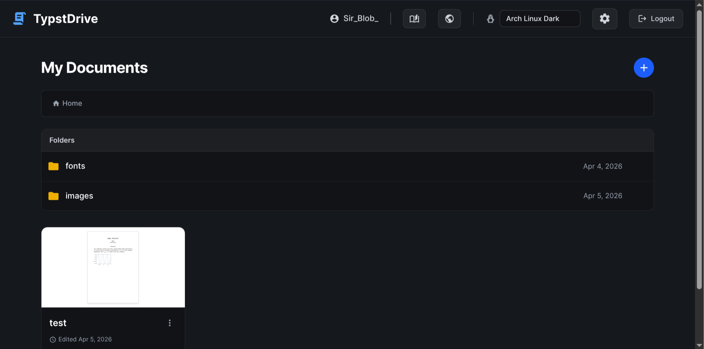

# TypstDrive

TypstDrive is a collaborative web editor for Typst. With built-in dark mode, multiple themes, and a clean Google Docs-like interface, it makes creating and sharing documents effortless.

Full documentation, including self-hosting, configuration, administration and the API reference, is at **[sirblobby.github.io/TypstDrive](https://sirblobby.github.io/TypstDrive/)**.

## Features

- **Real-Time Collaboration**: See changes and cursors from other people instantly while you write together.
- **Instant Preview**: Your document updates as you type, with zoom controls and a preview pane you can collapse.
- **Editor Tools**: Find and replace, line comments, heading sizes, quotes, and quick insert for images, tables, documents, symbols and emoji.
- **Editor Settings**: Choose the editor font and size, and turn on spell checking, line numbers and a minimap.
- **Version History**: Versions are saved automatically when people leave the editor. See who edited and when, compare changes and restore older versions.
- **Comments and Suggestions**: Comment on text, reply and resolve threads, or suggest edits for others to accept or reject.
- **Projects**: Multi-file workspaces for larger documents and full templates, with your own fonts and images.
- **Organize Your Drive**: Folders, search, grid and list views, and starred documents and projects for quick access.
- **Sharing**: Share documents, projects and folders with people as editors or viewers, share documents with suggesters, or transfer ownership to someone else.
- **Share Links**: Let anyone with the link view, suggest or edit, optionally with a password or an expiry date.
- **Team Spaces**: Shared drives owned by a team, where members create and edit documents and projects together.
- **Export Options**: Export to PDF, PNG, SVG, HTML, Markdown, Word or LaTeX.
- **Presentation Mode**: Turn a document into a slideshow and draw on the slides as you present.
- **Packages**: Publish a project as a Typst package that everyone on your server can import.
- **Sign-In Options**: Passwords, one-time codes by email, single sign-on, GitHub and Google, with email verification and password reset.
- **Customizable Themes**: Choose from several themes (Catppuccin, Arch Linux, Cerberus) and switch dark mode on or off.
- **Branding**: Admins can set the site name, logo, accent color, tagline and a message on the sign-in page.
- **Admin Tools**: Manage users, storage quotas, version history limits, sign-in rules, team spaces and packages, with an audit log of every change.

## Documentation

- [Self-hosting](https://sirblobby.github.io/TypstDrive/getting-started/self-hosting/) and [configuration](https://sirblobby.github.io/TypstDrive/getting-started/configuration/)
- [Sign-in and single sign-on](https://sirblobby.github.io/TypstDrive/getting-started/authentication/) and [email](https://sirblobby.github.io/TypstDrive/getting-started/email/)
- [User guide](https://sirblobby.github.io/TypstDrive/guide/drive/)
- [Site settings for administrators](https://sirblobby.github.io/TypstDrive/admin/site-settings/)
- [API reference](https://sirblobby.github.io/TypstDrive/api/)
- [Desktop sync with Typst Desktop](https://sirblobby.github.io/TypstDrive/api/desktop/)
- [Development](https://sirblobby.github.io/TypstDrive/development/)

## License

TypstDrive is released under the [Apache License 2.0](LICENSE).

You are free to use, change and share TypstDrive, including for commercial use, as long as you:

- Include a copy of the license with any copies you share.
- Keep the existing copyright and license notices.
- Mark any files you changed.

The license comes with no warranty. See the [LICENSE](LICENSE) file for the full terms.

When the site name, logo or colors are changed in Site Settings, a small "Powered by TypstDrive" link is shown to credit the project.

TypstDrive uses the [Typst](https://github.com/typst/typst) compiler, which is also released under the Apache License 2.0.

TypstDrive is a community application and is not affiliated with, endorsed by, or supported by the official Typst project. Links to Typst documentation and Typst Universe open the official Typst website.

## Screenshots

  

  
  

## Donate
If you like this project, consider donating to me. It will help me to maintain this project and make more projects like this.
 
As a broke college student, every donation goes straight to the important things: server costs, textbooks, and upgrading my diet from instant ramen to slightly more expensive instant ramen.
 

