# TypstDrive

[](https://github.com/SirBlobby/TypstDrive/releases)
[](https://typst.app/)
[](https://www.rust-lang.org/)
[](https://svelte.dev/docs/kit)
[](https://tailwindcss.com/)
[](https://bun.sh/)
[](https://sirblobby.github.io/TypstDrive/self-hosting/install/)
[](https://sirblobby.github.io/TypstDrive/)
[](LICENSE)

TypstDrive is a self-hosted place to write, organize and share [Typst](https://typst.app/) documents in your browser. Write on one side, see the finished pages on the other, and work on the same document with other people at the same time.

> [!NOTE]
> TypstDrive is a community project. It is not affiliated with, endorsed by, or supported by the official Typst project. It uses the open-source Typst compiler, and links to Typst documentation and Typst Universe open the official Typst website. Please report problems on the [TypstDrive issue tracker](https://github.com/SirBlobby/TypstDrive/issues).

Full documentation, including a user guide, self-hosting, administration and the API reference, is at **[sirblobby.github.io/TypstDrive](https://sirblobby.github.io/TypstDrive/)**.

## Features

### Writing

- **Live Preview**: Pages update as you type, with zoom, a resizable split, and a view menu to show the editor and preview, the editor only, or the preview only. Click the preview to jump to its source, or click the text to scroll the preview there.
- **Editor**: Syntax highlighting for Typst, LaTeX, BibTeX, YAML and TOML, autocompletion, inline errors, auto-closing brackets, a Format document shortcut for Typst and smart features from the tinymist language server.
- **Formatting Toolbar**: Headings, bold, italic, code, quotes, math, lists, a font picker and page settings.
- **LaTeX Documents**: Write LaTeX documents and projects with a LaTeX editor and toolbar, compiled on the server by [Tectonic](https://tectonic-typesetting.github.io/), which downloads the packages a document uses. Compiles run in a locked-down sandbox, packages a command needs are added to the preamble for you, and administrators can turn LaTeX off.
- **Quick Insert**: Images, tables, other documents, symbols and emoji, with an image picker that searches your drive and uploads by button, drop or paste.
- **Slash Commands**: Type `/` for a searchable list of formatting, insert, export, view and review actions, or select text and press `/` to apply one to it.
- **Learn Typst and LaTeX**: Step-by-step guides for both languages in the documentation, with the rendered result under every example.
- **Find and Replace**, line comments and a spell checker that skips code and math.
- **Customizable Keybinds**: Change the editor shortcuts and spot conflicts at a glance.
- **Editor Settings**: Font, font size, line numbers and a minimap.

### Working Together

- **Real-Time Collaboration**: See other people's changes and cursors instantly, follow someone's cursor by clicking their picture, see who is in which file of a project, and whether each person is editing, suggesting or viewing.
- **Comments**: Comment on text in documents and project files, reply, and resolve or reopen threads.
- **Suggestions**: Type in suggesting mode to propose edits inline, shown live to others and in the preview, for owners and editors to accept or reject.
- **Version History**: Automatic and manual versions, a timeline of who edited, side-by-side changes and one-click restore.

### Organizing and Sharing

- **Drive**: Folders with custom colors, sorting, grid and list views, stars, file previews, duplicating documents and projects, selecting several items to move, star or delete them together, and a trash that keeps deleted items for 30 days.
- **Search**: A search bar with `type:`, `is:`, `before:` and `after:` filters, and `doc:` to search the text inside documents.
- **Projects**: Multi-file workspaces for books, theses and templates, with image and PDF previews in the file list, downloadable as a ZIP.
- **Git Sync**: Link a project to a folder in a GitHub, GitLab, Gitea, Forgejo or Codeberg repository, pull changes and push your own as commits, with GitHub and GitLab tokens saved once in your settings and stored encrypted. Only the document files are copied, so large repositories are fine.
- **Templates**: Start a document or project from any Typst Universe template, with search, type filters and previews, and fill in author names and affiliations from ORCID. Only the templates people use are downloaded.
- **Packages**: Publish a project as a package everyone on your server can import, with private packages for people and teams.
- **Fonts and Images**: Upload once and use everywhere, with an emoji font built in.
- **Citations**: Paste a DOI, arXiv, PubMed, PMC or Semantic Scholar ID to get a BibTeX or Hayagriva entry, and sync Zotero libraries and collections into bibliography files.
- **Sharing**: Share documents, projects and folders as editor, suggester or viewer, and hand over ownership.
- **Share Links**: Let anyone with the link view, suggest or edit, with an optional password and expiry date.
- **Public PDF Links**: A named URL such as `/pdf/my-cv` that always serves the latest compiled PDF, for CVs and living documents.
- **Team Spaces**: Shared drives owned by a team, with owner, admin, member and viewer roles.
- **Import**: Turn Word, LaTeX, Markdown and HTML files into Typst documents.

### Finishing

- **Export**: PDF, HTML, PNG, SVG and Typst or LaTeX source from the editor or straight from the drive's action menu, plus Word, Markdown, LaTeX and HTML through Pandoc.
- **Presentation Mode**: Full-screen slides with a slide overview, timer, progress bar, laser pointer, pen, highlighter and eraser, plus a speaker view with the next slide and speaker notes from Touying, Polylux or Mosaic.
- **Render API**: Turn Typst and LaTeX into PDF, PNG, SVG or HTML from your own code, render single formulas and snippets as tightly cropped images, pick a page and size, and check documents for errors, with scoped keys, rate limits and usage charts.
- **Typst Desktop**: Keep documents on your computer and in sync with the [Typst Desktop](https://github.com/SirBlobby/typst-desktop) app.

### Accounts and Administration

- **Sign-In Options**: Passwords, one-time email codes, Google, GitHub and any OpenID Connect provider such as Keycloak, Authentik or Authelia.
- **Email**: Branded emails for sign-in codes, password resets, team invitations, sharing and ownership offers.
- **Account Security**: Email verification, password reset, active sessions, connected accounts and sign-in lockout.
- **Themes**: Cerberus, Catppuccin and Arch Linux themes in light and dark mode, site themes added by admins, and personal themes made with color pickers or uploaded as YAML, plus text size and high contrast options.
- **Branding**: Your own site name, logo, accent color, tagline and sign-in message.
- **Admin Tools**: Users, registration rules, sign-in methods, email testing, team limits, storage quotas, version history limits, package rules, PDF link rules, citation services, LaTeX support, Git sync, site themes, trash retention, API limits and an audit log.
- **Performance Page**: Uptime, CPU, memory, disk and live-editing activity, with charts of page load, server response, Typst compile and LaTeX compile times.
- **Flexible Hosting**: SQLite, PostgreSQL or MySQL/MariaDB with automatic upgrades, plus Redis or Valkey and S3-compatible storage for larger installs.


### Future Features
- [] Add language support for more languages.

## Self-Hosting

TypstDrive runs as a single Docker container.

1. Generate a secret that keeps people signed in across restarts:

    ```bash
    openssl rand -hex 64
    ```

2. Save this as `docker-compose.yml` and paste the secret into `COOKIE_SECRET`:

    ```yaml
    services:
      typstdrive:
        image: ghcr.io/sirblobby/typstdrive:latest
        container_name: typstdrive
        restart: unless-stopped
        ports:
          - "3000:3000"
        environment:
          - COOKIE_SECRET=paste-your-secret-here
          - PUBLIC_URL=http://localhost:3000
          - RUST_LOG=info
        volumes:
          - ./data:/data
    ```

3. Start it:

    ```bash
    docker compose up -d
    ```

4. Open `http://localhost:3000` and create the administrator account on the setup page.

Keep passwords and keys, such as email or sign-in provider secrets, in a `.env` file next to the compose file: copy [`example.env`](example.env) to `.env`, fill in what you need, and add `env_file: .env` to the service. `.env` is ignored by git.

Everything is stored in `./data`, so that is the folder to back up. To update, run `docker compose pull` and `docker compose up -d`; the database is upgraded automatically.

Before opening TypstDrive to the internet, put it behind a reverse proxy with HTTPS and set `PUBLIC_URL` to your domain. The documentation covers each step:

- [Install with Docker](https://sirblobby.github.io/TypstDrive/self-hosting/install/)
- [HTTPS and reverse proxies](https://sirblobby.github.io/TypstDrive/self-hosting/reverse-proxy/)
- [Updates and backups](https://sirblobby.github.io/TypstDrive/self-hosting/updates-and-backups/)
- [Databases](https://sirblobby.github.io/TypstDrive/self-hosting/databases/)
- [Sign-in and single sign-on](https://sirblobby.github.io/TypstDrive/self-hosting/sign-in/) and [email](https://sirblobby.github.io/TypstDrive/self-hosting/email/)
- [Settings reference](https://sirblobby.github.io/TypstDrive/self-hosting/configuration/)

## Documentation

- [Your first document](https://sirblobby.github.io/TypstDrive/start/first-document/)
- [Learn Typst and LaTeX](https://sirblobby.github.io/TypstDrive/learn/)
- [User guide](https://sirblobby.github.io/TypstDrive/guide/)
- [Self-hosting](https://sirblobby.github.io/TypstDrive/self-hosting/)
- [Administration](https://sirblobby.github.io/TypstDrive/admin/)
- [API reference](https://sirblobby.github.io/TypstDrive/api/)
- [Contributing](https://sirblobby.github.io/TypstDrive/development/)

## Contributors

Thanks to everyone who has contributed code to TypstDrive:

| [<br>SirBlobby](https://github.com/SirBlobby) | [<br>Nikhil Verma](https://github.com/nikhilweee) | [<br>douxev](https://github.com/douxev) |
|:-:|:-:|:-:|

See the [Contributing guide](https://sirblobby.github.io/TypstDrive/development/) to get involved.

## Acknowledgements

TypstDrive is built on the work of many open-source projects and services:

- [Typst](https://typst.app/) and its open-source [compiler](https://github.com/typst/typst), which turns documents into PDF, PNG, SVG and HTML (Apache License 2.0). Thanks to the Typst team and contributors for making it possible to build tools like this.
- The authors of the packages and templates on [Typst Universe](https://typst.app/universe), which TypstDrive downloads and offers as templates.
- [tinymist](https://github.com/Myriad-Dreamin/tinymist) for language server features such as completions and hover help.
- [Tectonic](https://tectonic-typesetting.github.io/) for compiling LaTeX documents.
- [Hayagriva](https://github.com/typst/hayagriva), Typst's bibliography format, used for `.yml` reference files.
- [Pandoc](https://pandoc.org/) for converting to and from Word, Markdown, LaTeX and HTML.
- [SvelteKit](https://svelte.dev/docs/kit), [Svelte](https://svelte.dev/), [Vite](https://vite.dev/) and [Tailwind CSS](https://tailwindcss.com/) for the web app.
- [CodeMirror](https://codemirror.net/) for the editor, with [codemirror-lang-typst](https://www.npmjs.com/package/codemirror-lang-typst) and [codemirror-lang-latex](https://www.npmjs.com/package/codemirror-lang-latex) for highlighting.
- [Yjs](https://yjs.dev/), [y-websocket](https://github.com/yjs/y-websocket) and [y-codemirror.next](https://github.com/yjs/y-codemirror.next) in the browser, and [yrs](https://github.com/y-crdt/y-crdt) on the server, for live collaboration.
- [PDF.js](https://mozilla.github.io/pdf.js/) for PDF previews, [Chart.js](https://www.chartjs.org/) for charts and [Iconify](https://iconify.design/) for icons.
- [Rust](https://www.rust-lang.org/), [Tokio](https://tokio.rs/), [Axum](https://github.com/tokio-rs/axum) and [SQLx](https://github.com/launchbadge/sqlx) for the server, with [lettre](https://github.com/lettre/lettre) for email, [redis-rs](https://github.com/redis-rs/redis-rs) for running several copies and [object_store](https://github.com/apache/arrow-rs-object-store) for S3 storage.
- [Catppuccin](https://catppuccin.com/) and the other color palettes that inspired the built-in themes.
- The services behind the citation tools: [doi.org](https://www.doi.org/), [Crossref](https://www.crossref.org/), [DataCite](https://datacite.org/), [arXiv](https://arxiv.org/), the [National Library of Medicine](https://www.ncbi.nlm.nih.gov/) for PubMed and PMC, [Semantic Scholar](https://www.semanticscholar.org/), [ORCID](https://orcid.org/) and [Zotero](https://www.zotero.org/).
- [Git](https://git-scm.com/), and the GitHub and GitLab APIs used by Git sync.

Each project keeps its own license. TypstDrive is not affiliated with any of them.

## License

TypstDrive is released under the [Apache License 2.0](LICENSE).

TypstDrive uses the [Typst](https://github.com/typst/typst) compiler, which is also released under the Apache License 2.0.

## Disclaimer

TypstDrive is a community application and is not affiliated with, endorsed by, or supported by the official Typst project. "Typst" is used only to describe the document language TypstDrive works with. Links to Typst documentation and Typst Universe open the official Typst website.

## Previews

<table>
  <tr>
    <td width="50%">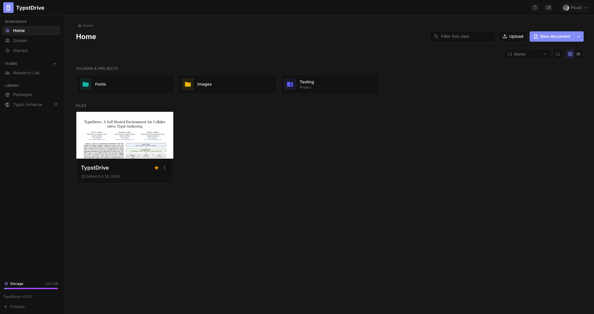</td>
    <td width="50%">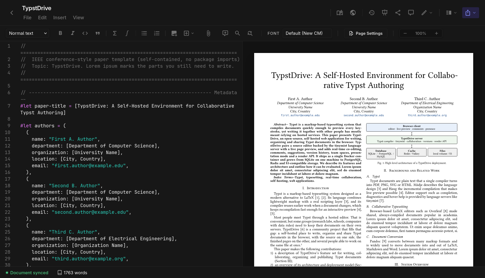</td>
  </tr>
  <tr>
    <td width="50%">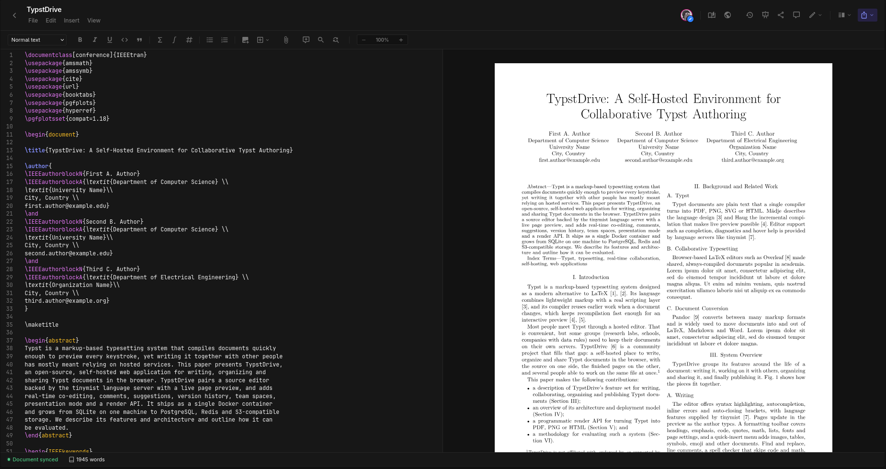</td>
    <td width="50%">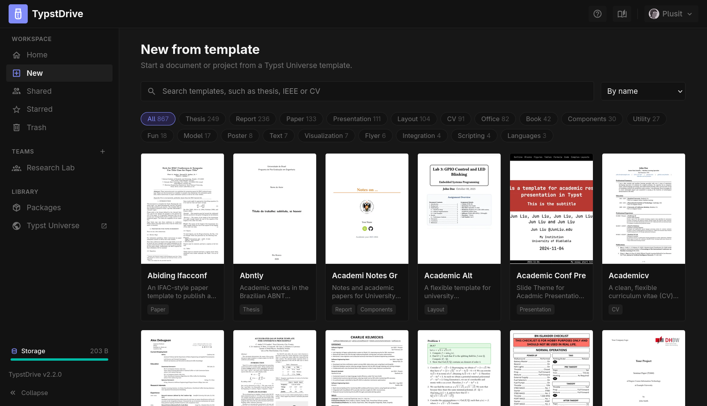</td>
  </tr>
  <tr>
    <td width="50%">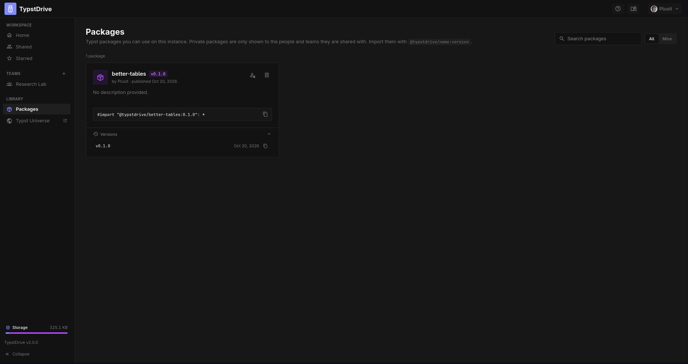</td>
    <td width="50%">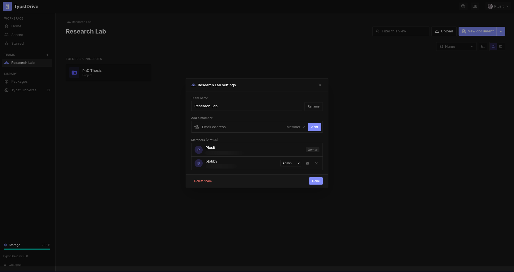</td>
  </tr>
  <tr>
    <td width="50%">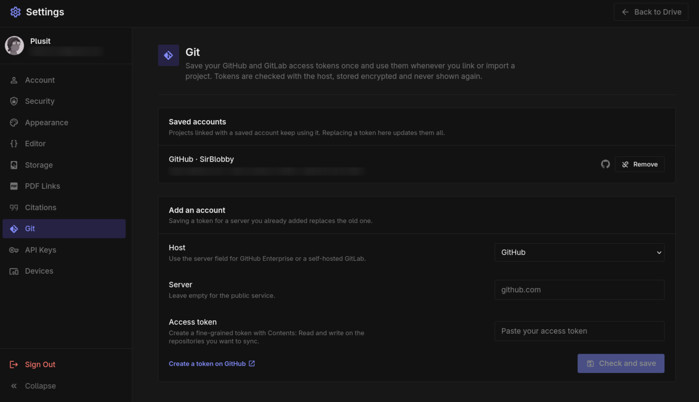</td>
    <td width="50%">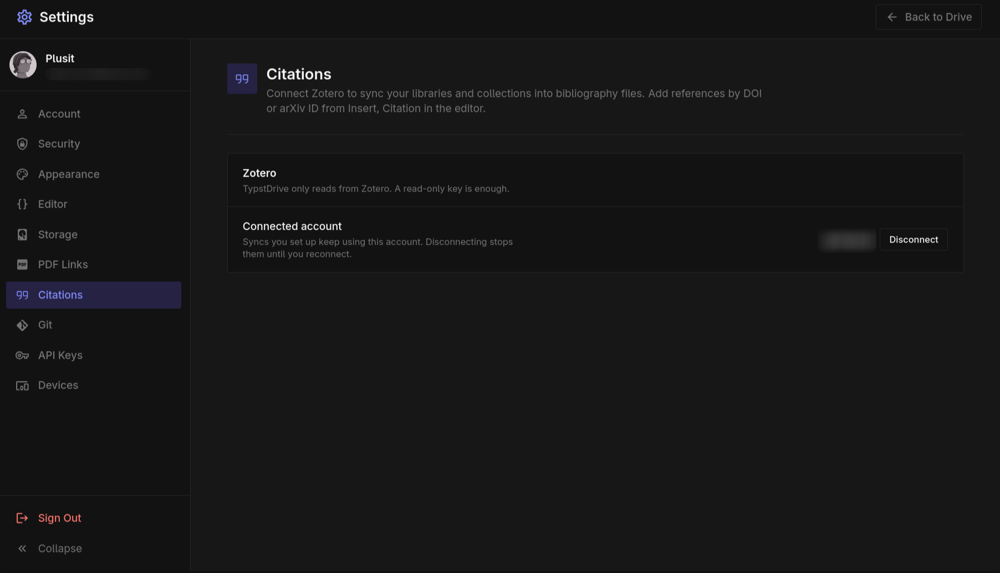</td>
  </tr>
  <tr>
    <td width="50%">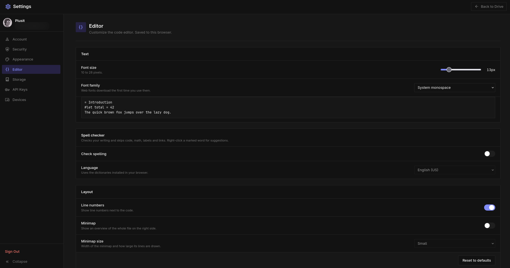</td>
    <td width="50%">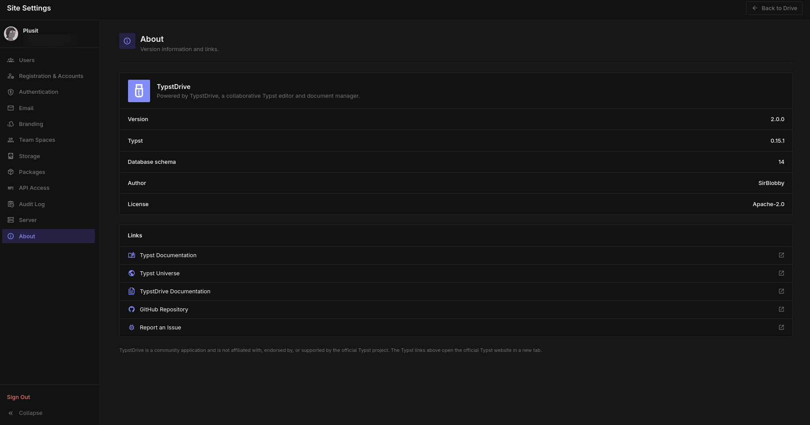</td>
  </tr>
  <tr>
    <td width="50%">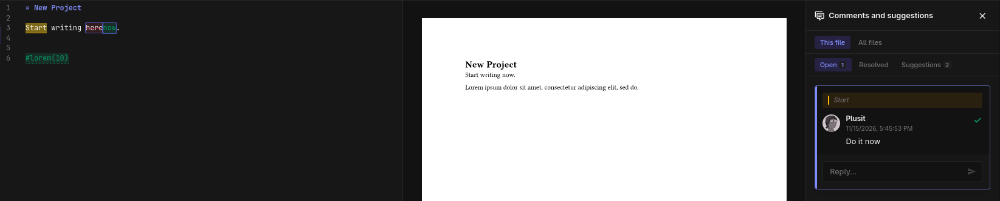</td>
    <td width="50%">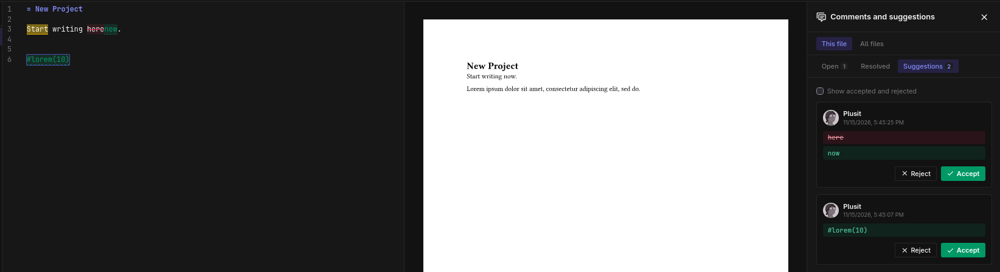</td>
  </tr>
  <tr>
    <td width="50%">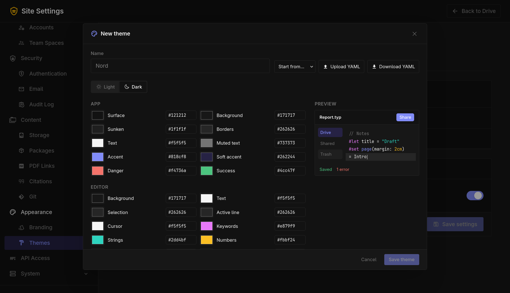</td>
    <td width="50%">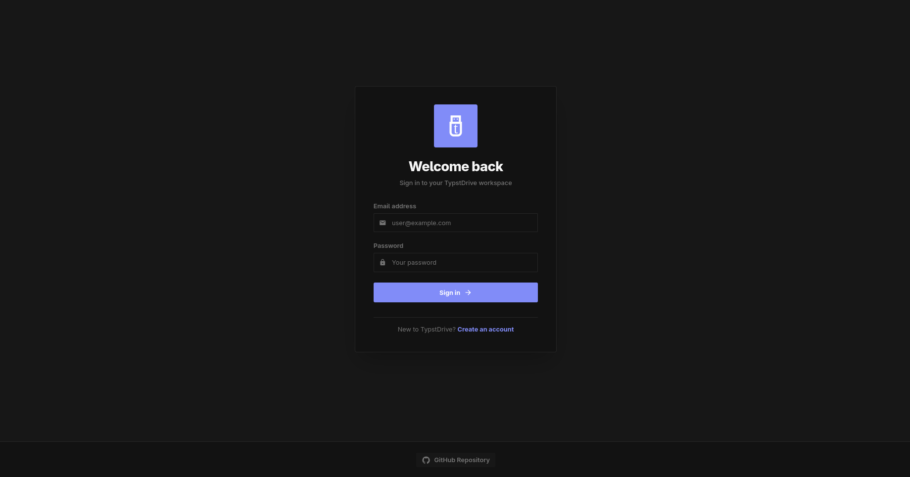</td>
  </tr>
</table>

## Donate
If you like this project, consider donating to me. It will help me to maintain this project and make more projects like this.
<br>
As a broke college student, every donation goes straight to the important things: textbooks, energy drinks, and upgrading my diet from instant ramen to slightly more expensive instant ramen.
<br>
[](https://ko-fi.com/sirblob)
