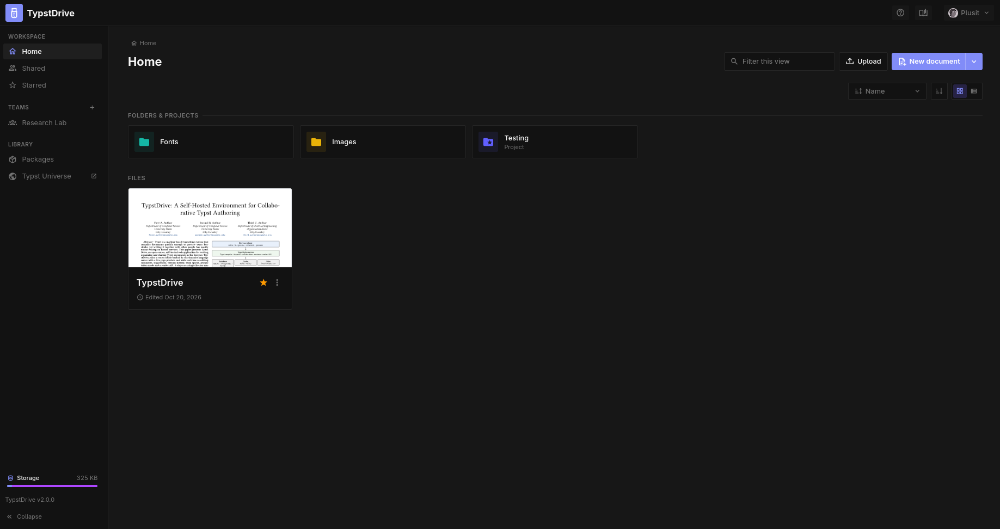
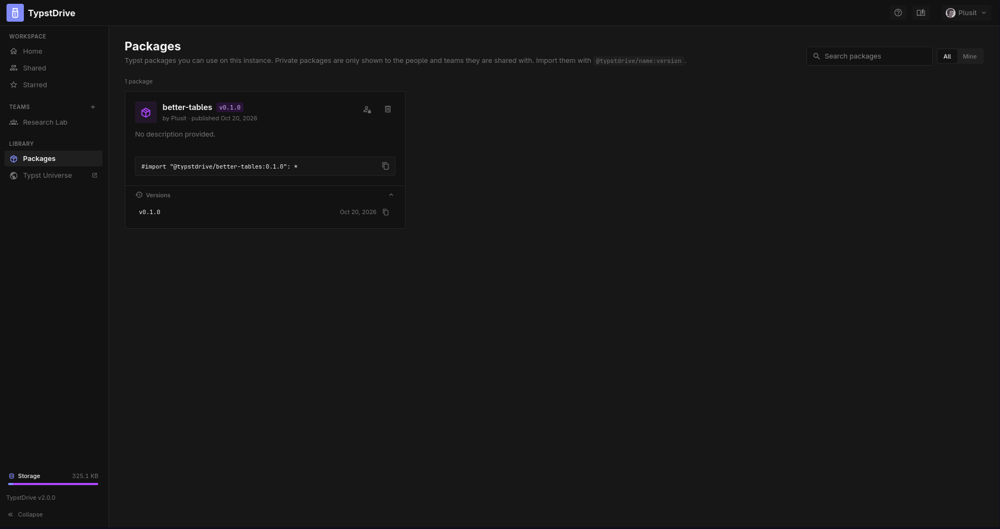
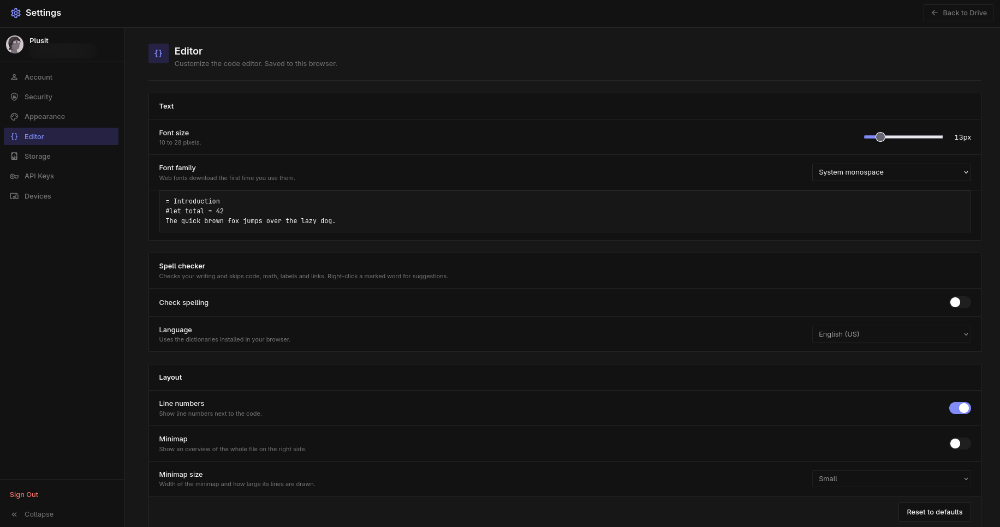
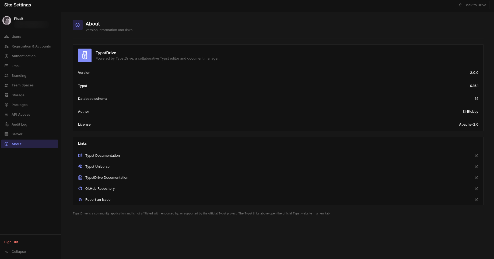
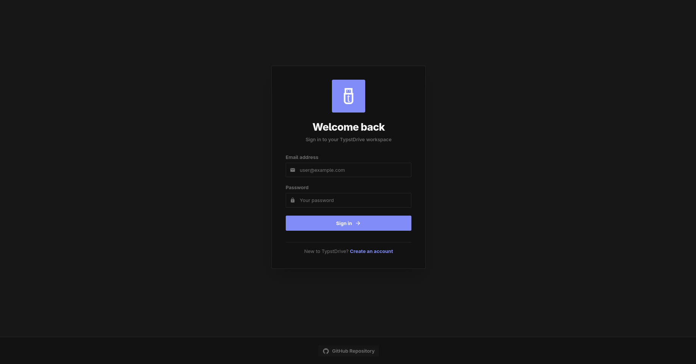

# TypstDrive

[](https://github.com/SirBlobby/TypstDrive/releases)
[](https://typst.app/)
[](https://www.rust-lang.org/)
[](https://svelte.dev/docs/kit)
[](https://tailwindcss.com/)
[](https://bun.sh/)
[](https://sirblobby.github.io/TypstDrive/self-hosting/install/)
[](https://sirblobby.github.io/TypstDrive/)
[](LICENSE)

TypstDrive is a self-hosted place to write, organize and share [Typst](https://typst.app/) documents in your browser. Write on one side, see the finished pages on the other, and work on the same document with other people at the same time.

> [!NOTE]
> TypstDrive is a community project. It is not affiliated with, endorsed by, or supported by the official Typst project. It uses the open-source Typst compiler, and links to Typst documentation and Typst Universe open the official Typst website. Please report problems on the [TypstDrive issue tracker](https://github.com/SirBlobby/TypstDrive/issues).

Full documentation, including a user guide, self-hosting, administration and the API reference, is at **[sirblobby.github.io/TypstDrive](https://sirblobby.github.io/TypstDrive/)**.

**Try it out @** [https://typ.sirblob.co/](https://typ.sirblob.co/)

Username: test@sirblob.co
Password: password

## Features

### Writing

- **Live Preview**: Pages update as you type, with zoom and a view menu to show the editor and preview, the editor only, or the preview only.
- **Editor**: Syntax highlighting for Typst, LaTeX, BibTeX, YAML and TOML, autocompletion, inline errors, auto-closing brackets and smart features from the tinymist language server.
- **Formatting Toolbar**: Headings, bold, italic, code, quotes, math, lists, a font picker and page settings.
- **LaTeX Documents**: Write basic LaTeX documents and projects with a LaTeX editor and toolbar, rendered through [MiTeX](https://github.com/mitex-rs/mitex).
- **Quick Insert**: Images, tables, other documents, symbols and emoji.
- **Find and Replace**, line comments and a spell checker that skips code and math.
- **Customizable Keybinds**: Change the editor shortcuts and spot conflicts at a glance.
- **Editor Settings**: Font, font size, line numbers and a minimap.

### Working Together

- **Real-Time Collaboration**: See other people's changes and cursors instantly, follow someone's cursor by clicking their picture, and see who is in which file of a project.
- **Comments**: Comment on text, reply, and resolve or reopen threads.
- **Suggestions**: Propose edits for others to accept or reject.
- **Version History**: Automatic and manual versions, a timeline of who edited, side-by-side changes and one-click restore.

### Organizing and Sharing

- **Drive**: Folders with custom colors, sorting, grid and list views, stars, file previews, duplicating documents and projects, selecting several items to move, star or delete them together, and a trash that keeps deleted items for 30 days.
- **Search**: A search bar with `type:`, `is:`, `before:` and `after:` filters, and `doc:` to search the text inside documents.
- **Projects**: Multi-file workspaces for books, theses and templates, downloadable as a ZIP.
- **Templates**: Start a document or project from any Typst Universe template, with search, type filters and previews, and fill in author names and affiliations from ORCID. Only the templates people use are downloaded.
- **Packages**: Publish a project as a package everyone on your server can import, with private packages for people and teams.
- **Fonts and Images**: Upload once and use everywhere, with an emoji font built in.
- **Citations**: Paste a DOI, arXiv, PubMed, PMC or Semantic Scholar ID to get a BibTeX or Hayagriva entry, and sync Zotero libraries and collections into bibliography files.
- **Sharing**: Share documents, projects and folders as editor, suggester or viewer, and hand over ownership.
- **Share Links**: Let anyone with the link view, suggest or edit, with an optional password and expiry date.
- **Public PDF Links**: A named URL such as `/pdf/my-cv` that always serves the latest compiled PDF, for CVs and living documents.
- **Team Spaces**: Shared drives owned by a team, with owner, admin, member and viewer roles.
- **Import**: Turn Word, LaTeX, Markdown and HTML files into Typst documents.

### Finishing

- **Export**: PDF, HTML, PNG, SVG and Typst or LaTeX source from the editor or straight from the drive's action menu, plus Word, Markdown, LaTeX and HTML through Pandoc.
- **Presentation Mode**: Full-screen slides with a slide overview, timer, progress bar, laser pointer, pen, highlighter and eraser.
- **Render API**: Turn Typst into PNG, PDF or HTML from your own code, with scoped keys, rate limits and usage charts.
- **Typst Desktop**: Keep documents on your computer and in sync with the [Typst Desktop](https://github.com/SirBlobby/typst-desktop) app.

### Accounts and Administration

- **Sign-In Options**: Passwords, one-time email codes, Google, GitHub and any OpenID Connect provider such as Keycloak, Authentik or Authelia.
- **Email**: Branded emails for sign-in codes, password resets, team invitations, sharing and ownership offers.
- **Account Security**: Email verification, password reset, active sessions, connected accounts and sign-in lockout.
- **Themes**: Cerberus, Catppuccin and Arch Linux themes in light and dark mode, site themes added by admins, and personal themes made with color pickers or uploaded as YAML, plus text size and high contrast options.
- **Branding**: Your own site name, logo, accent color, tagline and sign-in message.
- **Admin Tools**: Users, registration rules, sign-in methods, email testing, team limits, storage quotas, version history limits, package rules, PDF link rules, citation services, site themes, trash retention, API limits and an audit log.
- **Flexible Hosting**: SQLite, PostgreSQL or MySQL/MariaDB with automatic upgrades, plus Redis or Valkey and S3-compatible storage for larger installs.


### Future Features
- [] Add language support for more languages.

## Self-Hosting

TypstDrive runs as a single Docker container.

1. Generate a secret that keeps people signed in across restarts:

    ```bash
    openssl rand -hex 64
    ```

2. Save this as `docker-compose.yml` and paste the secret into `COOKIE_SECRET`:

    ```yaml
    services:
      typstdrive:
        image: ghcr.io/sirblobby/typstdrive:latest
        container_name: typstdrive
        restart: unless-stopped
        ports:
          - "3000:3000"
        environment:
          - COOKIE_SECRET=paste-your-secret-here
          - PUBLIC_URL=http://localhost:3000
          - RUST_LOG=info
        volumes:
          - ./data:/data
    ```

3. Start it:

    ```bash
    docker compose up -d
    ```

4. Open `http://localhost:3000` and create the administrator account on the setup page.

Keep passwords and keys, such as email or sign-in provider secrets, in a `.env` file next to the compose file: copy [`example.env`](example.env) to `.env`, fill in what you need, and add `env_file: .env` to the service. `.env` is ignored by git.

Everything is stored in `./data`, so that is the folder to back up. To update, run `docker compose pull` and `docker compose up -d`; the database is upgraded automatically.

Before opening TypstDrive to the internet, put it behind a reverse proxy with HTTPS and set `PUBLIC_URL` to your domain. The documentation covers each step:

- [Install with Docker](https://sirblobby.github.io/TypstDrive/self-hosting/install/)
- [HTTPS and reverse proxies](https://sirblobby.github.io/TypstDrive/self-hosting/reverse-proxy/)
- [Updates and backups](https://sirblobby.github.io/TypstDrive/self-hosting/updates-and-backups/)
- [Databases](https://sirblobby.github.io/TypstDrive/self-hosting/databases/)
- [Sign-in and single sign-on](https://sirblobby.github.io/TypstDrive/self-hosting/sign-in/) and [email](https://sirblobby.github.io/TypstDrive/self-hosting/email/)
- [Settings reference](https://sirblobby.github.io/TypstDrive/self-hosting/configuration/)

## Documentation

- [Your first document](https://sirblobby.github.io/TypstDrive/start/first-document/)
- [User guide](https://sirblobby.github.io/TypstDrive/guide/)
- [Self-hosting](https://sirblobby.github.io/TypstDrive/self-hosting/)
- [Administration](https://sirblobby.github.io/TypstDrive/admin/)
- [API reference](https://sirblobby.github.io/TypstDrive/api/)
- [Contributing](https://sirblobby.github.io/TypstDrive/development/)

## Acknowledgements

TypstDrive is built on the work of many open-source projects and services:

- [Typst](https://typst.app/) and its open-source [compiler](https://github.com/typst/typst), which turns documents into PDF, PNG, SVG and HTML (Apache License 2.0). Thanks to the Typst team and contributors for making it possible to build tools like this.
- The authors of the packages and templates on [Typst Universe](https://typst.app/universe), which TypstDrive downloads and offers as templates.
- [tinymist](https://github.com/Myriad-Dreamin/tinymist) for language server features such as completions and hover help.
- [MiTeX](https://github.com/mitex-rs/mitex) for rendering LaTeX documents with Typst.
- [Hayagriva](https://github.com/typst/hayagriva), Typst's bibliography format, used for `.yml` reference files.
- [Pandoc](https://pandoc.org/) for converting to and from Word, Markdown, LaTeX and HTML.
- [SvelteKit](https://svelte.dev/docs/kit), [Svelte](https://svelte.dev/), [Vite](https://vite.dev/) and [Tailwind CSS](https://tailwindcss.com/) for the web app.
- [CodeMirror](https://codemirror.net/) for the editor, with [codemirror-lang-typst](https://www.npmjs.com/package/codemirror-lang-typst) and [codemirror-lang-latex](https://www.npmjs.com/package/codemirror-lang-latex) for highlighting.
- [Yjs](https://yjs.dev/), [y-websocket](https://github.com/yjs/y-websocket) and [y-codemirror.next](https://github.com/yjs/y-codemirror.next) in the browser, and [yrs](https://github.com/y-crdt/y-crdt) on the server, for live collaboration.
- [PDF.js](https://mozilla.github.io/pdf.js/) for PDF previews, [Chart.js](https://www.chartjs.org/) for charts and [Iconify](https://iconify.design/) for icons.
- [Rust](https://www.rust-lang.org/), [Tokio](https://tokio.rs/), [Axum](https://github.com/tokio-rs/axum) and [SQLx](https://github.com/launchbadge/sqlx) for the server, with [lettre](https://github.com/lettre/lettre) for email, [redis-rs](https://github.com/redis-rs/redis-rs) for running several copies and [object_store](https://github.com/apache/arrow-rs-object-store) for S3 storage.
- [Catppuccin](https://catppuccin.com/) and the other color palettes that inspired the built-in themes.
- The services behind the citation tools: [doi.org](https://www.doi.org/), [Crossref](https://www.crossref.org/), [DataCite](https://datacite.org/), [arXiv](https://arxiv.org/), the [National Library of Medicine](https://www.ncbi.nlm.nih.gov/) for PubMed and PMC, [Semantic Scholar](https://www.semanticscholar.org/), [ORCID](https://orcid.org/) and [Zotero](https://www.zotero.org/).

Each project keeps its own license. TypstDrive is not affiliated with any of them.

## License

TypstDrive is released under the [Apache License 2.0](LICENSE).

TypstDrive uses the [Typst](https://github.com/typst/typst) compiler, which is also released under the Apache License 2.0.

## Disclaimer

TypstDrive is a community application and is not affiliated with, endorsed by, or supported by the official Typst project. "Typst" is used only to describe the document language TypstDrive works with. Links to Typst documentation and Typst Universe open the official Typst website.

## Previews

<p align="center">
  
</p>
<p align="center">
  
</p>
<p align="center">
  
</p>
<p align="center">
  
</p>
<p align="center">
  
</p>
<p align="center">
  
</p>
<p align="center">
  
</p>

## Donate
If you like this project, consider donating to me. It will help me to maintain this project and make more projects like this.
<br>
As a broke college student, every donation goes straight to the important things: textbooks, energy drinks, and upgrading my diet from instant ramen to slightly more expensive instant ramen.
<br>
[](https://ko-fi.com/sirblob)
