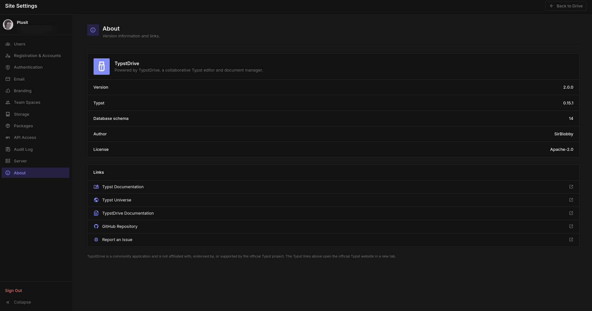

# Administration

Administrators look after a TypstDrive server from the browser. Open **Site Settings** from the account menu in the top right. The first account, created on the setup page, is an administrator, and administrators can make others administrators too.

The pages below follow the groups in the site settings sidebar.

### People

| Page | What you can do |
|---|---|
| [Users and accounts](users.md) | Create, remove and help users, and decide who can sign up. |
| [Team spaces](teams.md) | Decide who can create teams and how big they can be. |

### Security

| Page | What you can do |
|---|---|
| [Sign-in and security](security.md) | Choose sign-in methods, lockout rules and session length, check email, and read the audit log. |

### Content

| Page | What you can do |
|---|---|
| [Storage and history](storage.md) | Set storage limits, how many versions each document keeps, and how long the trash keeps deleted items. |
| [Packages](packages.md) | Control who can publish packages and how big they can be. |
| [PDF links](pdf-links.md) | Turn public PDF links on or off, limit them, and remove any link. |
| [Citations](citations.md) | Turn reference lookups, ORCID lookups and Zotero sync on or off. |
| [LaTeX](latex.md) | Turn LaTeX documents, projects and API renders on or off. |
| [Git](git.md) | Turn Git sync on or off, and decide whether repositories outside GitHub and GitLab are allowed. |

### Appearance

| Page | What you can do |
|---|---|
| [Look and feel](branding.md) | Set your own name, logo, colors and sign-in message. |
| [Themes](themes.md) | Add color themes for everyone and decide whether people can make their own. |

### API

| Page | What you can do |
|---|---|
| [API access](api.md) | Turn the API on or off and set limits. **API Access** sits on its own in the sidebar, between the groups. |

### System

| Page | What you can do |
|---|---|
| [Server, performance and about](server.md) | Check how the server is set up, how fast it runs, and which version it runs. |

Settings that need a restart, such as the database or email server, are set when [self-hosting](../self-hosting/index.md) instead.
