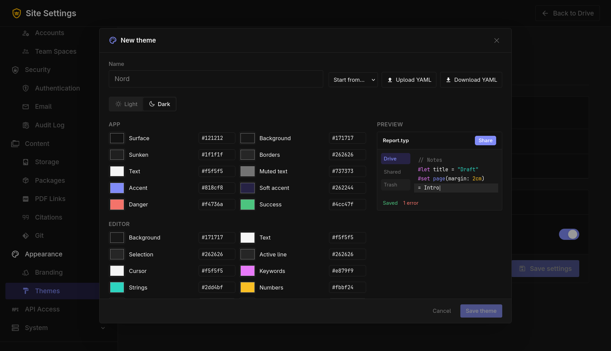

# Themes

**Site Settings → Appearance → Themes** adds color themes for everyone on the server. A theme only changes the app's colors. The site name, logo, tagline and accent color set in [Branding](branding.md) stay the same, and a branding accent color still wins over a theme's accent.



## Site themes

Site themes appear under **Site themes** in everyone's theme picker, next to the built-in Cerberus, Catppuccin and Arch Linux themes.

- **New theme** opens the theme editor, starting from the theme you are using.
- **Upload YAML** reads a theme file and opens it in the editor so you can check it before saving.
- Edit, download as YAML or delete any theme from the list. People using a deleted theme go back to Cerberus.

A server can have up to 50 site themes. Adding, changing and removing them is recorded in the audit log.

## The theme editor

Each theme has a light and a dark version. Switch between them with **Light** and **Dark** and set each color with a color picker or by typing a hex code such as `#1e66f5`. The preview shows the result as you go. **Start from** copies the colors of a built-in theme.

| Group | Colors |
|---|---|
| App | Surface, background, sunken areas, borders, text, muted text, accent, soft accent, danger, success |
| Editor | Background, text, selection, active line, cursor, keywords, strings, numbers, comments, variables, functions |

## YAML format

```yaml
name: Nord
light:
  surface: "#eceff4"
  surface_muted: "#e5e9f0"
  surface_sunken: "#d8dee9"
  line: "#d8dee9"
  ink: "#2e3440"
  ink_muted: "#4c566a"
  accent: "#5e81ac"
  accent_soft: "#dbe4f0"
  danger: "#bf616a"
  success: "#a3be8c"
  editor_background: "#eceff4"
  editor_text: "#2e3440"
  selection: "#d8dee9"
  active_line: "#e5e9f0"
  cursor: "#5e81ac"
  keyword: "#81a1c1"
  string: "#a3be8c"
  number: "#b48ead"
  comment: "#4c566a"
  variable: "#2e3440"
  function: "#88c0d0"
dark:
  surface: "#2e3440"
  # the same keys as light
```

- Colors must be quoted, because `#` starts a comment in YAML. Short codes like `"#fff"` work too.
- Colors you leave out use Cerberus colors, so a file can set only the colors it changes.
- **Download YAML** in the editor or the list gives you a complete file to start from.

## Personal themes

**Let people make their own themes** lets everyone create, upload and use up to 20 themes of their own in **Settings → Appearance**. It is on by default. When turned off, personal themes are hidden and people using one go back to Cerberus. Their themes are kept and come back when it is turned on again.

Themes are kept in the server's memory, so loading them never waits on the database. With several copies of TypstDrive behind Redis, a change made on one copy is passed to the others straight away.
