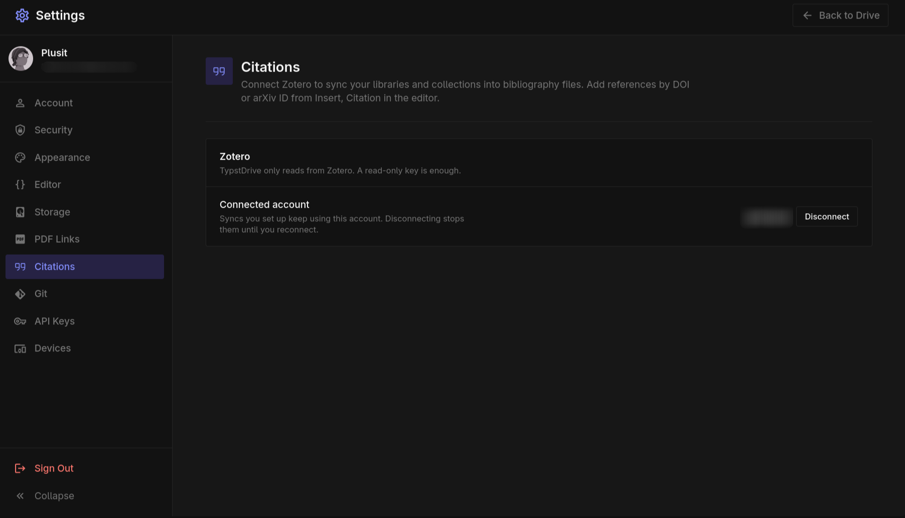

# Citations

Add references to a bibliography file without typing them by hand. Open **Insert → Citation** in a document, or **Edit → Citations** in a project.

## Add a reference by identifier

1. Paste an identifier or a link to one:

    | Kind | Examples |
    |---|---|
    | DOI | `10.1038/nature14539`, `https://doi.org/10.1038/nature14539` |
    | arXiv | `1706.03762`, `arXiv:1706.03762v5`, `https://arxiv.org/abs/1706.03762` |
    | PubMed | `PMID 31452104`, `31452104`, `https://pubmed.ncbi.nlm.nih.gov/31452104/` |
    | PubMed Central | `PMC6611412`, `https://pmc.ncbi.nlm.nih.gov/articles/PMC6611412/` |
    | Semantic Scholar | a `semanticscholar.org/paper/...` link, or `CorpusId:13756489` |

2. Pick the bibliography file, or choose **New file...** and name one.
3. Choose **Look up** to preview the entry, then **Add to** the file.
4. Choose **Insert citation** to put `@key` at the cursor, or `\cite{key}` in a LaTeX file.

Files ending in `.bib` get BibTeX entries. Files ending in `.yml` or `.yaml` get [Hayagriva](https://github.com/typst/hayagriva) entries, Typst's own bibliography format. The citation key is made from the first author, the year and the first word of the title, such as `lecun2015deep`. If that key is already in the file, a letter is added.

The first time you add to a new file, put the bibliography where the list should appear:

```typst
#bibliography("references.bib")
```

In a document, bibliography files are kept with the document's files under the paperclip. In a project, they are project files you can open and edit.

### Where the details come from

- **DOI** and **arXiv** details come from doi.org, which covers Crossref, DataCite and arXiv. If doi.org cannot be reached, Crossref is asked directly.
- **PubMed** and **PMC** details come from the National Library of Medicine.
- **Semantic Scholar** papers that have a DOI or arXiv ID are looked up through doi.org for the fullest details. Other papers use what Semantic Scholar knows: title, authors, venue, volume, pages and date.

## Sync from Zotero

Keep a bibliography file in step with a Zotero library or collection.



1. Connect Zotero once in **Settings → Citations**. Create a key on zotero.org with read access to your library, and to any groups you want to use, and paste it in.
2. Open the **Zotero** tab in the citations dialog.
3. Pick a library and, if you like, one collection.
4. Choose the file to save to, such as `zotero.bib`, and choose **Sync to**.

Choose the refresh button next to a synced file to update it. Syncing replaces the whole file, so keep your own entries in a separate file. If an item has a citation key in Zotero, that key is used; otherwise one is made the same way as above.

Anyone who can edit the document or project can refresh a sync. It keeps using the Zotero account of the person who set it up, and stops working if they disconnect Zotero.

!!! note
    Lookups reach doi.org, api.crossref.org, api.ncbi.nlm.nih.gov and api.semanticscholar.org, and Zotero sync reaches api.zotero.org. An administrator can turn either off. See [Citations](../admin/citations.md).
