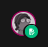
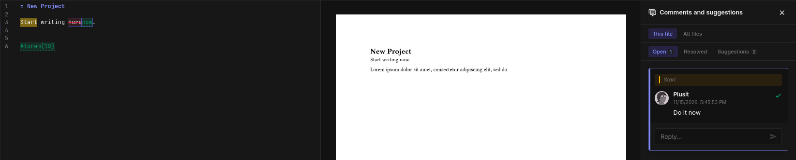
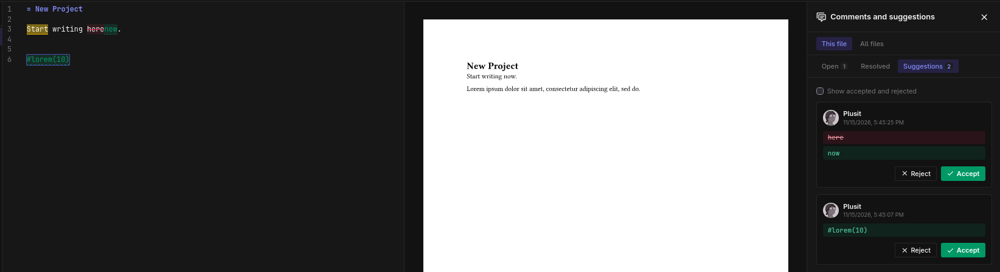

# Working together

## Editing at the same time

Everyone who opens a document can work on it at the same moment. You see other people's changes as they type, their cursors in their own colors, and their profile pictures at the top of the editor. Nothing gets overwritten: all changes are merged automatically.

A small badge on each picture shows whether that person is editing, suggesting or only viewing.

## Following someone

Click a collaborator's picture at the top of the editor to follow them. Your view scrolls along with their cursor, which is handy when someone walks you through a document. In a project, you also switch to whichever file they open.

A **Following** label with their name appears next to the pictures. Following stops when you click their picture or the label again, click or type in the editor, scroll, or when they leave.

## Comments

Select some text, then choose **Add comment** from the right-click menu, type `/` and pick **Comment**, press the comment button in the toolbar, or press ++ctrl+alt+m++.

- Commented text is highlighted. Hover over it to peek at the comment, or click it to open the conversation in the comments panel.
- Reply to keep the conversation going, and **Resolve** it when you are done. Resolved comments move to the **Resolved** tab and can be reopened. Replying to a resolved comment reopens it too.
- You can edit and delete your own comments. The owner can delete any comment.

Everyone who can open the document can read comments. Owners, editors and suggesters can write them.

In a project, comments and suggestions belong to the file they were made on. The panel shows the open file by default. Choose **All files** to see every file's comments and suggestions, and click one to jump to its file.

## Suggesting changes

Switch from **Editing** to **Suggesting** with the pencil button at the top of the editor to propose changes instead of making them directly. Type, delete and paste as usual: your changes show right away as crossed-out text with the proposed text next to it, and are saved as suggestions automatically. Keep typing in the same spot to grow the same suggestion, or click into one of your own suggestions to change it. Erasing everything you typed takes the suggestion back.

The preview shows the document as it would look with the suggestions accepted, and other people see your suggestion appear while you type.

Owners and editors **Accept** or **Reject** suggestions in the **Suggestions** tab of the comments panel. People with the suggester role are always in suggesting mode. You can take back your own suggestion while it is still waiting.

The formatting toolbar is hidden while suggesting, because some of its buttons change the document directly.

## Version history

TypstDrive keeps snapshots of your document so you can look back or undo larger mistakes.

**When versions are saved**

- When someone who changed the document leaves it.
- When you choose **File → Save Version** or press ++ctrl+s++.
- Nothing is saved if nothing changed. Automatic saves that happen within 15 minutes of each other are merged into one.

**Looking back**

Open **History** from the toolbar. Versions are grouped by day and show who saved them and who edited in between. Select a version to see what changed, or compare it with the document as it is now.

**Restoring**

Owners and editors can give a version a name and restore it. Restoring first saves the current text as a new version, so you can always change your mind.

An administrator may limit how many versions each document keeps.
