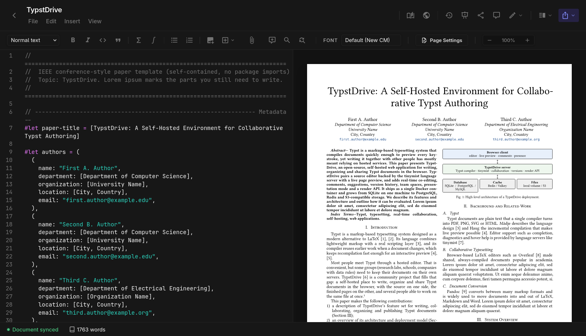
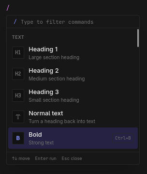

# Writing in the editor

The editor has two halves: the text you write on the left and a live preview of the pages on the right.

This page describes Typst documents. LaTeX documents have their own editor and toolbar, described in [LaTeX documents](latex.md).

## Writing

- Typst code is colored so it is easy to read, and suggestions pop up as you type.
- In projects, bibliography (`.bib`), YAML (`.yml`, `.yaml`) and TOML (`.toml`) files get their own colors, and the comment shortcut uses the right comment mark for each. Other files, such as `.md` or `.txt`, open as plain text.
- Typing an opening bracket or quote adds the closing one for you. With text selected, typing `*`, `_`, `` ` ``, `$`, `(` and similar wraps the selection instead of replacing it.
- Mistakes are underlined, and the error bar under the toolbar tells you what went wrong and on which line.
- Smart features such as jumping to where something is defined, renaming and formatting are available to owners and editors.
- Type `@` to pick a label or a citation key from your bibliography files. In projects this works in every file and includes labels and entries from the whole project.

## The top bar

The buttons in the top right show only icons. Hover over one to see its name. Documents and projects share the same order:

| Button | What it does |
|---|---|
| Typst Docs, Typst Universe | Open the Typst documentation or package library in a new tab. |
| Version history | Documents only. See [Version history](collaboration.md#version-history). |
| Present | Show the document as slides. See [Presenting](presenting.md). |
| Share | Choose who can open it. See [Sharing](sharing.md). |
| Publish as package | Projects only, for the owner. See [Packages](packages.md). |
| Comments | Opens the comments panel. |
| Editing or Suggesting | See [Suggesting changes](collaboration.md#suggesting-changes). |
| View | Chooses the view mode below. |
| Print or export | Print, or download a PDF, the source file, SVG or PNG. |

## View modes

The **View** button in the top bar chooses what the editor shows:

| Mode | What you see |
|---|---|
| Editor and preview | The text and the preview side by side. |
| Editor only | Just the text, with the full width to write in. |
| Preview only | Just the pages, for reading or checking the layout. |

In **Editor and preview**, drag the line between the two to give either side more room, or double-click it to split them evenly again. With the line focused, the left and right arrow keys move it too.

In a Typst file, the editor and preview follow each other. Click in the text and the preview scrolls to that spot, marking it briefly. Click the preview and the cursor moves to the text it came from; in a project, its file opens first. Typing does not move the preview, and while the preview is out of date or the document has an error, clicks do nothing until it catches up.

Your choice and the split are remembered in your browser. Viewers only ever see the preview.

### Preview in a separate window

Choose **Preview in new window** from the **View** button or the **View** menu to move the preview into its own window, for example on a second monitor. The editor gets the full width of its window. The preview window updates as you type, follows the cursor both ways as described above, and has its own zoom control. Close the preview window, or choose it again, to bring the preview back beside the editor. Choosing a view mode also brings it back.

If nothing opens, allow pop-ups for the site. The preview window closes when you leave the document or project.

## The toolbar

The formatting toolbar sits above the text:

- **Heading** sizes, **bold**, **italic**, **code** and **quote**.
- **Math** inline or on its own line.
- **Bullet** and **numbered** lists.
- **Upload** an image or font, and **Insert** (see below).
- **Document files**, the paperclip, lists the files this document uses.
- **Comment**, **Find** and **Search and replace**.
- **Font** picker and **Page settings** for paper size, margins, page numbers and more.
- **Zoom** for the preview.

Hover over any button to see what it does and its keyboard shortcut.

## Insert

The **Insert** button adds things at the cursor:

| Item | What it does |
|---|---|
| Image | Search the images in your drive (and, in a project, the project's own images), or upload a new one with the button, by dropping it in, or by pasting it. Picking a drive image in a project copies it into the project. Type to search, use the arrow keys to pick, and press ++enter++ to insert. |
| Table | Choose how many rows and columns, with an optional header row. |
| Document | Include another document you own or that is shared with you. |
| Symbol | Search math and text symbols by name, such as "arrow" or "alpha". |
| Emoji | Search emoji by name. |

## Slash commands

Type `/` at the start of a line or after a space to open a list of commands, such as headings, lists, tables, math, page breaks and comments. It also has actions for the whole document: switching between editing and suggesting, changing the view, exporting, printing, presenting, sharing, saving a version, page settings and citations. Keep typing to filter the list: letters do not need to be next to each other, so `pgbrk` finds **Page break**. Use the arrow keys to choose, ++enter++ or ++tab++ to run, and ++escape++ to close the list and keep what you typed.

Select some text and press `/` to apply a command to it, for example to make it bold, turn it into a heading or a link, or comment on it. A search box opens so the selected text stays as it is.

Typst and LaTeX files each get their own commands. `//` comments and division like `a/b` do not open the list.

## Find and replace

Press ++ctrl+f++ to search the document, or ++ctrl+h++ to search and replace. Both are also in the **Edit** menu.

## Formatting

Press ++shift+alt+f++ (++shift+option+f++ on a Mac), or choose **Edit → Format document**, to tidy up the indentation, spacing and line breaks of a Typst file. It works in documents and in every `.typ` file of a project. A file with syntax errors is left as it is until you fix them.

## Spell checking

Turn on spell checking in [your settings](settings.md#editor). It only checks your writing and skips code, math, labels and links. Right-click a marked word for suggestions.

## Keyboard shortcuts

These are the shortcuts out of the box. On a Mac, use ++cmd++ instead of ++ctrl++. You can change most of them in [your settings](settings.md#keybinds).

| Shortcut | Action |
|---|---|
| ++ctrl+s++ | Save a version (in a project, confirm that your changes are saved) |
| ++ctrl+b++ | Bold |
| ++ctrl+i++ | Italic |
| ++ctrl+e++ | Inline code |
| ++ctrl+m++ | Inline math |
| ++ctrl+slash++ | Turn the selected lines into comments, or back |
| ++ctrl+f++ | Find |
| ++ctrl+h++ | Find and replace |
| ++ctrl+alt+m++ | Comment on the selected text |
| ++shift+alt+f++ | Format a Typst file |
| ++ctrl+z++ and ++ctrl+y++ | Undo and redo |

## Saving

Everything you type is saved automatically every few seconds. **Versions**, which are snapshots you can go back to, are saved when people leave the document or when you press ++ctrl+s++. See [Version history](collaboration.md#version-history).

Projects don't have versions yet. In a project, ++ctrl+s++ just confirms that your changes are saved, or tells you they'll sync once you're back online.
