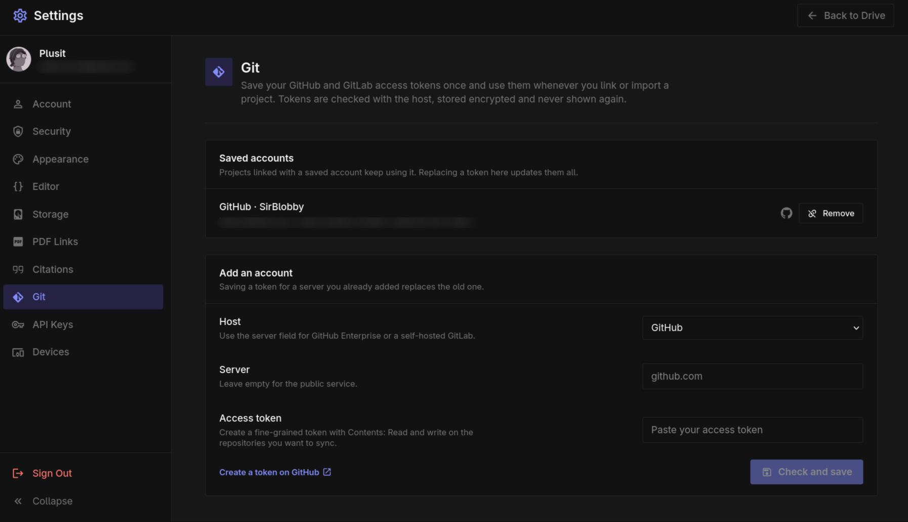

# Git sync

Link a project to a folder in a Git repository, pull changes other people pushed, and push your own changes back as a commit. Open **File → Git Sync** in a project.

TypstDrive never clones the whole repository. It only copies the files your document needs, so a repository with gigabytes of data next to your paper is fine.

## What gets synced

Only these files inside the linked folder are copied into the project:

- Document sources and data: `.typ`, `.tex`, `.bib`, `.csl`, `.yml`, `.yaml`, `.toml`, `.json`, `.md`, `.txt`, `.csv`
- Images: `.png`, `.jpg`, `.jpeg`, `.gif`, `.svg`, `.webp`, `.pdf`
- Fonts: `.ttf`, `.otf`, `.woff`, `.woff2`

Everything else, and everything outside the folder, stays in the repository untouched. Files larger than 50 MB are skipped, and a linked folder can hold up to 5,000 synced files. You can also exclude paths yourself, one per line: a folder such as `data/`, a file such as `notes.md`, or a pattern such as `*.csv`.

## Import a repository as a new project

In your drive, choose **New → From Git**. Fill in the repository the same way as below, give the project a name, choose **Check repository**, then **Import project**. The new project is created in the folder you are in, already linked, and opens when the import is done.

## Link a repository to an existing project

Only the project owner can link a repository.

1. Paste the address of the repository, such as `https://github.com/owner/paper`.
2. Pick the branch, and the folder that holds the document. Leave the folder empty to use the whole repository.
3. Paste an access token. Public repositories can be pulled without one, but pushing always needs a token.
4. Choose **Check repository**. TypstDrive lists the files it will import, the files it skips, and which project files will be replaced or removed.
5. Choose **Link and import**.

If the import would go over your storage space, the check lists the largest files so you can exclude them.

### Access tokens

| Host | Token |
|---|---|
| GitHub | A fine-grained personal access token with **Contents: Read and write** on the repository. |
| GitLab | A project or personal access token with the `api` scope. |
| Gitea, Forgejo, Codeberg and others | An access token with repository write access. Fill in your username under **More options** if the server asks for it. |

The token is stored encrypted. Editors of the project pull and push with the owner's token, and their commits use their own name and email address.

### Saved accounts

Instead of pasting a token for every project, save your GitHub or GitLab account once in **Settings → Git**:

1. Pick **GitHub** or **GitLab**, and fill in the server for GitHub Enterprise or a self-hosted GitLab.
2. Paste an access token and choose **Check and save**. TypstDrive asks the host who the token belongs to, so a mistyped token is caught right away.

When you link or import a repository on that server and leave the token field empty, the saved account is used. Projects linked this way follow the account: replacing its token updates all of them, and removing the account stops pushing until you add a token again. In a project's **Link settings** you can switch between a token for that project and your saved account.

Saved tokens are never sent back to your browser; only the last four characters are shown so you can tell them apart.

For GitHub Enterprise or a self-hosted GitLab, pick **GitHub** or **GitLab** as the host so TypstDrive uses their web API. Any other server is reached with Git itself.

## Pull and push

The Git window shows what changed in the repository and what changed in the project since the last sync.

- **Pull** brings in new commits. Files you have not touched are updated right away, also for people who have them open.
- **Commit and push** sends the files you tick as one commit. Write a short message that describes the change. If the repository has new commits, pull first.

If a file changed both in the project and in the repository, pulling stops and asks what to keep:

- **Use repository version** replaces your copy.
- **Keep my version** keeps your copy, and it shows up as a change you can push.

## Unlink

**Link settings → Unlink** stops syncing. The project files stay as they are and nothing changes in the repository.
