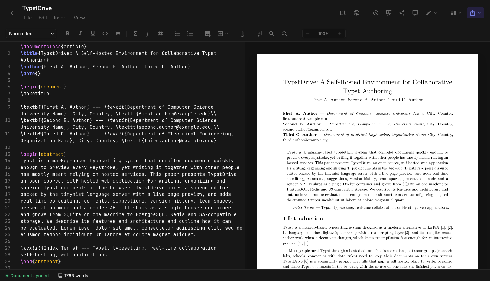

# LaTeX documents

TypstDrive is built for Typst, but it also writes and compiles real LaTeX. Use it when you already know LaTeX, when someone sends you a `.tex` file, or for a paper that has to follow a LaTeX template.



LaTeX is compiled on the server by [Tectonic](https://tectonic-typesetting.github.io/), a complete TeX engine based on XeTeX. It downloads the LaTeX packages a document uses the first time it needs them, so most packages from TeX Live work without any setup.

New to LaTeX? The [LaTeX guides](../learn/latex/basics.md) teach it from the beginning.

!!! note
    Administrators can [turn LaTeX off](../admin/latex.md). Then the LaTeX choices are hidden and existing LaTeX documents do not compile.

## Creating a LaTeX document

Choose **New document** in the drive and pick **LaTeX** under **Language**. The arrow next to **New document** also has a **LaTeX document** shortcut.

A new LaTeX document starts with a small article:

```latex
\documentclass{article}
\title{New Document}
\author{}

\begin{document}
\maketitle

\section{Introduction}
Start writing here.

\end{document}
```

Uploading a `.tex` file with **Upload** also creates a LaTeX document. **New → Import** is different: it converts the `.tex` file into a Typst document with Pandoc.

LaTeX documents show a **LaTeX** badge on their card in the drive.

## Creating a LaTeX project

Choose **New → Project** and pick **LaTeX** under **Language**. The project starts with a single `main.tex` file, which is its entry point. See [Projects](projects.md).

Use a project for anything with several files: chapters pulled in with `\input` or `\include`, a `.bib` bibliography, images, or your own `.sty` and `.cls` files. Paths are relative to the folder of the entry point, just like on your own computer.

LaTeX projects cannot be [published as packages](packages.md).

## What works

- Packages with `\usepackage`, such as `amsmath`, `geometry`, `hyperref`, `graphicx`, `booktabs`, `siunitx` and TikZ. They are downloaded the first time a document uses them.
- Document classes such as `article`, `report`, `book`, `beamer` and journal classes, or your own `.cls` file in a project.
- Bibliographies with BibTeX and `natbib`, or BibLaTeX with `backend=bibtex`.
- Cross-references, tables of contents and citations. LaTeX is run as many times as needed for them to settle.
- Images in the project or in your drive with `\includegraphics`.
- Your own fonts with `fontspec`: upload the font file and use its file name, for example `\setmainfont{MyFont-Regular.otf}`.

## What does not work

- **Shell escape** is always off, so `minted`, `\write18` and packages that run outside programs do not work. Use `listings` instead of `minted`.
- **Biber** is not available. Use BibLaTeX with `backend=bibtex`, or BibTeX.
- **pdfLaTeX-only packages** may not work, because the engine is XeTeX. Most documents work as they are; `inputenc` and `fontenc` are simply not needed.
- Files outside the document or project, such as system fonts or files elsewhere on the server, cannot be read.

## The first compile

The very first LaTeX compile on a server takes longer, up to a minute, while Tectonic downloads the core LaTeX files. A document that uses a package nobody has used before also waits for that package to download. After that, compiles take about a second.

## The editor

LaTeX documents use a LaTeX editor instead of the Typst one:

- Colors for LaTeX commands, environments and math.
- Suggestions for common commands and environments as you type.
- Typing `\begin{itemize}` adds the matching `\end{itemize}`.
- Hover over a command to see what it does.
- Warnings for common mistakes, such as an `\end` without a `\begin`.
- ++ctrl+slash++ comments lines out with `%`.

The Typst language server is not used for LaTeX, so go-to-definition and renaming are not available.

## The LaTeX toolbar

The toolbar above the text inserts LaTeX instead of Typst:

- **Section** picker: Normal text, Section, Subsection, Subsubsection, Paragraph and Subparagraph.
- **Bold**, **italic**, **underline**, **monospace** and **quote**.
- **Math** inline (`$...$`), on its own line (`\[...\]`) or as a numbered `equation`.
- **Bullet** (`itemize`) and **numbered** (`enumerate`) lists. Selected lines each become an `\item`.
- **Upload image** adds the picture to the document's files and inserts a `figure` that uses it.
- **Insert**: figure, table, link, footnote, label, reference, citation, verbatim block, table of contents and page break.
- **Document files**, **Comment**, **Find**, **Search and replace** and **Zoom** work as they do for Typst. Picking a file inserts the matching LaTeX: `\includegraphics` for images, `\setmainfont` for fonts, `\input` for `.tex` files and `\bibliography` for `.bib` files.

When the toolbar, the `/` menu or the image picker inserts a command that needs a package, the package is added to the preamble for you: `graphicx` for images, `hyperref` for links, `fontspec` for fonts and `amsmath` for `\text` and `\eqref`. This only happens in the file with `\documentclass`, so in a project, add packages for other files to the main file yourself.

The font picker and **Page settings** are hidden, because they write Typst settings. Set fonts and page layout in the preamble instead, for example with `fontspec` and `geometry`.

Keyboard shortcuts insert LaTeX too: ++ctrl+b++ for `\textbf`, ++ctrl+i++ for `\textit`, ++ctrl+e++ for `\texttt` and ++ctrl+m++ for inline math.

## Errors

When LaTeX stops with an error, the error bar under the toolbar shows the message with its line number, and the line is underlined in the editor. In a project, the error is underlined when you open the file it is in. Errors inside a package show the message without a line.

A document that runs for too long, for example because of a macro that calls itself forever, is stopped after 90 seconds on a default server.

## Exporting

**PDF** downloads the PDF exactly as LaTeX made it. PNG and SVG work as usual. **.tex source** downloads your LaTeX file. HTML export and the Pandoc conversions in the **File** menu are not available for LaTeX documents.

Downloading a folder as a ZIP saves LaTeX documents as `.tex` files.
