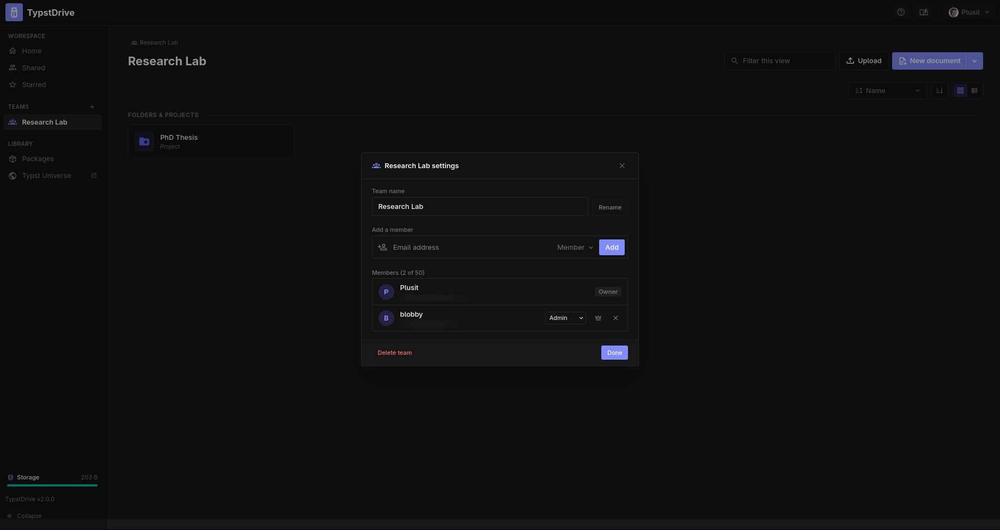

# Team spaces

A team space is a shared drive that belongs to a group instead of one person. It has its own documents, projects, folders, files, fonts, packages and storage. Because the team owns the work, it stays put when someone leaves.

## Switching spaces

Your teams are listed under **Teams** in the drive sidebar. Choose one to open its drive, or **Home** to go back to yours. Anything you create while a team is open belongs to that team.

## Creating a team

Choose the **+** next to **Teams** and give it a name. You become its owner. Your administrator decides who can create teams and how many.

## Roles

| Role | Work on documents and projects | Invite and remove people | Change roles | Rename the team | Delete the team |
|---|---|---|---|---|---|
| Owner | Yes | Everyone | Everyone | Yes | Yes |
| Admin | Yes | Members and viewers | Members and viewers | Yes | No |
| Member | Yes | No | No | No | No |
| Viewer | Read only | No | No | No | No |

Each team has exactly one owner.

## Managing a team

Hover over the team in the sidebar and choose the gear button.

- **Invite** someone by the email of their TypstDrive account and choose a role. If email is set up, they get a message with a link.
- **Change** someone's role or **remove** them.
- **Leave** a team. The owner has to hand the team to someone else first.
- **Make owner** hands the team to another member. You stay on as an admin.
- **Delete** the team and everything in its drive. This skips the trash.

Items deleted from a team's drive go to the team's own [trash](drive.md#trash), shown while you are working in the team.

If the owner's account is deleted, the team passes to an admin, then a member, then a viewer.
