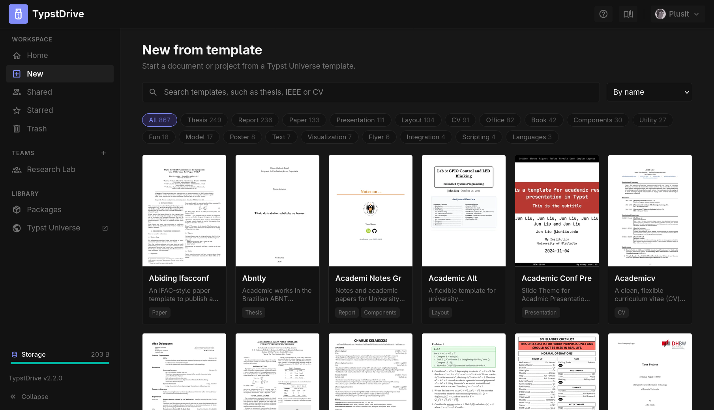

# Templates

Start a new document from one of the community templates on [Typst Universe](https://typst.app/universe), such as papers, theses, CVs, letters and presentations.

## Starting from a template

1. Choose **New** under **Workspace** in the drive sidebar, or open the arrow next to **New document** and choose **From template**.
2. Search by name or topic, filter by type (for example **Paper**, **Thesis** or **CV**), and sort by name or by most recently updated.
3. Choose a template to see a larger preview, its description and authors, and a link to its Typst Universe page.
4. Give it a name and, if you like, add authors (see below).
5. Choose **Create**.

The new item is created in the folder you were looking at when you used **From template**, or at the top of your drive when you used **New** in the sidebar. In a team space, it is created in the team's drive.

- A template that is a single file becomes a **document**.
- A template with several files, such as a bibliography or images, becomes a [project](projects.md) with the template's main file as its entry point.

The template imports its package, for example `#import "@preview/charged-ieee:0.1.4": ieee`, which is downloaded automatically the first time it compiles.

## Filling in authors from ORCID

Under **Authors**, paste an ORCID iD, such as `0000-0002-1825-0097` or `https://orcid.org/0000-0002-1825-0097`, and choose **Add**. The person's public name, email and affiliations are read from their ORCID record. When someone has several affiliations, pick the right one from the list; current ones come first. Choose **Add by name** to add someone without an ORCID iD, and edit any name or affiliation before creating.

When you choose **Create**, the template's author field in its main file is filled in:

- A list of authors, such as `authors: ((name: "...", affiliation: "..."),)`, is replaced with your authors, using the same keys the template uses. Keys TypstDrive does not know, such as a footnote number, keep the template's example value.
- A single text field, such as `author: "Your Name"`, gets everyone's names separated by commas.

If the template has no author field TypstDrive can recognize, it is created unchanged and you are told to add the authors yourself. The authors you used last are remembered in your browser for next time.

ORCID lookups can be turned off by an administrator in [Citations](../admin/citations.md).

## How templates are loaded

TypstDrive never downloads the whole package collection. It reads the Typst Universe index, which lists every package and whether its `typst.toml` has a `[template]` section, and keeps the newest version of each template in memory for six hours. Preview images are fetched one at a time as you scroll and kept in memory. A template's files are only downloaded when someone creates something from it, and are then cached on the server for the next person.

If the server cannot reach Typst Universe, the page says so and offers to try again. Templates that are already loaded keep working until the server can refresh the list.

Templates are made by the community. Check a template's license on its Typst Universe page before you publish work based on it.
