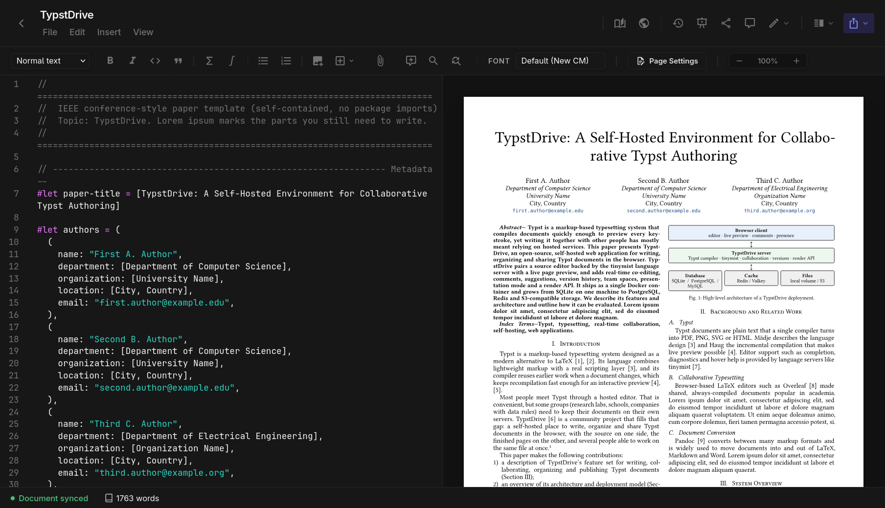

# Welcome to TypstDrive

TypstDrive is a place to write, organize and share [Typst](https://typst.app/) documents from your web browser. Think of it as a shared drive and a document editor in one: you write on the left, see the finished pages on the right, and invite other people to work on the same document with you at the same time.

You run TypstDrive on your own server, so your documents stay with you.

!!! info "Not an official Typst product"
    TypstDrive is a community project. It is not affiliated with, endorsed by, or supported by the official Typst project. It uses the open-source Typst compiler to turn your writing into finished documents. See [About and disclaimer](about.md).

## What you can do

**Write**
:   A comfortable editor with syntax colors, suggestions as you type, a formatting toolbar, find and replace, spell checking and shortcuts you can change. The preview updates as you type, and you can show the editor, the preview or both.

**LaTeX too**
:   Write basic [LaTeX documents and projects](guide/latex.md) with their own editor and toolbar, rendered with MiTeX.

**Organize**
:   Folders with colors, a search bar with filters that can also look inside your documents, sorting, a grid or list view, and stars for the things you open most.

**Work together**
:   Several people can type in the same document at once and see each other's cursors. Leave comments, suggest changes for someone else to accept, and look back through the version history.

**Share**
:   Share with people by email as editors, suggesters or viewers, or send a link that anyone can open, with an optional password and expiry date.

**Go bigger**
:   Projects hold many files for books, theses and templates. Turn a project into a package that everyone on your server can use.

**Finish**
:   Export to PDF, PNG, SVG, HTML, Markdown, Word or LaTeX, or present your slides full screen and draw on them while you talk.

**Teams**
:   Team spaces are shared drives that belong to a group instead of one person.

**Take it offline**
:   The [Typst Desktop](guide/desktop.md) app keeps your TypstDrive documents in sync on your computer.

## Where to go next

- **New to TypstDrive?**

    ---

    Write [your first document](start/first-document.md) in a few minutes, then take a quick look at [how Typst works](start/typst-primer.md).

- **Learn every feature**

    ---

    The [User Guide](guide/index.md) explains the drive, the editor, sharing, teams and everything else, one topic at a time.

- **Run your own server**

    ---

    [Self-Hosting](self-hosting/index.md) walks you through installing TypstDrive with Docker, adding HTTPS and keeping it backed up.

- **Look after a server**

    ---

    [Administration](admin/index.md) covers users, sign-in rules, branding, storage limits and more.

