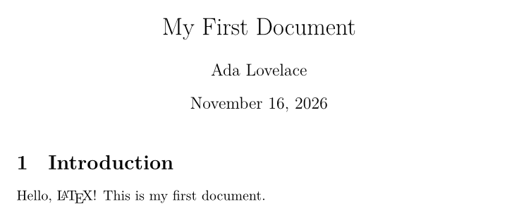
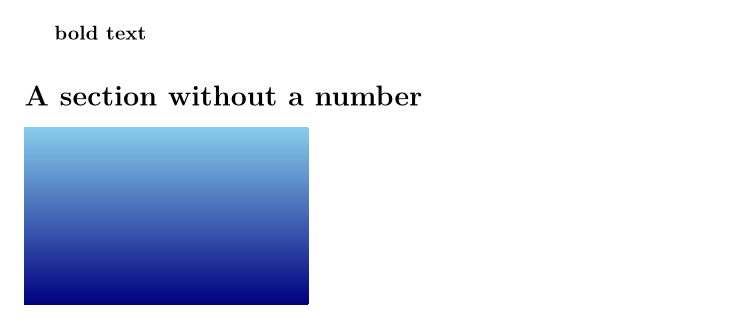
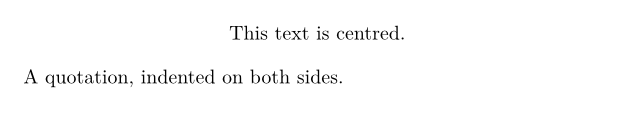
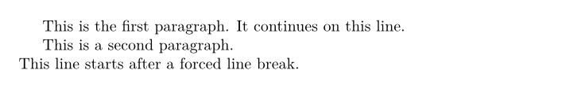
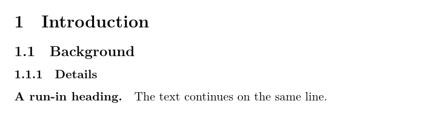
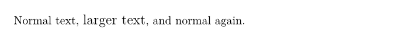
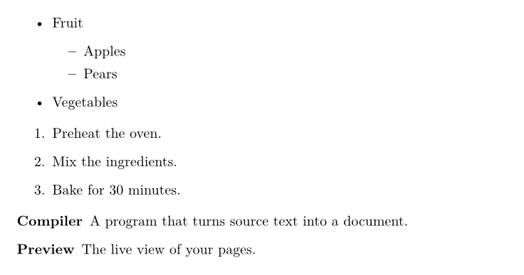
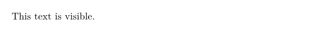
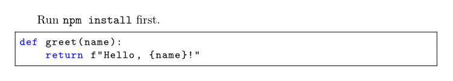
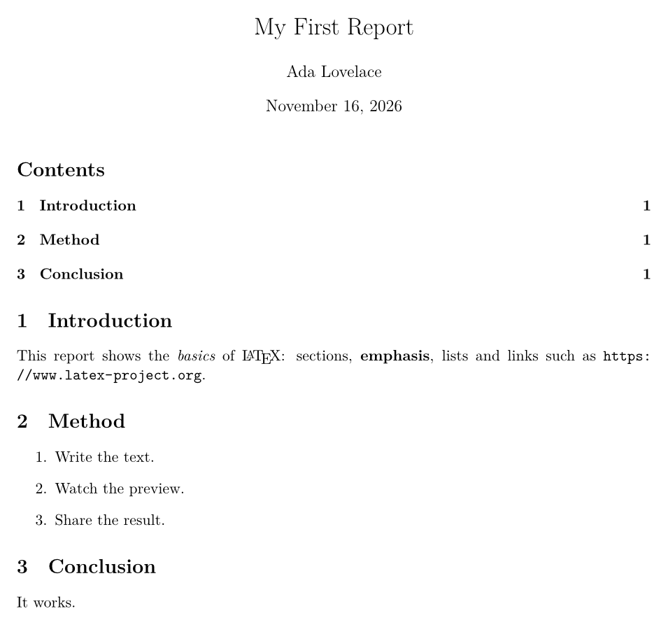

# LaTeX: the basics

A LaTeX document is plain text with **commands** that start with a backslash, such as `\section{Introduction}`. You write the text and the commands, and the TeX engine lays out the pages. In TypstDrive, LaTeX is compiled by [Tectonic](https://tectonic-typesetting.github.io/), a modern TeX engine based on XeTeX.

## The shape of every document

Every LaTeX document has two parts: the **preamble**, where you choose the document class and load packages, and the **body**, between `\begin{document}` and `\end{document}`, which holds what you see on the page.

```latex
\documentclass{article}
\usepackage{amsmath}

\title{My First Document}
\author{Ada Lovelace}
\date{\today}

\begin{document}
\maketitle

\section{Introduction}
Hello, \LaTeX! This is my first document.

\end{document}
```

{ .learn-result loading=lazy }


- `\documentclass{article}` picks the overall design. Common classes are `article` for short papers, `report` and `book` for longer works with chapters, `letter`, and `beamer` for slides.
- Options go in square brackets: `\documentclass[11pt,a4paper,twocolumn]{article}`.
- `\usepackage{...}` loads a package, which adds commands. Tectonic downloads packages the first time they are used, so almost every package from TeX Live just works.
- `\maketitle` prints the title, author and date given in the preamble.

## Commands and environments

**Commands** start with a backslash. Required arguments go in curly braces and optional ones in square brackets.

```latex
\textbf{bold text}
\section*{A section without a number}
\includegraphics[width=5cm]{photo.jpg}
```

{ .learn-result loading=lazy }


**Environments** wrap a part of the document between `\begin{name}` and `\end{name}`.

```latex
\begin{center}
This text is centred.
\end{center}

\begin{quote}
A quotation, indented on both sides.
\end{quote}
```

{ .learn-result loading=lazy }


Every `\begin` needs a matching `\end`. In TypstDrive, typing `\begin{itemize}` adds the `\end{itemize}` for you, and the editor warns you when they do not match.

## Paragraphs and line breaks

Like in Typst, a single line break is ignored and an empty line starts a new paragraph. Several spaces count as one.

```latex
This is the first paragraph. It continues
on this line.

This is a second paragraph.\\
This line starts after a forced line break.
```

{ .learn-result loading=lazy }


`\\` forces a line break. Use it sparingly, mostly in tables, addresses and poems. `\newpage` starts a new page.

## Sections

```latex
\section{Introduction}
\subsection{Background}
\subsubsection{Details}
\paragraph{A run-in heading.} The text continues on the same line.
```

{ .learn-result loading=lazy }


Sections are numbered automatically. Add `*` for an unnumbered one: `\section*{Acknowledgements}`. Classes `report` and `book` add `\chapter{...}` above `\section`. `\tableofcontents` prints a table of contents; it needs a second pass, which TypstDrive runs for you.

## Emphasis and text styles

| You type | You get |
|---|---|
| `\emph{emphasis}` | *emphasis*, usually italic |
| `\textbf{bold}` | **bold** |
| `\textit{italic}` | *italic* |
| `\texttt{monospace}` | `monospace` |
| `\textsc{Small Caps}` | small capitals |
| `\underline{underlined}` | underlined |
| `\textsuperscript{th}` and `\textsubscript{2}` | superscript and subscript in text |

Sizes from smallest to largest: `\tiny`, `\scriptsize`, `\footnotesize`, `\small`, `\normalsize`, `\large`, `\Large`, `\LARGE`, `\huge`, `\Huge`. They apply until the end of the group, so wrap them in braces:

```latex
Normal text, {\large larger text}, and normal again.
```

{ .learn-result loading=lazy }


For colour, load `xcolor`: `\usepackage{xcolor}`, then `\textcolor{red}{red text}`.

In TypstDrive, the toolbar and ++ctrl+b++, ++ctrl+i++ and ++ctrl+e++ insert `\textbf`, `\textit` and `\texttt` for you.

## Lists

```latex
\begin{itemize}
  \item Fruit
  \begin{itemize}
    \item Apples
    \item Pears
  \end{itemize}
  \item Vegetables
\end{itemize}

\begin{enumerate}
  \item Preheat the oven.
  \item Mix the ingredients.
  \item Bake for 30 minutes.
\end{enumerate}

\begin{description}
  \item[Compiler] A program that turns source text into a document.
  \item[Preview] The live view of your pages.
\end{description}
```

{ .learn-result loading=lazy }


## Special characters

These characters have a meaning in LaTeX: `# $ % & ~ _ ^ \ { }`. Type them like this:

| Character | You type |
|---|---|
| `#`, `$`, `%`, `&`, `_` | `\#`, `\$`, `\%`, `\&`, `\_` |
| `{` and `}` | `\{` and `\}` |
| `~` | `\textasciitilde{}` |
| `^` | `\textasciicircum{}` |
| `\` | `\textbackslash{}` |

Other useful marks:

| You type | You get |
|---|---|
| ` ``quotes'' ` | curly double quotes |
| `` `single' `` | curly single quotes |
| `--` | an en dash, as in 1990--2000 |
| `---` | an em dash |
| `\ldots` | an ellipsis |
| `~` | a space that never breaks, as in `Fig.~1` |

Because Tectonic uses XeTeX, you can type accented letters and symbols such as é, ü, ß, € and — directly. You do not need `inputenc` or `fontenc`.

## Comments

A `%` starts a comment that runs to the end of the line. In TypstDrive, ++ctrl+slash++ comments the selected lines out.

```latex
This text is visible. % This note is not.
% A whole line of notes.
```

{ .learn-result loading=lazy }


## Code listings

`verbatim` shows text exactly as typed. For syntax colours, use the `listings` package. (`minted` does not work in TypstDrive, because it needs to run an outside program.)

```latex
\documentclass{article}
\usepackage{listings}
\usepackage{xcolor}
\lstset{basicstyle=\ttfamily\small, keywordstyle=\color{blue}, frame=single}

\begin{document}
Run \verb|npm install| first.

\begin{lstlisting}[language=Python]
def greet(name):
    return f"Hello, {name}!"
\end{lstlisting}
\end{document}
```

{ .learn-result loading=lazy }


## A complete first document

```latex
\documentclass[11pt,a4paper]{article}
\usepackage[margin=2.5cm]{geometry}
\usepackage{hyperref}

\title{My First Report}
\author{Ada Lovelace}
\date{\today}

\begin{document}
\maketitle
\tableofcontents

\section{Introduction}
This report shows the \emph{basics} of \LaTeX: sections,
\textbf{emphasis}, lists and links such as \url{https://www.latex-project.org}.

\section{Method}
\begin{enumerate}
  \item Write the text.
  \item Watch the preview.
  \item Share the result.
\end{enumerate}

\section{Conclusion}
It works.

\end{document}
```

{ .learn-result loading=lazy }


## Reading errors

When LaTeX stops, the error bar shows the message and line. The most common ones:

| Message | Usual cause |
|---|---|
| `Undefined control sequence` | A typo in a command, or a command from a package you did not load. |
| `Missing $ inserted` | A math symbol such as `_` or `^` outside math. |
| `Missing } inserted` or `Extra }` | Unbalanced braces. |
| `\begin{x} ended by \end{y}` | Environments closed in the wrong order. |
| `File 'x.sty' not found` | A misspelled package name. |

Fix the first error first: later ones are often caused by it.

## Next steps

Write formulas in [Math](math.md).
