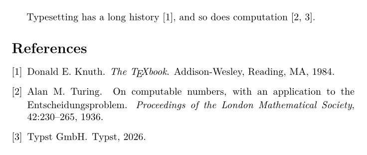
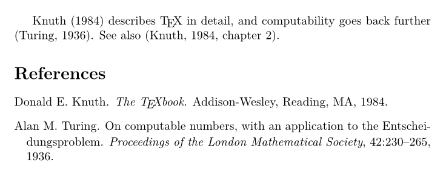
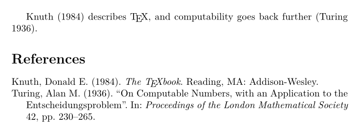
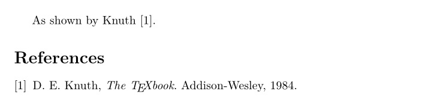

# LaTeX: bibliographies

LaTeX keeps references in a separate **`.bib` file** and builds the reference list from the entries you cite. This guide covers the three common ways to do it and what works in TypstDrive.

## The .bib file

Upload a file named, for example, `refs.bib`. Each entry has a type, a **key** you cite it by, and fields.

A file named `refs.bib`:

```bibtex
@book{knuth1984,
  author    = {Donald E. Knuth},
  title     = {The {\TeX}book},
  publisher = {Addison-Wesley},
  address   = {Reading, MA},
  year      = {1984},
}

@article{turing1936,
  author  = {Alan M. Turing},
  title   = {On Computable Numbers, with an Application to the {Entscheidungsproblem}},
  journal = {Proceedings of the London Mathematical Society},
  volume  = {42},
  pages   = {230--265},
  year    = {1936},
}

@misc{typst,
  author = {{Typst GmbH}},
  title  = {Typst},
  year   = {2026},
  url    = {https://typst.app},
}
```

- Common types are `@article`, `@book`, `@inproceedings`, `@incollection`, `@phdthesis`, `@techreport` and `@misc`.
- Separate several authors with `and`: `author = {Ada Lovelace and Charles Babbage}`.
- Braces around a word, like `{Entscheidungsproblem}`, keep its capital letters. Double braces around an organisation name stop it being read as first and last name.

TypstDrive can fill the `.bib` file for you from DOIs, arXiv, PubMed and Semantic Scholar IDs, or keep it in sync with Zotero. See [Citations](../../guide/citations.md).

## Plain BibTeX

The classic way. Cite with `\cite`, then say where the list goes and in which style.

```latex
\documentclass{article}

\begin{document}
Typesetting has a long history~\cite{knuth1984}, and so does
computation~\cite{turing1936, typst}.

\bibliographystyle{plain}
\bibliography{refs}
\end{document}
```

{ .learn-result loading=lazy }


- `\bibliography{refs}` names the file without `.bib`.
- Styles that come with BibTeX: `plain` (numbered, sorted), `unsrt` (numbered in citation order), `alpha` (labels like [Knu84]), `abbrv`, and `ieeetr`. Journal classes often bring their own, such as `IEEEtran`.
- `\cite[p.~7]{knuth1984}` adds a page number.
- `\nocite{*}` lists every entry in the file, cited or not.

TypstDrive runs BibTeX and LaTeX as many times as needed, so citations and the list appear in one compile.

## natbib: author-year citations

`natbib` adds citations written into the sentence, as used in the sciences and humanities.

```latex
\documentclass{article}
\usepackage[round]{natbib}

\begin{document}
\citet{knuth1984} describes \TeX\ in detail, and computability goes
back further \citep{turing1936}. See also \citep[chapter~2]{knuth1984}.

\bibliographystyle{plainnat}
\bibliography{refs}
\end{document}
```

{ .learn-result loading=lazy }


| Command | Result |
|---|---|
| `\citet{knuth1984}` | Knuth (1984) |
| `\citep{knuth1984}` | (Knuth, 1984) |
| `\citep[p.~7]{knuth1984}` | (Knuth, 1984, p. 7) |
| `\citeauthor{knuth1984}` | Knuth |
| `\citeyear{knuth1984}` | 1984 |

Use `plainnat`, `abbrvnat` or `unsrtnat` as the style. Add the `numbers` option, `\usepackage[numbers]{natbib}`, for numbered citations with the same commands.

## BibLaTeX

BibLaTeX is the modern system with many styles and full Unicode support. It normally runs a program called Biber, which TypstDrive does not have, so **always add `backend=bibtex`**.

```latex
\documentclass{article}
\usepackage[backend=bibtex, style=authoryear]{biblatex}
\addbibresource{refs.bib}

\begin{document}
\textcite{knuth1984} describes \TeX, and computability goes back
further \parencite{turing1936}.

\printbibliography
\end{document}
```

{ .learn-result loading=lazy }


- `\addbibresource{refs.bib}` takes the file name **with** `.bib`.
- Styles include `numeric`, `alphabetic`, `authoryear`, `authortitle`, `ieee` and `apa`.
- `\textcite` and `\parencite` match natbib's `\citet` and `\citep`. `\cite`, `\footcite` and `\autocite` also exist.
- `\printbibliography[title={References}]` changes the heading.

## Which one should I use?

| You need | Use |
|---|---|
| A journal or conference template | Whatever the template uses, usually plain BibTeX with its own style. |
| Author-year citations with few changes | `natbib` with `plainnat`. |
| Many styles, sorting and filtering options | BibLaTeX with `backend=bibtex`. |

## A bibliography without a .bib file

For a handful of references, write the list by hand with `thebibliography`:

```latex
\documentclass{article}

\begin{document}
As shown by Knuth~\cite{knuth}.

\begin{thebibliography}{9}
\bibitem{knuth}
D.~E. Knuth, \emph{The \TeX book}. Addison-Wesley, 1984.
\end{thebibliography}
\end{document}
```

{ .learn-result loading=lazy }


## Troubleshooting

| Problem | Fix |
|---|---|
| Citations show as `[?]` | Check that the key in `\cite` matches the `.bib` file exactly, including case. |
| The list is empty | Check the file name in `\bibliography{refs}` (no `.bib`) or `\addbibresource{refs.bib}` (with `.bib`). |
| BibLaTeX error about Biber | Add `backend=bibtex` to the BibLaTeX options. |
| Capital letters become lowercase in titles | Put braces around them in the `.bib` file: `{DNA}`. |

## Next steps

Write your own commands and drawings in [Commands, packages and drawings](macros.md).
