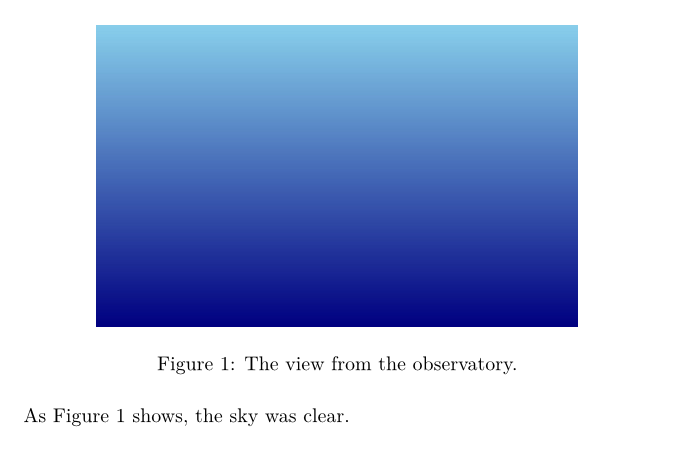
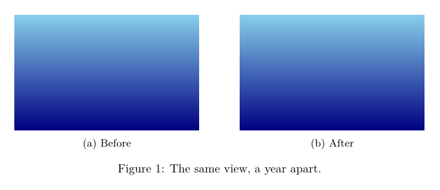
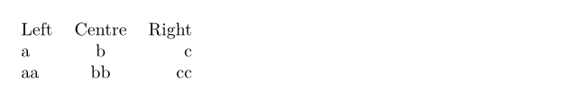
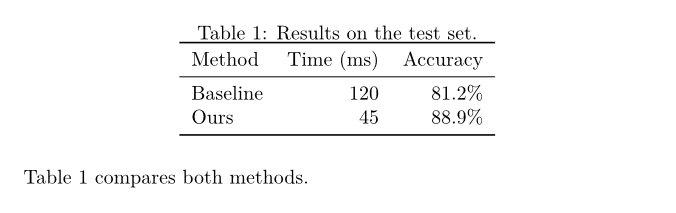
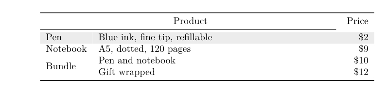
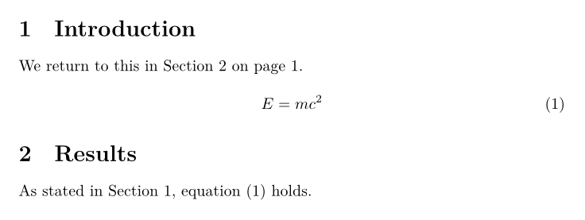
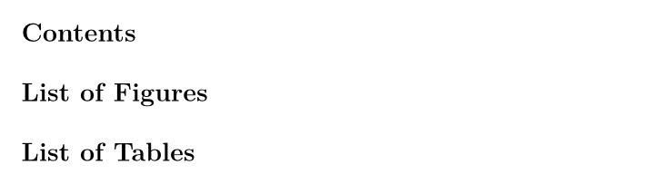

# LaTeX: images, tables and references

## Images

Load `graphicx` and use `\includegraphics`. Upload the picture first: with **Document files** or **Upload image** in the toolbar for a document, or in the file tree of a project.

```latex
\documentclass{article}
\usepackage{graphicx}

\begin{document}
\includegraphics[width=0.8\linewidth]{photo.jpg}
\end{document}
```

{ .learn-result loading=lazy }


| Option | What it does |
|---|---|
| `width=5cm` or `width=0.5\linewidth` | Width, fixed or as a share of the text width. |
| `height=4cm` | Height. Give only one of width and height to keep the proportions. |
| `scale=0.5` | Scale the original size. |
| `angle=90` | Rotate. |
| `keepaspectratio` | With both width and height, fit inside without stretching. |

PNG, JPG and PDF images work. SVG, GIF and WebP do not: convert them to PNG or PDF first. In TypstDrive, the image picker and **Upload image** insert `\includegraphics` and add `graphicx` to the preamble for you.

## Figures and captions

A `figure` environment gives an image a caption and a number. Figures **float**: LaTeX moves them to a good spot, usually the top of a page, so the text does not get big gaps.

```latex
\documentclass{article}
\usepackage{graphicx}

\begin{document}
\begin{figure}[htbp]
  \centering
  \includegraphics[width=0.7\linewidth]{photo.jpg}
  \caption{The view from the observatory.}
  \label{fig:observatory}
\end{figure}

As Figure~\ref{fig:observatory} shows, the sky was clear.
\end{document}
```

{ .learn-result loading=lazy }


- `[htbp]` lists where the figure may go: **h**ere, **t**op, **b**ottom or a separate **p**age. `[H]` from the `float` package forces "exactly here".
- `\label` must come **after** `\caption`, or the reference gets the wrong number.
- `~` before `\ref` keeps "Figure" and the number on the same line.

### Side-by-side images

```latex
\documentclass{article}
\usepackage{graphicx}
\usepackage{subcaption}

\begin{document}
\begin{figure}[htbp]
  \centering
  \begin{subfigure}{0.45\linewidth}
    \includegraphics[width=\linewidth]{photo.jpg}
    \caption{Before}
  \end{subfigure}
  \hfill
  \begin{subfigure}{0.45\linewidth}
    \includegraphics[width=\linewidth]{photo.jpg}
    \caption{After}
  \end{subfigure}
  \caption{The same view, a year apart.}
\end{figure}
\end{document}
```

{ .learn-result loading=lazy }


## Tables

`tabular` builds a table. The column specification says how many columns there are and how they are aligned: `l` left, `c` centre, `r` right, `p{3cm}` a paragraph column with a fixed width, and `|` for a vertical line.

```latex
\begin{tabular}{lcr}
  Left & Centre & Right \\
  a & b & c \\
  aa & bb & cc \\
\end{tabular}
```

{ .learn-result loading=lazy }


`&` separates cells and `\\` ends a row. `\hline` draws a horizontal line.

### Professional tables with booktabs

Good tables use few lines. `booktabs` gives well-spaced rules, and the result looks like a printed book.

```latex
\documentclass{article}
\usepackage{booktabs}

\begin{document}
\begin{table}[htbp]
  \centering
  \caption{Results on the test set.}
  \label{tab:results}
  \begin{tabular}{lrr}
    \toprule
    Method   & Time (ms) & Accuracy \\
    \midrule
    Baseline & 120       & 81.2\%   \\
    Ours     & 45        & 88.9\%   \\
    \bottomrule
  \end{tabular}
\end{table}

Table~\ref{tab:results} compares both methods.
\end{document}
```

{ .learn-result loading=lazy }


For tables, the caption usually goes **above**, as in this example.

### Merged cells, wide columns and colours

```latex
\documentclass{article}
\usepackage{booktabs}
\usepackage{multirow}
\usepackage{tabularx}
\usepackage[table]{xcolor}

\begin{document}
\begin{tabularx}{\linewidth}{l X r}
  \toprule
  \multicolumn{2}{c}{Product} & Price \\
  \cmidrule(r){1-2}
  \rowcolor{gray!15}
  Pen      & Blue ink, fine tip, refillable & \$2 \\
  Notebook & A5, dotted, 120 pages           & \$9 \\
  \multirow{2}{*}{Bundle} & Pen and notebook & \$10 \\
           & Gift wrapped                    & \$12 \\
  \bottomrule
\end{tabularx}
\end{document}
```

{ .learn-result loading=lazy }


- `\multicolumn{2}{c}{...}` spans two columns.
- `\multirow{2}{*}{...}` from `multirow` spans two rows.
- `tabularx` with an `X` column fills the given width and wraps long text.
- `\rowcolor` from `xcolor` with the `table` option colours a row.

Long tables that need to break across pages use the `longtable` package.

## Cross-references

Anything numbered can be labelled with `\label` and referred to with `\ref` (the number) or `\pageref` (the page).

```latex
\documentclass{article}
\usepackage{amsmath}

\begin{document}
\section{Introduction}\label{sec:intro}
We return to this in Section~\ref{sec:results} on page~\pageref{sec:results}.

\begin{equation}
  E = mc^2 \label{eq:energy}
\end{equation}

\section{Results}\label{sec:results}
As stated in Section~\ref{sec:intro}, equation~\eqref{eq:energy} holds.
\end{document}
```

{ .learn-result loading=lazy }


References need a second LaTeX run to settle. TypstDrive runs LaTeX as many times as needed, so you never see `??` for long.

For "Figure 1" and "Section 2" written for you, load `cleveref` after `hyperref` and use `\cref{fig:observatory}`.

## Links

`hyperref` turns every reference, citation and table of contents entry into a link, and adds web links.

```latex
\documentclass{article}
\usepackage{hyperref}
\hypersetup{colorlinks=true, linkcolor=blue, urlcolor=blue}

\begin{document}
Visit \url{https://typst.app} or read the
\href{https://www.latex-project.org/help/documentation/}{LaTeX documentation}.
\end{document}
```

{ .learn-result loading=lazy }


Load `hyperref` near the end of the preamble; it works best after the other packages. In TypstDrive, inserting a link from the toolbar adds `hyperref` for you.

## Footnotes

```latex
TypstDrive compiles LaTeX with Tectonic.\footnote{A TeX engine based on XeTeX.}
Footnotes are numbered automatically.\footnote{And placed at the bottom of the page.}
```

{ .learn-result loading=lazy }


## Lists of figures and tables

```latex
\tableofcontents
\listoffigures
\listoftables
```

{ .learn-result loading=lazy }


## Next steps

Add citations in [Bibliographies](bibliography.md).
