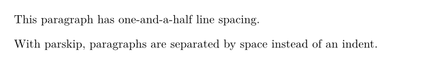
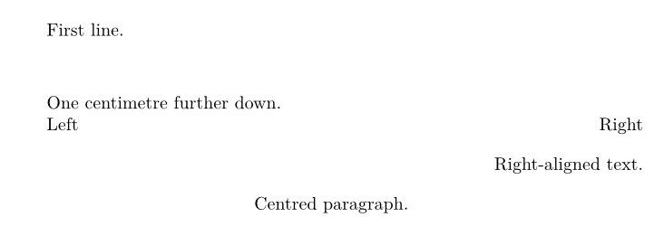
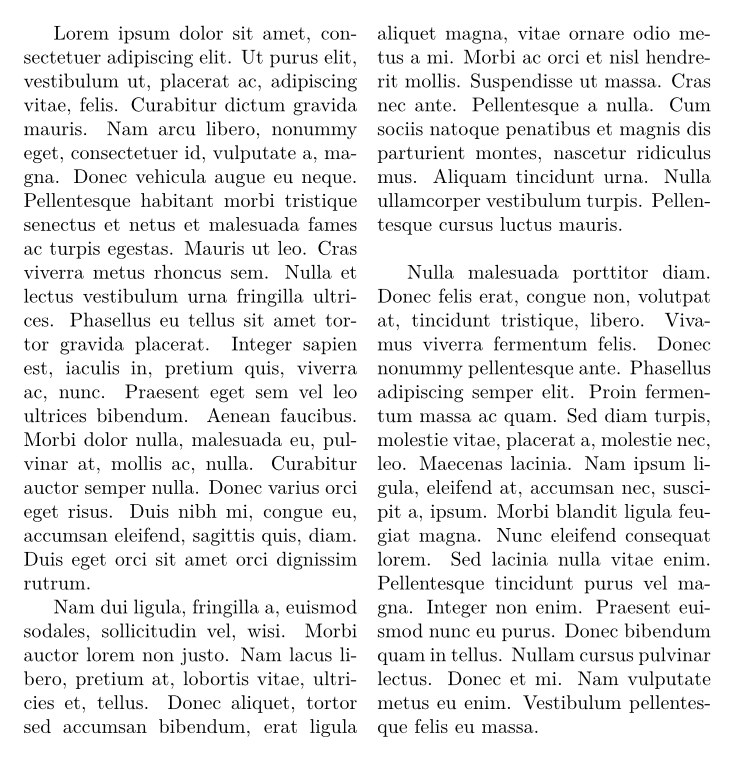
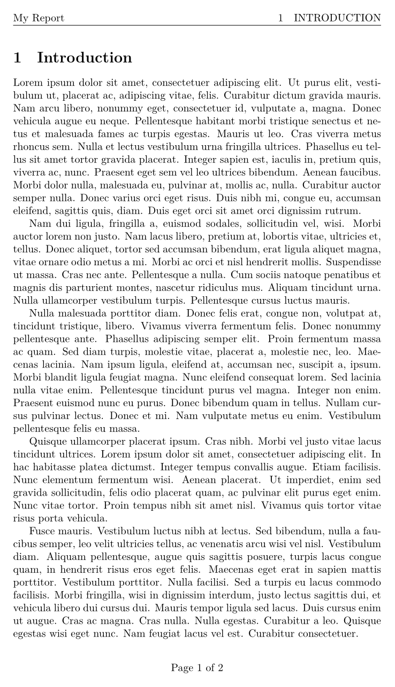
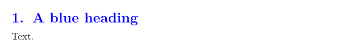
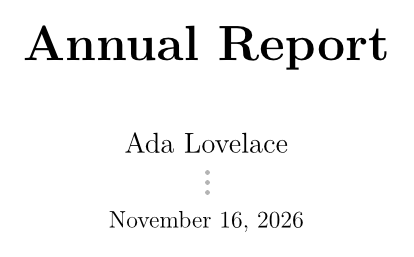
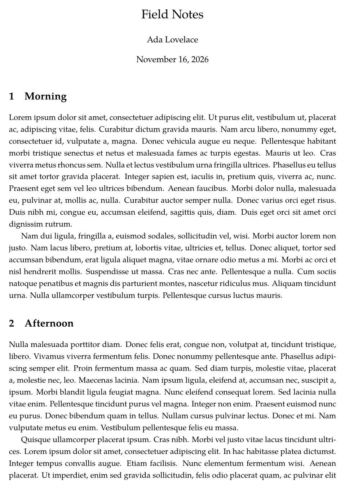

# LaTeX: page layout and fonts

LaTeX's defaults look good, but almost every real document changes the margins, the font or the spacing. This guide shows the packages and commands that do it.

## Class options

The first place to change the look is the document class.

```latex
\documentclass[11pt,a4paper,twoside]{article}
```

| Option | What it does |
|---|---|
| `10pt`, `11pt`, `12pt` | Base font size. |
| `a4paper`, `letterpaper`, `a5paper` | Paper size. |
| `twocolumn` | Two columns for the whole document. |
| `twoside` | Different left and right pages, for printing. |
| `landscape` | Landscape pages (works best together with `geometry`). |
| `titlepage` | Put the title on its own page. |

## Margins with geometry

The `geometry` package sets paper size and margins in one place.

```latex
\documentclass{article}
\usepackage[a4paper, margin=2.5cm]{geometry}

\begin{document}
Text with 2.5 cm margins on all sides.
\end{document}
```

{ .learn-result loading=lazy }


More options: `top=3cm, bottom=2cm, left=2.5cm, right=2.5cm`, `inner` and `outer` for two-sided documents, `landscape`, and `paperwidth=12cm, paperheight=18cm` for a custom size.

## Fonts with fontspec

Because TypstDrive compiles LaTeX with XeTeX, you can use any OpenType or TrueType font with `fontspec`. Upload the font files to the document or project, then name the files.

```latex
\documentclass{article}
\usepackage{fontspec}
\setmainfont{MyFont-Regular.otf}[
  BoldFont = MyFont-Bold.otf,
  ItalicFont = MyFont-Italic.otf,
]

\begin{document}
Body text in my own font, with \textbf{bold} and \textit{italic}.
\end{document}
```

{ .learn-result loading=lazy }


- `\setmainfont` sets the normal text font, `\setsansfont` the sans-serif font used by `\textsf`, and `\setmonofont` the font used by `\texttt`.
- `\newfontfamily\headingfont{MyHeading.otf}` defines a font you can switch to with `{\headingfont ...}`.
- Fonts that come with TeX Live can be used by their **file name**, without uploading anything. Tectonic cannot look fonts up by their display name, so `\setmainfont{TeX Gyre Pagella}` does not work, but this does:

    ```latex
    \usepackage{fontspec}
    \setmainfont{texgyrepagella}[
      Extension = .otf,
      UprightFont = *-regular,
      BoldFont = *-bold,
      ItalicFont = *-italic,
      BoldItalicFont = *-bolditalic,
    ]
    ```

    Other good choices are `texgyretermes` (like Times), `texgyreheros` (like Helvetica) and `lmroman10` (Latin Modern, the default look). Fonts installed on the server itself cannot be used.

In TypstDrive, picking a font file from **Document files** inserts `\setmainfont{...}` and adds `fontspec` to the preamble for you.

Without `fontspec`, a font package changes everything at once: `\usepackage{libertinus}`, `\usepackage{tgpagella}` or `\usepackage{lmodern}`.

## Line and paragraph spacing

```latex
\documentclass{article}
\usepackage{setspace}
\usepackage{parskip}

\begin{document}
\onehalfspacing
This paragraph has one-and-a-half line spacing.

With parskip, paragraphs are separated by space instead of an indent.
\end{document}
```

{ .learn-result loading=lazy }


- `setspace` gives `\singlespacing`, `\onehalfspacing` and `\doublespacing`.
- `parskip` replaces the first-line indent with a gap between paragraphs.
- To change the indent yourself, use `\setlength{\parindent}{1.5em}` and `\setlength{\parskip}{0.5em}`.
- `\noindent` skips the indent for one paragraph.

## Space and alignment

```latex
First line.

\vspace{1cm}
One centimetre further down.

Left \hfill Right

\begin{flushright}
Right-aligned text.
\end{flushright}

{\centering Centred paragraph.\par}
```

{ .learn-result loading=lazy }


- `\vspace` and `\hspace` add space; `\vfill` and `\hfill` push things apart.
- Units: `pt`, `mm`, `cm`, `in`, `em`, `ex`.
- `center`, `flushleft` and `flushright` environments align text; `\centering` does the same inside a group or float.

## Columns

`twocolumn` in the class switches the whole document. For a part of it, use `multicol`:

```latex
\documentclass{article}
\usepackage{multicol}
\usepackage{lipsum}

\begin{document}
\begin{multicols}{2}
\lipsum[1-3]
\end{multicols}
\end{document}
```

{ .learn-result loading=lazy }


`\lipsum` from the `lipsum` package writes placeholder paragraphs, handy for trying layouts.

## Headers, footers and page numbers

`\pagestyle{plain}` shows only the page number, and `\pagestyle{empty}` shows nothing. For your own headers and footers, use `fancyhdr`:

```latex
\documentclass{article}
\usepackage{fancyhdr}
\usepackage{lastpage}
\usepackage{lipsum}

\pagestyle{fancy}
\fancyhf{}
\fancyhead[L]{My Report}
\fancyhead[R]{\leftmark}
\fancyfoot[C]{Page \thepage\ of \pageref{LastPage}}
\renewcommand{\headrulewidth}{0.4pt}

\begin{document}
\section{Introduction}
\lipsum[1-8]
\end{document}
```

{ .learn-result loading=lazy }


- `L`, `C` and `R` place text on the left, centre and right. With `twoside`, use `LE`, `RO` and so on for even and odd pages.
- `\leftmark` is the current section or chapter title.
- `\thispagestyle{empty}` hides the header and footer on one page, for example the title page.

Page numbers can be Roman for front matter: `\pagenumbering{roman}`, then `\pagenumbering{arabic}` where the main text starts.

## Section headings

The `titlesec` package changes how headings look.

```latex
\documentclass{article}
\usepackage{titlesec}
\usepackage{xcolor}

\titleformat{\section}{\Large\bfseries\color{blue}}{\thesection.}{0.6em}{}
\titlespacing*{\section}{0pt}{2ex}{1ex}

\begin{document}
\section{A blue heading}
Text.
\end{document}
```

{ .learn-result loading=lazy }


## Title pages

For a fully custom title page, use the `titlepage` environment:

```latex
\documentclass{report}

\begin{document}
\begin{titlepage}
  \centering
  \vspace*{4cm}
  {\Huge\bfseries Annual Report\par}
  \vspace{1cm}
  {\Large Ada Lovelace\par}
  \vfill
  {\large \today\par}
\end{titlepage}

\chapter{Introduction}
Text.
\end{document}
```

{ .learn-result loading=lazy }


## Putting it together

```latex
\documentclass[11pt,a4paper]{article}
\usepackage[margin=2.5cm]{geometry}
\usepackage{fontspec}
\setmainfont{texgyrepagella}[
  Extension = .otf,
  UprightFont = *-regular,
  BoldFont = *-bold,
  ItalicFont = *-italic,
]
\usepackage{setspace}
\usepackage{fancyhdr}
\usepackage{lipsum}

\onehalfspacing
\pagestyle{fancy}
\fancyhf{}
\fancyhead[R]{Field Notes}
\fancyfoot[C]{\thepage}

\title{Field Notes}
\author{Ada Lovelace}

\begin{document}
\maketitle
\thispagestyle{empty}

\section{Morning}
\lipsum[1-2]

\section{Afternoon}
\lipsum[3-4]
\end{document}
```

{ .learn-result loading=lazy }


## Next steps

Add pictures and tables in [Images, tables and references](figures.md).
