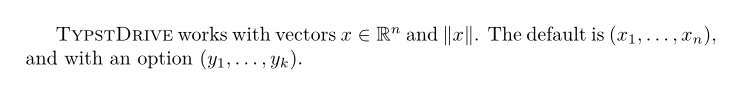
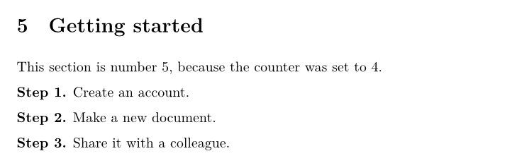
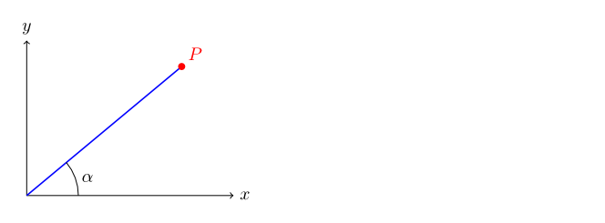
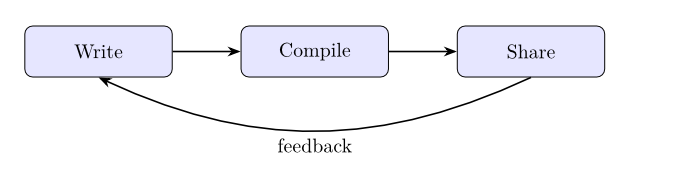
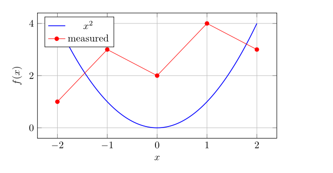
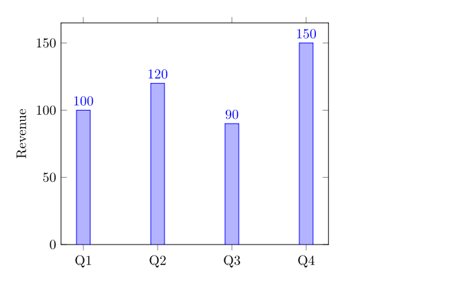
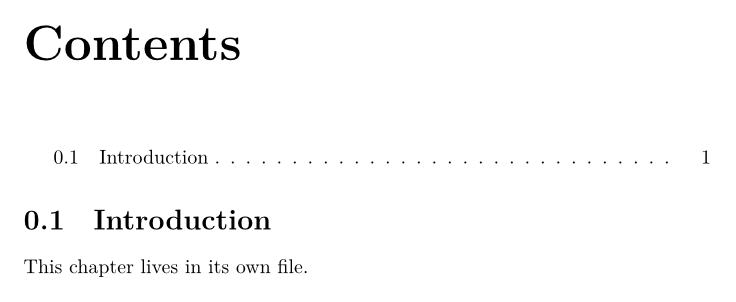
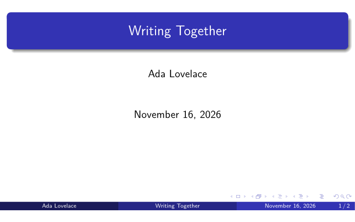

# LaTeX: commands, packages and drawings

Once the basics are in place, LaTeX becomes much more pleasant when you define your own commands, know which packages to reach for, and split large documents into files.

## Your own commands

`\newcommand` saves typing and keeps notation consistent. Define commands in the preamble.

```latex
\documentclass{article}
\usepackage{amsmath,amssymb}

\newcommand{\R}{\mathbb{R}}
\newcommand{\product}{\textsc{TypstDrive}}
\newcommand{\norm}[1]{\left\lVert #1 \right\rVert}
\newcommand{\vect}[2][n]{(#2_1, \ldots, #2_{#1})}

\begin{document}
\product\ works with vectors $x \in \R^n$ and $\norm{x}$.
The default is $\vect{x}$, and with an option $\vect[k]{y}$.
\end{document}
```

{ .learn-result loading=lazy }


- `[1]` says the command takes one argument, used as `#1`.
- `[2][n]` says it takes two arguments and the first is optional, with `n` as its default.
- `\renewcommand` replaces an existing command, for example `\renewcommand{\abstractname}{Summary}`.
- After a command without arguments, use `\ ` or `{}` to keep the following space: `\product\ works`.

## Your own environments

```latex
\documentclass{article}
\usepackage{xcolor}

\newenvironment{note}
  {\par\medskip\noindent\textcolor{blue}{\textbf{Note.}}\ \itshape}
  {\par\medskip}

\begin{document}
\begin{note}
Environments wrap a part of the document in a consistent style.
\end{note}
\end{document}
```

{ .learn-result loading=lazy }


The first group runs at `\begin{note}` and the second at `\end{note}`.

## Counters and lengths

LaTeX keeps a **counter** for every numbered thing, and `\the` followed by its name prints it: `\thesection`, `\thepage`, `\thefigure`. You can change them and make your own.

```latex
\documentclass{article}
\setlength{\parindent}{0pt}
\setlength{\parskip}{0.6em}

\newcounter{step}
\newcommand{\step}[1]{\stepcounter{step}\textbf{Step \thestep.} #1\par}

\begin{document}
\setcounter{section}{4}
\section{Getting started}
This section is number \thesection, because the counter was set to 4.

\step{Create an account.}
\step{Make a new document.}
\step{Share it with a colleague.}
\end{document}
```

{ .learn-result loading=lazy }


- `\newcounter{step}` creates a counter, `\stepcounter{step}` adds one, and `\setcounter{step}{0}` resets it.
- **Lengths** such as `\parindent` and `\parskip` are changed with `\setlength`, and `\addtolength` adds to them. Set page dimensions such as `\textwidth` with `geometry` in the preamble instead.

## Useful packages

| Package | What it adds |
|---|---|
| `amsmath`, `amssymb`, `amsthm` | Better math, extra symbols, theorems and proofs. |
| `graphicx` | Images. |
| `booktabs`, `tabularx`, `multirow`, `longtable` | Good-looking, wide, merged and multi-page tables. |
| `geometry` | Paper size and margins. |
| `fontspec` | Any OpenType or TrueType font. |
| `xcolor` | Colours: `\textcolor{red}{...}`, `\colorbox{yellow}{...}`. |
| `hyperref`, `cleveref` | Links, and references that write "Figure 1" for you. |
| `siunitx` | Numbers and units: `\SI{9.81}{\metre\per\second\squared}`, `\num{12345.678}`. |
| `enumitem` | Control over lists: `\begin{enumerate}[label=(\alph*)]`. |
| `csquotes` | Correct quotation marks: `\enquote{...}`. |
| `listings` | Program code with colours. |
| `tikz`, `pgfplots` | Drawings and plots. |
| `lipsum` | Placeholder text: `\lipsum[1-3]`. |

Load only what you need. Some packages must be loaded in a certain order; the most common rule is to load `hyperref` near the end, and `cleveref` after it.

## Drawing with TikZ

TikZ draws diagrams from coordinates. Everything goes in a `tikzpicture` environment.

```latex
\documentclass{article}
\usepackage{tikz}

\begin{document}
\begin{tikzpicture}
  \draw[->] (0,0) -- (4,0) node[right] {$x$};
  \draw[->] (0,0) -- (0,3) node[above] {$y$};
  \draw[thick, blue] (0,0) -- (3,2.5);
  \fill[red] (3,2.5) circle (2pt) node[above right] {$P$};
  \draw (1,0) arc (0:40:1) node[midway, right] {$\alpha$};
\end{tikzpicture}
\end{document}
```

{ .learn-result loading=lazy }


- `\draw` draws lines and shapes, `\fill` fills them, and `node` adds text.
- `--` joins points with straight lines; `circle`, `rectangle` and `arc` draw shapes.
- Options in brackets set colour, thickness and arrows: `[->, thick, red, dashed]`.

### A flow chart

```latex
\documentclass{article}
\usepackage{tikz}
\usetikzlibrary{positioning, arrows.meta}

\begin{document}
\begin{tikzpicture}[
  box/.style={draw, rounded corners, minimum width=2.6cm, minimum height=0.9cm, fill=blue!10},
  arrow/.style={-{Stealth}, thick},
]
  \node[box] (write) {Write};
  \node[box, right=1.2cm of write] (compile) {Compile};
  \node[box, right=1.2cm of compile] (share) {Share};
  \draw[arrow] (write) -- (compile);
  \draw[arrow] (compile) -- (share);
  \draw[arrow] (share.south) to[bend left=25] node[below] {feedback} (write.south);
\end{tikzpicture}
\end{document}
```

{ .learn-result loading=lazy }


## Plots with pgfplots

`pgfplots` draws charts from formulas or data.

```latex
\documentclass{article}
\usepackage{pgfplots}
\pgfplotsset{compat=1.18}

\begin{document}
\begin{tikzpicture}
  \begin{axis}[
      xlabel={$x$}, ylabel={$f(x)$},
      grid=major, legend pos=north west,
      width=10cm, height=6cm,
    ]
    \addplot[blue, thick, domain=-2:2, samples=100] {x^2};
    \addlegendentry{$x^2$}
    \addplot[red, mark=*] coordinates {(-2,1) (-1,3) (0,2) (1,4) (2,3)};
    \addlegendentry{measured}
  \end{axis}
\end{tikzpicture}
\end{document}
```

{ .learn-result loading=lazy }


A bar chart:

```latex
\documentclass{article}
\usepackage{pgfplots}
\pgfplotsset{compat=1.18}

\begin{document}
\begin{tikzpicture}
  \begin{axis}[
      ybar, symbolic x coords={Q1,Q2,Q3,Q4}, xtick=data,
      ylabel={Revenue}, nodes near coords, ymin=0,
    ]
    \addplot coordinates {(Q1,100) (Q2,120) (Q3,90) (Q4,150)};
  \end{axis}
\end{tikzpicture}
\end{document}
```

{ .learn-result loading=lazy }


The first compile that uses TikZ or pgfplots is slower while the packages download.

## Splitting a document into files

Create a **LaTeX project** for anything longer than a few pages, and put each chapter in its own file.

`chapters/intro.tex`:

```latex
\section{Introduction}
This chapter lives in its own file.
```

`main.tex`:

```latex
\documentclass{report}
\usepackage{graphicx}

\begin{document}
\tableofcontents
\input{chapters/intro}
\end{document}
```

{ .learn-result loading=lazy }


- `\input{file}` pastes the file in place. Leave out `.tex`.
- `\include{file}` does the same but starts a new page, and is meant for chapters in books and theses.
- Paths are relative to the main file. Images in subfolders are found with their path, such as `\includegraphics{figures/plot.pdf}`, or by adding `\graphicspath{{figures/}}` to the preamble.
- Your own `.sty` package and `.cls` class files work too: upload `mystyle.sty` and write `\usepackage{mystyle}`.

## Slides with beamer

```latex
\documentclass{beamer}
\usetheme{Madrid}

\title{Writing Together}
\author{Ada Lovelace}

\begin{document}
\frame{\titlepage}

\begin{frame}{Why collaborate?}
  \begin{itemize}
    \item<1-> Faster feedback
    \item<2-> Fewer copies of the same file
    \item<3-> Everyone sees the latest version
  \end{itemize}
\end{frame}
\end{document}
```

{ .learn-result loading=lazy }


`<2->` reveals an item from the second step on. TypstDrive's presentation mode shows the resulting pages as slides.

## What does not work in TypstDrive

- **Shell escape** is always off, so `minted`, `\write18`, `svg` and `gnuplot` integration do not work. Use `listings` instead of `minted`.
- **Biber** is not available. Use BibLaTeX with `backend=bibtex`.
- **pdfLaTeX-only packages** may fail, because the engine is XeTeX. `inputenc` and `fontenc` are not needed.

See [LaTeX documents](../../guide/latex.md) for everything about the LaTeX editor in TypstDrive.
