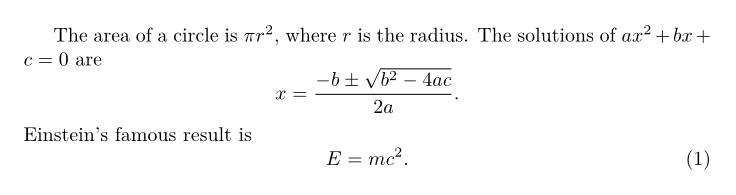
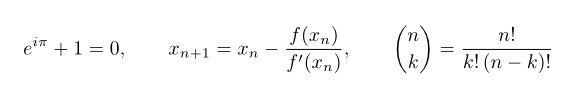
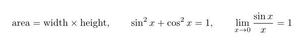
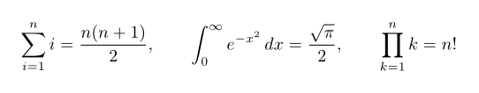
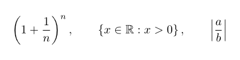
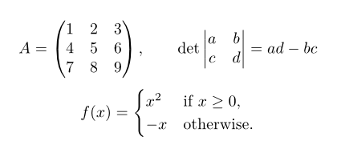
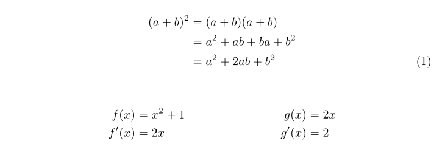
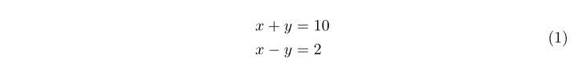
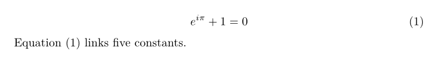
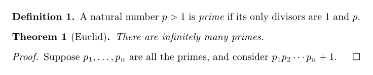

# LaTeX: math

Mathematics is what LaTeX is famous for. Load `amsmath` in every document with formulas; it adds the environments used on this page.

```latex
\usepackage{amsmath}
\usepackage{amssymb}
```

`amssymb` adds extra symbols such as `\mathbb{R}`. In TypstDrive, inserting a command that needs `amsmath` from the toolbar adds it for you.

## Inline and display math

- `$...$` or `\(...\)` puts a formula inside the text.
- `\[...\]` puts it on its own line, centred and unnumbered.
- `\begin{equation}...\end{equation}` puts it on its own line with a number.

```latex
The area of a circle is $\pi r^2$, where $r$ is the radius.
The solutions of $ax^2 + bx + c = 0$ are
\[
  x = \frac{-b \pm \sqrt{b^2 - 4ac}}{2a}.
\]
Einstein's famous result is
\begin{equation}
  E = mc^2.
\end{equation}
```

{ .learn-result loading=lazy }


Do not leave empty lines inside math; that is an error.

## Superscripts, subscripts and fractions

| You type | Meaning |
|---|---|
| `x^2` | superscript |
| `x_i` | subscript |
| `x_{i+1}^{2n}` | use braces for more than one character |
| `\frac{a}{b}` | a fraction |
| `\dfrac{a}{b}`, `\tfrac{a}{b}` | a full-size or small fraction |
| `\sqrt{x}`, `\sqrt[3]{x}` | square and cube root |
| `\binom{n}{k}` | binomial coefficient |

```latex
\[
  e^{i\pi} + 1 = 0, \qquad
  x_{n+1} = x_n - \frac{f(x_n)}{f'(x_n)}, \qquad
  \binom{n}{k} = \frac{n!}{k!\,(n-k)!}
\]
```

{ .learn-result loading=lazy }


## Greek letters and symbols

Greek letters: `\alpha`, `\beta`, `\gamma`, `\delta`, `\epsilon`, `\varepsilon`, `\theta`, `\lambda`, `\mu`, `\pi`, `\sigma`, `\phi`, `\omega`, and capitals `\Gamma`, `\Delta`, `\Sigma`, `\Omega`.

| Symbols | You type |
|---|---|
| ≤ ≥ ≠ ≈ ≡ | `\leq \geq \neq \approx \equiv` |
| × · ÷ ± | `\times \cdot \div \pm` |
| → ⇒ ↔ ↦ | `\to \Rightarrow \leftrightarrow \mapsto` |
| ∞ ∂ ∇ | `\infty \partial \nabla` |
| ∈ ∉ ⊂ ⊆ ∪ ∩ ∅ | `\in \notin \subset \subseteq \cup \cap \emptyset` |
| ∀ ∃ ¬ ∧ ∨ | `\forall \exists \neg \land \lor` |
| ℝ ℕ ℤ ℚ ℂ | `\mathbb{R} \mathbb{N} \mathbb{Z} \mathbb{Q} \mathbb{C}` |
| … ⋯ ⋮ ⋱ | `\ldots \cdots \vdots \ddots` |

Spacing in math is automatic. To add more, use `\,` (thin), `\;` (medium), `\quad` and `\qquad`.

## Text and function names in math

Letters in math are italic variables, and spaces are ignored. Use `\text` for words and the built-in operators for function names:

```latex
\[
  \text{area} = \text{width} \times \text{height}, \qquad
  \sin^2 x + \cos^2 x = 1, \qquad
  \lim_{x \to 0} \frac{\sin x}{x} = 1
\]
```

{ .learn-result loading=lazy }


Built-in names include `\sin`, `\cos`, `\tan`, `\log`, `\ln`, `\exp`, `\max`, `\min`, `\lim`, `\det` and `\gcd`. Define your own in the preamble with `\DeclareMathOperator{\argmax}{arg\,max}`.

## Sums, integrals and products

```latex
\[
  \sum_{i=1}^{n} i = \frac{n(n+1)}{2}, \qquad
  \int_0^\infty e^{-x^2}\,dx = \frac{\sqrt{\pi}}{2}, \qquad
  \prod_{k=1}^{n} k = n!
\]
```

{ .learn-result loading=lazy }


`\,` before `dx` adds the small space that is traditional in integrals. `\iint` and `\oint` give double and contour integrals.

## Brackets that grow

Plain brackets keep their size. Put `\left` and `\right` in front to make them grow with their content.

```latex
\[
  \left( 1 + \frac{1}{n} \right)^n, \qquad
  \left\{ x \in \mathbb{R} : x > 0 \right\}, \qquad
  \left| \frac{a}{b} \right|
\]
```

{ .learn-result loading=lazy }


For a fixed size, use `\big`, `\Big`, `\bigg` and `\Bigg` before the bracket.

## Matrices and cases

```latex
\[
  A = \begin{pmatrix}
    1 & 2 & 3 \\
    4 & 5 & 6 \\
    7 & 8 & 9
  \end{pmatrix}, \qquad
  \det \begin{vmatrix} a & b \\ c & d \end{vmatrix} = ad - bc
\]
\[
  f(x) = \begin{cases}
    x^2 & \text{if } x \geq 0, \\
    -x  & \text{otherwise.}
  \end{cases}
\]
```

{ .learn-result loading=lazy }


`&` separates columns and `\\` ends a row. `pmatrix` uses parentheses, `bmatrix` square brackets, `vmatrix` vertical bars and `matrix` none.

## Accents and styles

| You type | Meaning |
|---|---|
| `\hat{x}`, `\tilde{x}`, `\bar{x}`, `\dot{x}`, `\ddot{x}` | accents |
| `\vec{v}`, `\overrightarrow{AB}` | vector arrows |
| `\overline{a+b}`, `\underline{x}` | lines |
| `\overbrace{a+b}^{\text{sum}}`, `\underbrace{xy}_{\text{product}}` | braces with notes |
| `\mathbf{F}`, `\boldsymbol{\alpha}` | bold letters and bold Greek |
| `\mathrm{d}`, `\mathcal{A}`, `\mathfrak{g}`, `\mathbb{R}` | upright, calligraphic, fraktur, blackboard |

## Several lines

`align` lines up equations at `&` and numbers each line. `align*` does the same without numbers. `\nonumber` hides the number on one line.

```latex
\begin{align}
  (a+b)^2 &= (a+b)(a+b) \nonumber \\
          &= a^2 + ab + ba + b^2 \nonumber \\
          &= a^2 + 2ab + b^2
\end{align}

\begin{align*}
  f(x) &= x^2 + 1 & g(x) &= 2x \\
  f'(x) &= 2x     & g'(x) &= 2
\end{align*}
```

{ .learn-result loading=lazy }


Other environments from `amsmath`:

- `gather` centres several equations without aligning them.
- `multline` splits one long equation over lines.
- `aligned`, inside `\[...\]` or `equation`, gives one number to a block of aligned lines.

```latex
\begin{equation}
  \begin{aligned}
    x + y &= 10 \\
    x - y &= 2
  \end{aligned}
\end{equation}
```

{ .learn-result loading=lazy }


## Numbering and references

Label an equation and refer to it with `\eqref`, which adds the parentheses.

```latex
\begin{equation}
  e^{i\pi} + 1 = 0
  \label{eq:euler}
\end{equation}
Equation~\eqref{eq:euler} links five constants.
```

{ .learn-result loading=lazy }


To number equations by section, add `\numberwithin{equation}{section}` to the preamble.

## Theorems and proofs

`amsthm` adds theorem-like environments. Declare them once in the preamble.

```latex
\documentclass{article}
\usepackage{amsmath,amssymb,amsthm}
\newtheorem{theorem}{Theorem}
\newtheorem{lemma}[theorem]{Lemma}
\theoremstyle{definition}
\newtheorem{definition}{Definition}

\begin{document}
\begin{definition}
A natural number $p > 1$ is \emph{prime} if its only divisors are $1$ and $p$.
\end{definition}

\begin{theorem}[Euclid]
There are infinitely many primes.
\end{theorem}

\begin{proof}
Suppose $p_1, \ldots, p_n$ are all the primes, and consider $p_1 p_2 \cdots p_n + 1$.
\end{proof}
\end{document}
```

{ .learn-result loading=lazy }


## Common mistakes

| Problem | Fix |
|---|---|
| `Missing $ inserted` | `_` or `^` was used outside math. Wrap it in `$...$` or escape it as `\_`. |
| A superscript only covers one character | Use braces: `x^{10}`, not `x^10`. |
| Words in math run together in italics | Use `\text{...}`. |
| `Undefined control sequence \text` | Load `amsmath`. |
| `Display math should end with $$` | Use `\[...\]` instead of `$$...$$`. |

## Next steps

Change paper, fonts and spacing in [Page layout and fonts](layout.md).
