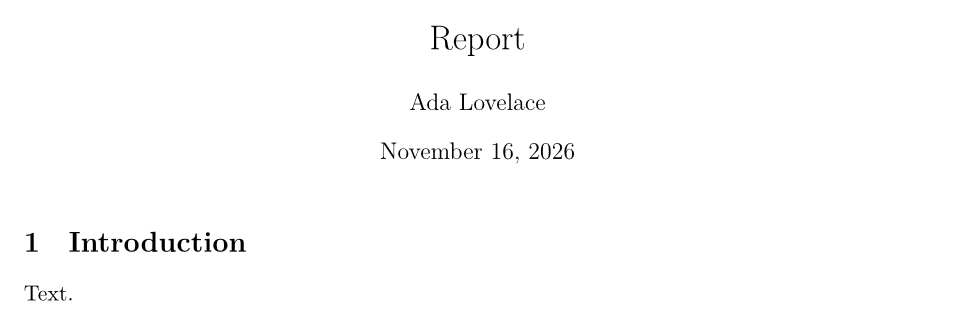
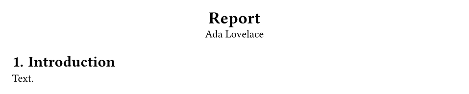
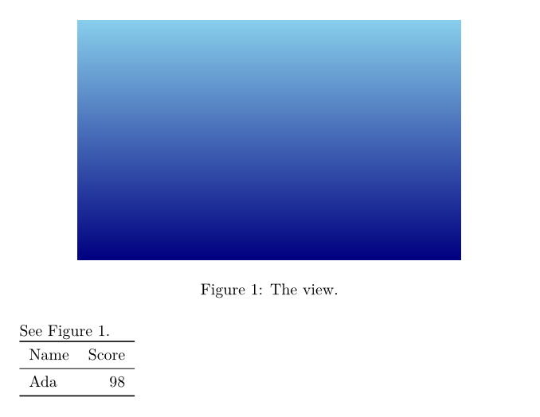
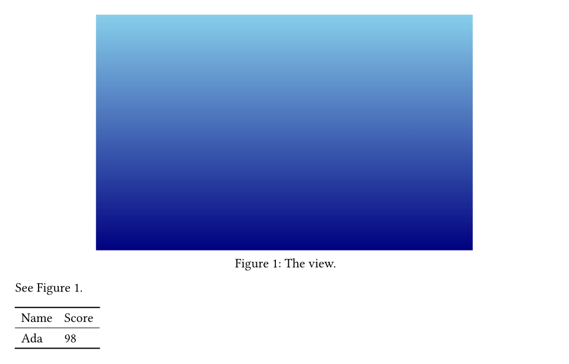

# Typst for LaTeX users

If you know LaTeX, you already know most of the ideas in Typst. This page maps the things you use every day to their Typst equivalents.

## Big differences

- **No preamble boilerplate.** A Typst document can start with text. There is no `\documentclass`, no `\begin{document}` and no packages for basics such as math, images, tables, colours or links.
- **One language.** Markup, styling and scripting are one consistent language, instead of macros, packages and their own option syntaxes.
- **Set and show rules instead of redefinitions.** `#set text(size: 11pt)` replaces class options and `\renewcommand`, and `#show heading: ...` replaces packages like `titlesec`.
- **Instant, single compile.** References, tables of contents and bibliographies are resolved in one run, and the preview updates as you type.
- **Clear errors.** Messages point at the exact spot and say what is wrong.

## Document structure

=== "LaTeX"

    ```latex
    \documentclass[11pt]{article}
    \usepackage[a4paper,margin=2.5cm]{geometry}
    \title{Report}
    \author{Ada Lovelace}
    \begin{document}
    \maketitle
    \section{Introduction}
    Text.
    \end{document}
    ```

    { .learn-result loading=lazy }


=== "Typst"

    ```typst
    #set page(paper: "a4", margin: 2.5cm)
    #set text(size: 11pt)
    #set heading(numbering: "1.")

    #align(center)[
      #text(17pt)[*Report*] \
      Ada Lovelace
    ]

    = Introduction
    Text.
    ```

    { .learn-result loading=lazy }


## Everyday markup

| LaTeX | Typst |
|---|---|
| `\section{Intro}` | `= Intro` |
| `\subsection{Scope}` | `== Scope` |
| `\section*{Intro}` | `#heading(numbering: none)[Intro]` |
| `\emph{text}`, `\textit{text}` | `_text_` |
| `\textbf{text}` | `*text*` |
| `\texttt{text}` | `` `text` `` |
| `\underline{text}` | `#underline[text]` |
| `\textcolor{red}{text}` | `#text(fill: red)[text]` |
| `{\large text}` | `#text(size: 14pt)[text]` |
| `\begin{itemize} \item A \end{itemize}` | `- A` |
| `\begin{enumerate} \item A \end{enumerate}` | `+ A` |
| `\begin{description} \item[T] D \end{description}` | `/ T: D` |
| `\\` | `\` |
| `\newpage` | `#pagebreak()` |
| `\vspace{1cm}`, `\hfill` | `#v(1cm)`, `#h(1fr)` |
| `\begin{center} ... \end{center}` | `#align(center)[...]` |
| `\footnote{...}` | `#footnote[...]` |
| `\url{...}`, `\href{url}{text}` | `https://...`, `#link("url")[text]` |
| `\verb|x|`, `verbatim` | `` `x` ``, ```` ``` ```` blocks |
| `% comment` | `// comment` |
| `\tableofcontents` | `#outline()` |
| `\today` | `#datetime.today().display()` |

## Math

Math in Typst uses names instead of backslash commands, and parentheses instead of braces.

| LaTeX | Typst |
|---|---|
| `$x^2$` | `$x^2$` |
| `\[ x^2 \]` | `$ x^2 $` (spaces inside) |
| `x_{i+1}` | `x_(i+1)` |
| `\frac{a}{b}` | `a/b` or `frac(a, b)` |
| `\sqrt{x}`, `\sqrt[3]{x}` | `sqrt(x)`, `root(3, x)` |
| `\alpha`, `\Gamma` | `alpha`, `Gamma` |
| `\leq`, `\neq`, `\to`, `\Rightarrow` | `<=`, `!=`, `->`, `=>` |
| `\infty`, `\pm`, `\times`, `\cdot` | `oo`, `plus.minus`, `times`, `dot` |
| `\mathbb{R}` | `RR` |
| `\mathbf{F}`, `\mathcal{A}` | `bold(F)`, `cal(A)` |
| `\text{if}` | `"if"` |
| `\sum_{i=1}^n`, `\int_0^1` | `sum_(i=1)^n`, `integral_0^1` |
| `\left( ... \right)` | `( ... )` (grows automatically) |
| `\begin{pmatrix} 1 & 2 \\ 3 & 4 \end{pmatrix}` | `mat(1, 2; 3, 4)` |
| `\begin{cases} ... \end{cases}` | `cases(...)` |
| `\begin{align} a &= b \\ &= c \end{align}` | `$ a &= b \ &= c $` |
| `\label{eq:x}` and `\eqref{eq:x}` | `<eq:x>` and `@eq:x` |
| `\hat{x}`, `\vec{v}`, `\overline{x}` | `hat(x)`, `arrow(v)`, `overline(x)` |

## Figures, tables and references

=== "LaTeX"

    ```latex
    \begin{figure}[htbp]
      \centering
      \includegraphics[width=0.7\linewidth]{photo.jpg}
      \caption{The view.}
      \label{fig:view}
    \end{figure}
    See Figure~\ref{fig:view}.

    \begin{tabular}{lr}
      \toprule
      Name & Score \\
      \midrule
      Ada & 98 \\
      \bottomrule
    \end{tabular}
    ```

    { .learn-result loading=lazy }


=== "Typst"

    ```typst
    #figure(
      image("photo.jpg", width: 70%),
      caption: [The view.],
    ) <fig:view>
    See @fig:view.

    #table(
      columns: 2,
      stroke: none,
      table.hline(),
      table.header([Name], [Score]),
      table.hline(stroke: 0.5pt),
      [Ada], [98],
      table.hline(),
    )
    ```

    { .learn-result loading=lazy }


## Bibliographies

| LaTeX | Typst |
|---|---|
| `\cite{knuth1984}` | `@knuth1984` |
| `\cite[p.~7]{knuth1984}` | `@knuth1984[p. 7]` |
| `\citet{knuth1984}` | `#cite(<knuth1984>, form: "prose")` |
| `\bibliographystyle{ieeetr}` `\bibliography{refs}` | `#bibliography("refs.bib", style: "ieee")` |

Typst reads the same `.bib` files, so you can keep your existing bibliography.

## Customisation

| LaTeX | Typst |
|---|---|
| `\documentclass[12pt]{article}` | `#set text(size: 12pt)` |
| `\usepackage[margin=2cm]{geometry}` | `#set page(margin: 2cm)` |
| `\usepackage{fontspec} \setmainfont{X}` | `#set text(font: "X")` |
| `\setlength{\parindent}{1em}` | `#set par(first-line-indent: 1em)` |
| `\usepackage{setspace} \onehalfspacing` | `#set par(leading: 1em)` |
| `\pagenumbering{roman}` | `#set page(numbering: "i")` |
| `\usepackage{fancyhdr}` | `#set page(header: [...], footer: [...])` |
| `\usepackage{titlesec}` | `#show heading: ...` |
| `\newcommand{\R}{\mathbb{R}}` | `#let R = $RR$` |
| `\newcommand{\note}[1]{...}` | `#let note(body) = ...` |
| `\input{chapter}` | `#include "chapter.typ"` |
| Packages from CTAN | `#import "@preview/name:version"` from Typst Universe |
| A document class | A template function used with `#show: template.with(...)` |

## Moving a document from LaTeX to Typst

TypstDrive can convert a `.tex` file to Typst for you: choose **New → Import** in the drive and pick the file. The conversion uses Pandoc and handles text, headings, lists, emphasis, math, tables and links; custom macros and complex layouts need some manual work afterwards.

If you have to keep a document in LaTeX, for example for a journal, you can keep writing it in TypstDrive as a LaTeX document. See [LaTeX documents](../guide/latex.md).
