# Typst: the basics

A Typst document is plain text. Most of it is just the words you want on the page, with a few marks for headings, emphasis and lists. This page covers everything you need to write a complete, well-structured document.

## Paragraphs and line breaks

Type normally. A single line break inside a paragraph is ignored, so you can break long lines wherever you like. An empty line starts a new paragraph.

```typst
This is the first paragraph. It continues
on this line, and Typst joins the lines together.

This is a second paragraph.

To force a line break without starting a new paragraph, \
end the line with a backslash.
```

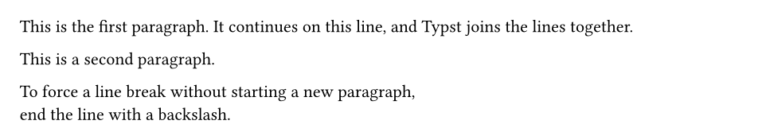{ .learn-result loading=lazy }


## Headings

Start a line with `=` signs. One `=` is the biggest heading, and each extra `=` makes a smaller one.

```typst
= Introduction
Typst is a markup language for documents.

== Background
Some history.

=== A small detail
Headings can go as deep as you need.
```

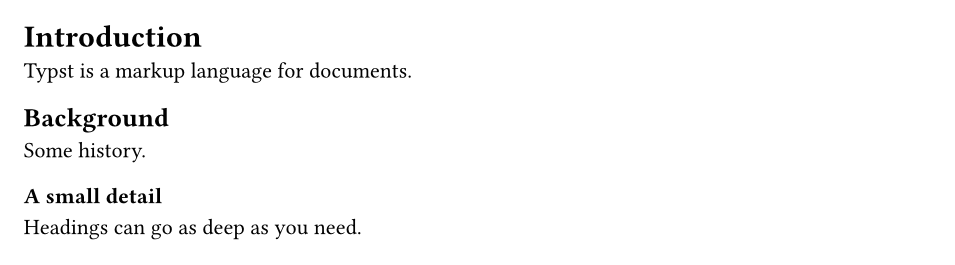{ .learn-result loading=lazy }


Headings are not numbered by default. Add `#set heading(numbering: "1.")` at the top to number them. See [Page layout and styling](layout.md).

## Emphasis

| You type | You get |
|---|---|
| `*bold*` | **bold** |
| `_italic_` | *italic* |
| `*_bold italic_*` | ***bold italic*** |
| `` `code` `` | `code` |
| `#underline[underlined]` | underlined |
| `#strike[crossed out]` | ~~crossed out~~ |
| `#text(fill: red)[red text]` | red text |
| `#smallcaps[Small Caps]` | Small capitals |
| `H#sub[2]O` and `x#super[2]` | subscript and superscript in text |

```typst
Typst makes *important words* stand out and _titles of books_ slant.
You can *mix _both_ styles*, write `inline code`, and
#text(fill: blue, weight: "bold")[colour a phrase].
```

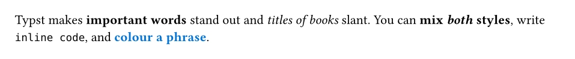{ .learn-result loading=lazy }


`*` and `_` only work at the start and end of a word. To make part of a word bold, use the function form: `un#strong[believ]able`.

## Lists

Use `-` for bullet points and `+` for numbered items. Indent with spaces to nest a list inside another.

```typst
- Fruit
  - Apples
  - Pears
- Vegetables

+ Preheat the oven.
+ Mix the ingredients.
  + Flour first.
  + Then eggs.
+ Bake for 30 minutes.
```

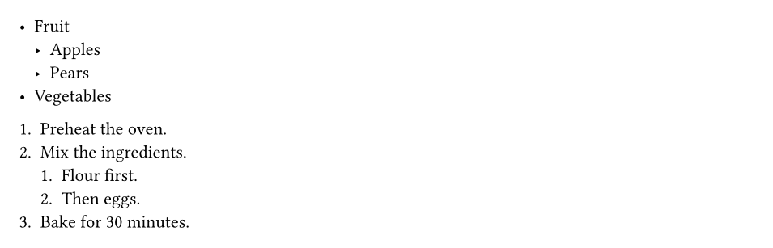{ .learn-result loading=lazy }


Numbered items count automatically. To start from another number, write the number yourself: `5. Fifth step`.

A **term list** pairs a word with its explanation:

```typst
/ Compiler: A program that turns source text into a document.
/ Preview: The live view of your pages next to the editor.
```

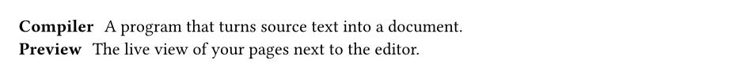{ .learn-result loading=lazy }


## Links

Web addresses become links on their own. Use `#link` for a link with different text.

```typst
Visit https://typst.app for the official documentation.

Read the #link("https://typst.app/docs/tutorial/")[Typst tutorial] next.

Write to #link("mailto:team@example.com")[the team].
```

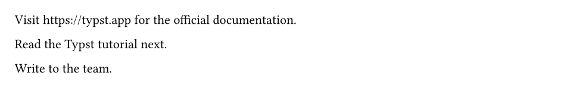{ .learn-result loading=lazy }


## Code and raw text

Backticks show text exactly as written, in a monospace font. Three backticks make a block, and a language name after them adds syntax colours.

````typst
Run `npm install` in the terminal.

```python
def greet(name):
    return f"Hello, {name}!"
```
````

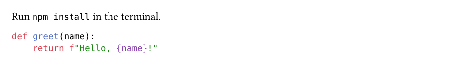{ .learn-result loading=lazy }


## Comments

Comments are notes for you. They never appear in the document.

```typst
// A comment runs to the end of the line.
This text is visible. // So is this, but not the comment.

/* A block comment
   can span several lines. */
```

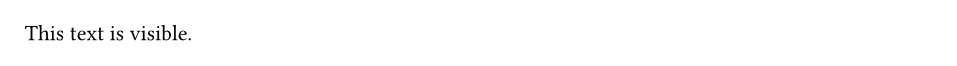{ .learn-result loading=lazy }


In TypstDrive, press ++ctrl+slash++ to turn the selected lines into comments and back.

## Special characters

Some characters have a meaning in Typst: `*`, `_`, `` ` ``, `#`, `$`, `=`, `-`, `+`, `/`, `<`, `>`, `@` and `\`. Put a backslash in front to type them literally.

```typst
The price is \$20 and the discount is 10\%.
Use \#hashtags and \*stars\* freely.
Email me at someone\@example.com.
```

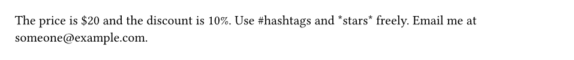{ .learn-result loading=lazy }


Typst also turns some character pairs into nicer symbols:

| You type | You get |
|---|---|
| `--` | an en dash, as in 1990–2000 |
| `---` | an em dash — like this |
| `...` | an ellipsis … |
| `"quotes"` and `'quotes'` | curly quotes, matched to the text language |
| `~` | a space that never breaks a line, as in `Fig.~1` |

## Functions

Everything beyond plain markup is a **function**, written with `#`, its name, and arguments in parentheses. Text that the function works on goes in square brackets.

```typst
#align(center)[This line is centred.]

#rect(width: 100%, fill: luma(235), inset: 10pt)[
  A grey box with some padding.
]

#lorem(30)
```

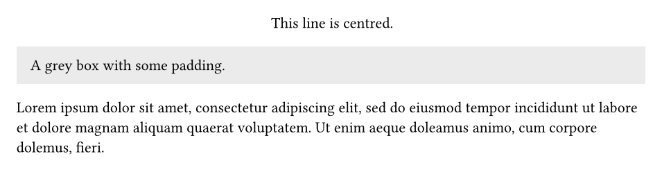{ .learn-result loading=lazy }


- Arguments in parentheses have a name and a value: `width: 100%`.
- Square brackets hold **content**: markup, just like the rest of your document.
- `#lorem(30)` writes 30 words of placeholder text, handy for trying out layouts.

You will meet many more functions in the next guides: `#set` and `#show` rules to change styles, `#image` and `#table` for media, and `#let` to make your own.

## A complete first document

```typst
#set document(title: "My first report", author: "Ada Lovelace")
#set page(paper: "a4", margin: 2.5cm, numbering: "1")
#set text(size: 11pt)
#set par(justify: true)
#set heading(numbering: "1.")

#align(center)[
  #text(size: 20pt, weight: "bold")[My first report]

  Ada Lovelace \
  #datetime.today().display("[day] [month repr:long] [year]")
]

#outline()

= Introduction
This report shows the *basics* of Typst: headings, _emphasis_,
lists and links such as https://typst.app.

= Method
+ Write the text.
+ Watch the preview.
+ Share the result.

= Conclusion
#lorem(40)
```

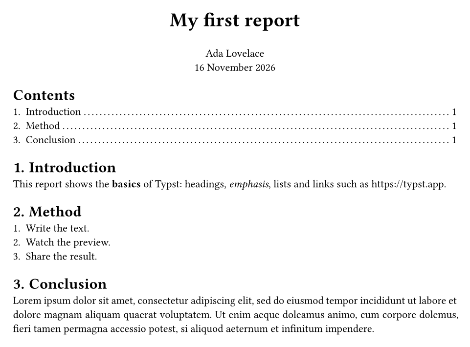{ .learn-result loading=lazy }


## Next steps

- Write formulas in [Math](math.md).
- Change the look of the whole document in [Page layout and styling](layout.md).
