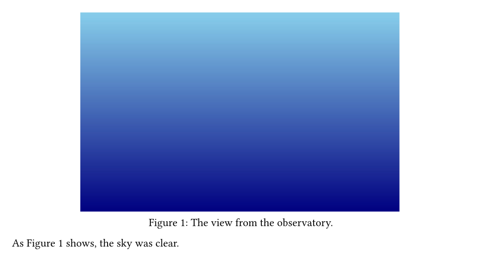
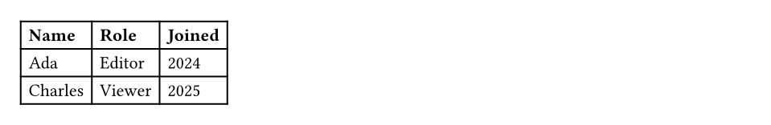
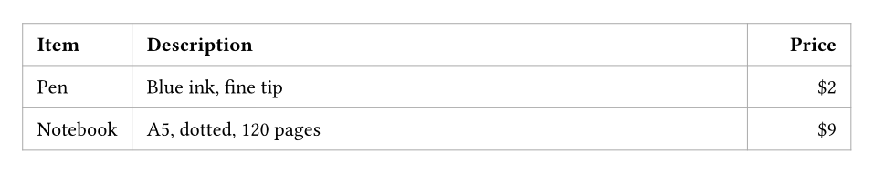
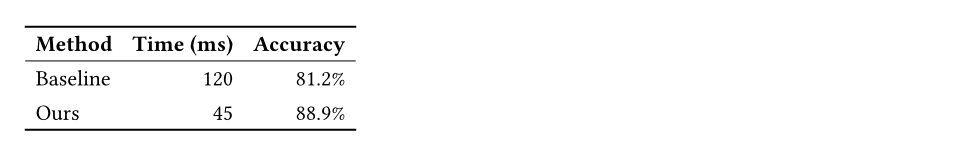
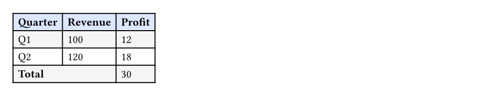
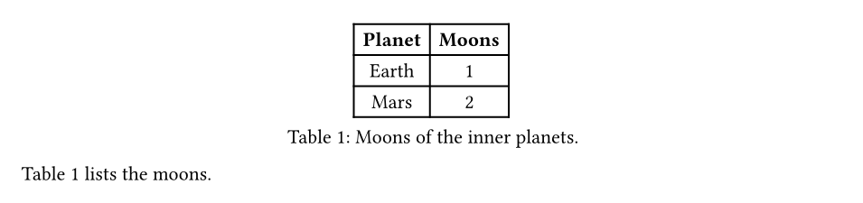
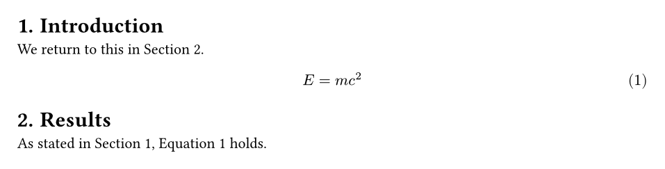
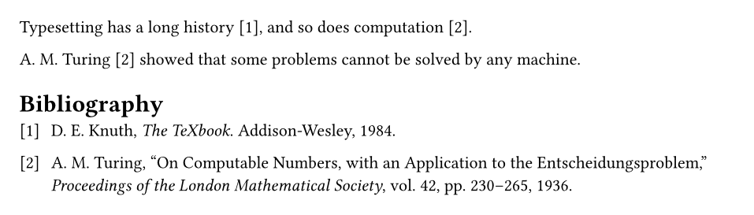

# Typst: images, tables and references

This guide covers everything that is not plain text: pictures, tables, figures with captions, cross-references, footnotes and bibliographies.

## Images

Upload the picture first: in a document, use **Document files** or **Upload image** in the toolbar; in a project, add it to the file tree. Then use its file name.

```typst
#image("photo.jpg", width: 80%)
```

{ .learn-result loading=lazy }


| Argument | What it does | Examples |
|---|---|---|
| `width` | Width, as a length or a share of the text width. | `8cm`, `60%` |
| `height` | Height. Give only one of width and height to keep the proportions. | `5cm` |
| `fit` | What to do when both are given. | `"cover"`, `"contain"`, `"stretch"` |
| `alt` | A description for screen readers. | `"A red bicycle"` |

PNG, JPG, GIF, WebP, SVG and PDF files all work. In TypstDrive, typing `/image` opens a picker with every picture you can use.

## Figures and captions

Wrap an image in `#figure` to give it a caption and a number. Add a **label** in angle brackets after it, so you can refer to it.

```typst
#figure(
  image("photo.jpg", width: 70%),
  caption: [The view from the observatory.],
) <observatory>

As @observatory shows, the sky was clear.
```

{ .learn-result loading=lazy }


`@observatory` prints "Figure 1", with the right number, and becomes a link in the PDF. Labels can contain letters, digits, `-`, `_`, `:` and `.`, so names like `<fig:observatory>` are common.

Figures float freely by default. To let Typst move a figure to the top or bottom of a page, add `placement: auto`.

## Tables

Give `#table` the number of columns, then list the cells row by row.

```typst
#table(
  columns: 3,
  [*Name*], [*Role*], [*Joined*],
  [Ada], [Editor], [2024],
  [Charles], [Viewer], [2025],
)
```

{ .learn-result loading=lazy }


Columns can have their own widths: `auto` fits the content, a length is fixed, and `fr` shares the remaining space.

```typst
#table(
  columns: (auto, 1fr, 2cm),
  align: (left, left, right),
  inset: 8pt,
  stroke: 0.5pt + gray,
  table.header([*Item*], [*Description*], [*Price*]),
  [Pen], [Blue ink, fine tip], [\$2],
  [Notebook], [A5, dotted, 120 pages], [\$9],
)
```

{ .learn-result loading=lazy }


- `table.header` marks the header row. It is repeated at the top of every page when a long table breaks.
- `align` takes one alignment for all cells, or one per column.
- `stroke: none` removes all lines.

### A clean, book-style table

```typst
#table(
  columns: 3,
  stroke: none,
  align: (left, right, right),
  table.hline(),
  table.header([*Method*], [*Time (ms)*], [*Accuracy*]),
  table.hline(stroke: 0.5pt),
  [Baseline], [120], [81.2%],
  [Ours], [45], [88.9%],
  table.hline(),
)
```

{ .learn-result loading=lazy }


### Merged cells and colours

```typst
#table(
  columns: 3,
  fill: (x, y) => if y == 0 { rgb("#dde7ff") } else if calc.odd(y) { luma(245) },
  table.header([*Quarter*], [*Revenue*], [*Profit*]),
  [Q1], [100], [12],
  [Q2], [120], [18],
  table.cell(colspan: 2)[*Total*], [30],
)
```

{ .learn-result loading=lazy }


`fill` can be a function of the column `x` and row `y`, which makes striped rows easy.

### Tables in figures

Wrap a table in `#figure` for a caption. Typst numbers tables separately from images and calls them "Table".

```typst
#figure(
  table(
    columns: 2,
    [*Planet*], [*Moons*],
    [Earth], [1],
    [Mars], [2],
  ),
  caption: [Moons of the inner planets.],
) <moons>

@moons lists the moons.
```

{ .learn-result loading=lazy }


## Cross-references

Anything with a number can be labelled and referenced: headings, figures, tables and equations.

```typst
#set heading(numbering: "1.")
#set math.equation(numbering: "(1)")

= Introduction <intro>
We return to this in @results.

$ E = m c^2 $ <energy>

= Results <results>
As stated in @intro, @energy holds.
```

{ .learn-result loading=lazy }


To change the word before the number, add it in brackets: `@intro[Chapter]`. For a reference without the word, use `#ref(<intro>, supplement: none)`.

## Footnotes

```typst
Typst was first released in 2023.#footnote[The first public beta.]
Footnotes are numbered automatically.#footnote[And placed at the bottom of the page.]
```

{ .learn-result loading=lazy }


## Bibliographies and citations

Upload a BibTeX file (`.bib`) or a Hayagriva file (`.yml`). Then cite entries by their key with `@`, and add `#bibliography` where the list should appear.

A file named `refs.bib`:

```bibtex
@book{knuth1984,
  author    = {Donald E. Knuth},
  title     = {The TeXbook},
  publisher = {Addison-Wesley},
  year      = {1984},
}

@article{turing1936,
  author  = {Alan M. Turing},
  title   = {On Computable Numbers, with an Application to the Entscheidungsproblem},
  journal = {Proceedings of the London Mathematical Society},
  year    = {1936},
  volume  = {42},
  pages   = {230--265},
}
```

The document:

```typst
Typesetting has a long history @knuth1984, and so does
computation @turing1936.

#cite(<turing1936>, form: "prose") showed that some problems
cannot be solved by any machine.

#bibliography("refs.bib", style: "ieee")
```

{ .learn-result loading=lazy }


- Styles include `"ieee"`, `"apa"`, `"chicago-author-date"`, `"mla"`, `"nature"` and many more. You can also upload a `.csl` file and use its name.
- `form: "prose"` writes the author's name into the sentence.
- `@knuth1984[p. 7]` adds a page number to the citation.
- Only cited entries appear in the list. Add `full: true` to `#bibliography` to list everything.

TypstDrive can fill a `.bib` file for you from DOIs, arXiv IDs and Zotero. See [Citations](../../guide/citations.md).

## Next steps

Make the computer do the repetitive work in [Scripting](scripting.md).
