# Typst: page layout and styling

Typst separates **what** you write from **how** it looks. You write the content once, then use `set` rules at the top of the document to choose paper, fonts, spacing and numbering for everything.

## Set rules

A set rule changes the default arguments of a function for the rest of the document, or for the rest of the block it is in.

```typst
#set text(size: 12pt)
#set par(justify: true)

This paragraph is 12 point and justified, and so is
every paragraph after it.

#[
  #set text(fill: blue)
  Only this block is blue.
]

Back to normal.
```

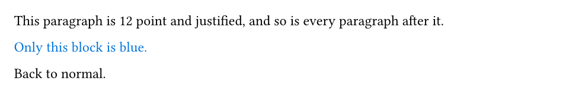{ .learn-result loading=lazy }


Put your set rules at the very top of the document, before any text. In TypstDrive, **Page settings** and the font picker in the toolbar write the most common ones for you.

## The page

```typst
#set page(
  paper: "a4",
  margin: (x: 2.5cm, y: 3cm),
  numbering: "1",
)

#lorem(200)
```

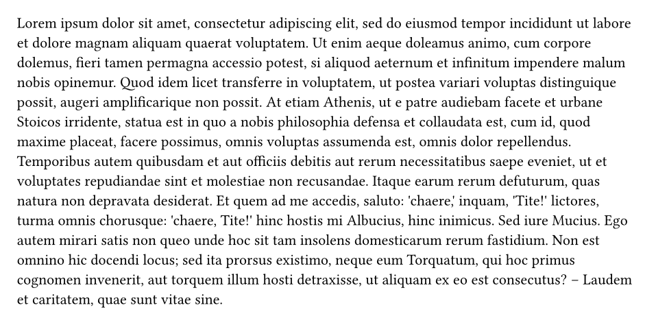{ .learn-result loading=lazy }


| Argument | What it does | Examples |
|---|---|---|
| `paper` | Standard paper size. | `"a4"`, `"us-letter"`, `"a5"`, `"presentation-16-9"` |
| `width`, `height` | A custom size, instead of `paper`. | `width: 12cm, height: 18cm` |
| `flipped` | Landscape. | `flipped: true` |
| `margin` | One value for all sides, or per side. | `2cm`, `(x: 2cm, y: 3cm)`, `(top: 3cm, rest: 2cm)`, `(inside: 3cm, outside: 2cm)` |
| `columns` | Number of columns of text. | `2` |
| `fill` | Background colour. | `rgb("#fdf6e3")`, `none` for transparent |
| `numbering` | Page numbers in the footer. | `"1"`, `"i"`, `"1 / 1"` |
| `number-align` | Where the number goes. | `center`, `right`, `top + right` |

## Text and fonts

```typst
#set text(
  font: "Libertinus Serif",
  size: 11pt,
  lang: "en",
)
```

| Argument | What it does | Examples |
|---|---|---|
| `font` | The font, or a list of fonts to try in order. | `"Libertinus Serif"`, `("Inter", "Noto Sans")` |
| `size` | Font size. | `10pt`, `12pt` |
| `weight` | Thickness. | `"regular"`, `"bold"`, `700` |
| `style` | Slant. | `"italic"` |
| `fill` | Colour. | `red`, `rgb("#1e66f5")`, `luma(80)` |
| `lang` | Language, for hyphenation, quotes and labels like "Figure". | `"en"`, `"de"`, `"fr"` |
| `hyphenate` | Turn hyphenation on or off. | `true`, `false` |

To use your own font in TypstDrive, upload the `.ttf` or `.otf` file, then use the font's name. The font picker in the toolbar lists every font you can use. See [Fonts and images](../../guide/fonts-and-images.md).

## Paragraphs

```typst
#set par(
  justify: true,
  leading: 0.65em,
  spacing: 1.2em,
  first-line-indent: 1.5em,
)

#lorem(60)

#lorem(60)
```

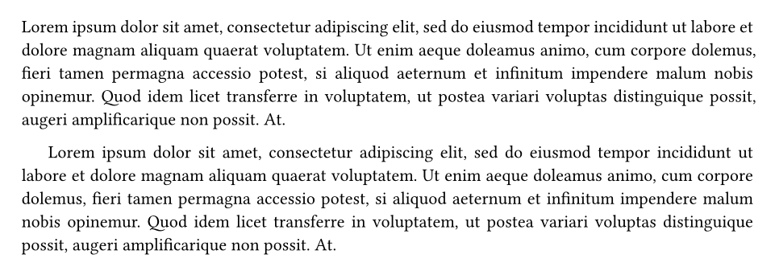{ .learn-result loading=lazy }


- `justify` lines up both edges of the text.
- `leading` is the space between lines in a paragraph.
- `spacing` is the space between paragraphs.
- `first-line-indent` indents the first line of each paragraph after the first.

## Headings and numbering

```typst
#set heading(numbering: "1.1")

= Introduction
== Scope
== Structure
= Results
```

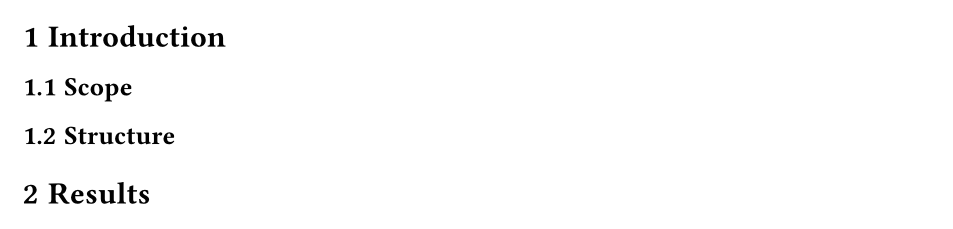{ .learn-result loading=lazy }


Numbering patterns use `1` for numbers, `a` or `A` for letters, `i` or `I` for Roman numerals, and any other characters as they are: `"1."`, `"1.a"`, `"I."`, `"Chapter 1"`.

## Table of contents

```typst
#outline()

= First chapter
== A section
= Second chapter
```

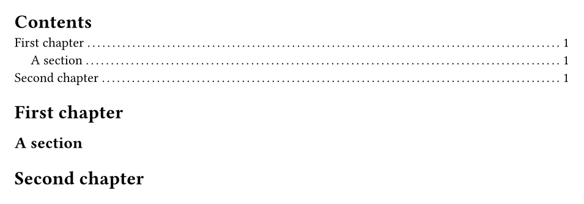{ .learn-result loading=lazy }


Options: `#outline(title: [Contents], depth: 2, indent: auto)`. For a list of figures, use `#outline(title: [Figures], target: figure.where(kind: image))`.

## Alignment

```typst
#align(center)[Centred text]
#align(right)[Right-aligned text]
#align(center + horizon)[Centred both ways in the available space]

#set align(center)
Everything after this is centred.
```

{ .learn-result loading=lazy }


## Spacing

```typst
First line.
#v(2cm)
Two centimetres further down.

Left #h(1fr) Right

Left #h(1fr) Middle #h(1fr) Right
```

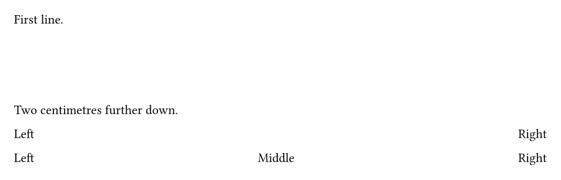{ .learn-result loading=lazy }


- `#v` adds vertical space, `#h` adds horizontal space.
- `1fr` means "one share of the remaining space", so `#h(1fr)` pushes things to the far edge.
- Lengths can be `pt`, `mm`, `cm`, `in` or `em` (relative to the font size).

## Page breaks

```typst
First page.
#pagebreak()
Second page.
#pagebreak(to: "odd")
Next odd page, for chapters in a printed book.
```

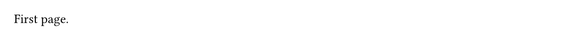{ .learn-result loading=lazy }


## Columns and grids

Two columns for the whole document:

```typst
#set page(columns: 2)
#lorem(300)
```

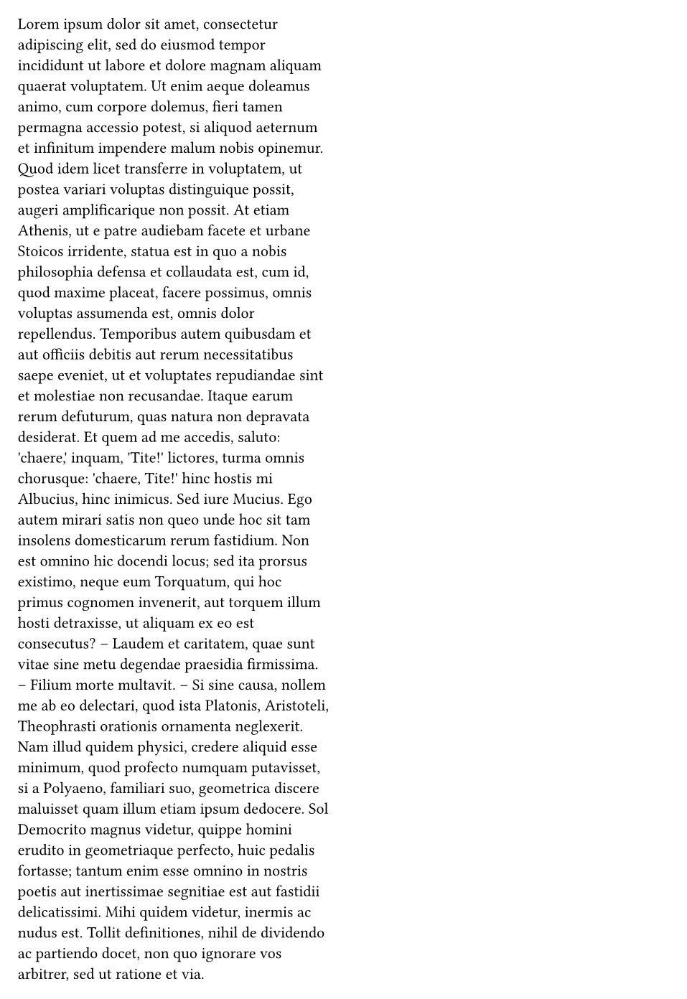{ .learn-result loading=lazy }


Or only for part of it:

```typst
#columns(2, gutter: 1cm)[
  #lorem(80)
  #colbreak()
  #lorem(40)
]
```

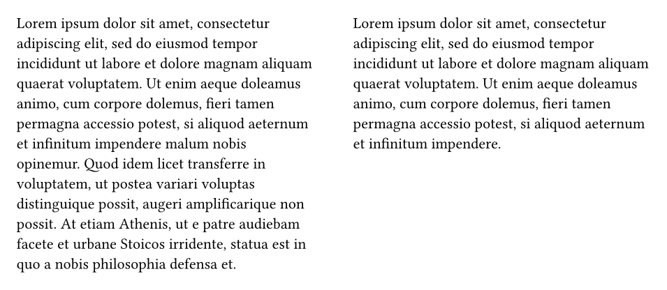{ .learn-result loading=lazy }


`#grid` places content in cells without borders, perfect for side-by-side layouts:

```typst
#grid(
  columns: (1fr, 2fr),
  gutter: 1em,
  rect(width: 100%, fill: luma(230))[Narrow column],
  rect(width: 100%, fill: luma(230))[Wide column with more room for text.],
)
```

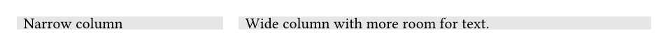{ .learn-result loading=lazy }


## Boxes and blocks

`#block` is a box that takes the full width and can break across pages. `#box` sits inside a line of text.

```typst
#block(
  fill: rgb("#eef4ff"),
  stroke: (left: 3pt + rgb("#1e66f5")),
  inset: 12pt,
  radius: 4pt,
  width: 100%,
)[
  *Note:* blocks are great for callouts and warnings.
]

Inline #box(fill: yellow, inset: 2pt)[highlighted] word.
```

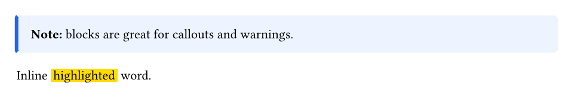{ .learn-result loading=lazy }


`#rect`, `#circle` and `#ellipse` draw shapes, and `#line(length: 100%)` draws a horizontal rule.

## Headers and footers

`header` and `footer` take any content. Page numbers are read with `counter(page)`, inside `context` because the number depends on where the content ends up.

```typst
#set page(
  header: [
    _My Report_
    #h(1fr)
    Draft
  ],
  footer: context [
    #h(1fr)
    Page #counter(page).display() of #counter(page).final().first()
    #h(1fr)
  ],
)

#lorem(400)
```

{ .learn-result loading=lazy }


To hide the header on the first page:

```typst
#set page(header: context {
  if counter(page).get().first() > 1 [
    _My Report_ #h(1fr) Draft
  ]
})

#lorem(600)
```

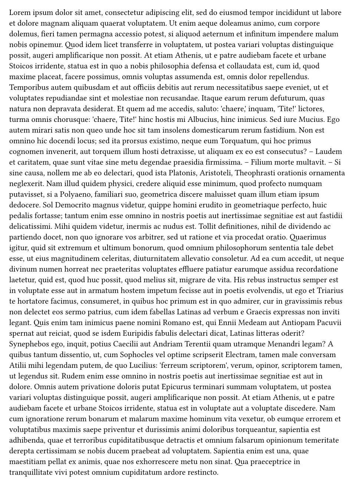{ .learn-result loading=lazy }


## Placing things anywhere

`#place` puts content at a fixed position without moving the text around it.

```typst
#place(top + right, dx: -1cm, dy: 1cm)[
  #text(fill: red, weight: "bold")[DRAFT]
]

#lorem(80)
```

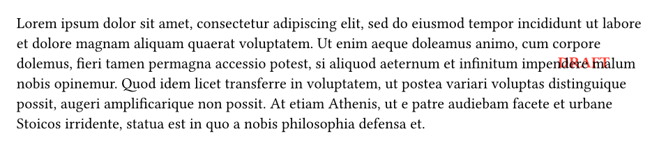{ .learn-result loading=lazy }


## Document information

```typst
#set document(
  title: "Annual Report 2026",
  author: ("Ada Lovelace", "Charles Babbage"),
  keywords: ("report", "finance"),
)
```

This fills in the PDF's title, authors and keywords, which PDF readers and search engines show.

## Putting it together

```typst
#set document(title: "Field Notes", author: "Ada Lovelace")
#set page(
  paper: "a5",
  margin: (inside: 2.5cm, outside: 1.8cm, y: 2cm),
  numbering: "1",
  number-align: center,
)
#set text(font: "Libertinus Serif", size: 10.5pt, lang: "en")
#set par(justify: true, first-line-indent: 1.2em, spacing: 0.8em)
#set heading(numbering: "1.")

#align(center + horizon)[
  #text(size: 24pt, weight: "bold")[Field Notes]
  #v(0.5em)
  Ada Lovelace
]
#pagebreak()

#outline()
#pagebreak()

= Morning
#lorem(150)

= Afternoon
#lorem(150)
```

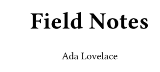{ .learn-result loading=lazy }


## Next steps

Add pictures, tables and references in [Images, tables and references](figures.md).
