# Typst: math

Typst has math built in. You do not need any package, and the syntax is close to how you would read a formula aloud.

## Inline and display math

Put math between dollar signs. Without spaces inside the dollars, the formula stays in the line of text. With a space after the opening dollar and before the closing one, it becomes a **display** formula on its own line, centred.

```typst
The area of a circle is $pi r^2$, where $r$ is the radius.

The solutions of $a x^2 + b x + c = 0$ are

$ x = (-b plus.minus sqrt(b^2 - 4 a c)) / (2 a) $
```

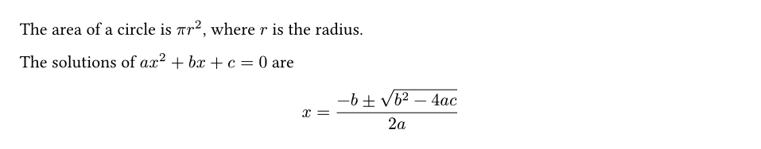{ .learn-result loading=lazy }


## Letters, numbers and spaces

Single letters are variables and are set in italics. Words of two or more letters are looked up as **symbols** or **functions**, so write `$a b$` (with a space) for a product of two variables. `$ab$` is an error, because there is no symbol named `ab`.

```typst
$ a b + 2 a c = a (b + 2 c) $
```

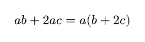{ .learn-result loading=lazy }


To write a word as text inside math, put it in quotes:

```typst
$ "area" = "width" times "height" $
```

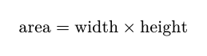{ .learn-result loading=lazy }


## Superscripts, subscripts and fractions

| You type | Meaning |
|---|---|
| `x^2` | superscript |
| `x_i` | subscript |
| `x_(i+1)^(2n)` | use parentheses for more than one character; they are not printed |
| `a/b` | a fraction |
| `(a+b)/(c+d)` | a fraction with longer parts; the outer parentheses disappear |
| `1/2 x` | a fraction followed by a variable |
| `sqrt(x)` and `root(3, x)` | square root and cube root |
| `binom(n, k)` | a binomial coefficient |

```typst
$ e^(i pi) + 1 = 0 $

$ x_(n+1) = x_n - f(x_n) / (f'(x_n)) $

$ binom(n, k) = (n!) / (k! (n - k)!) $
```

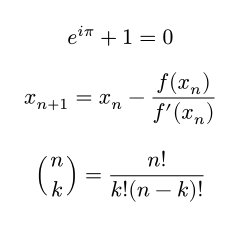{ .learn-result loading=lazy }


## Greek letters and symbols

Greek letters are written by name: `alpha`, `beta`, `gamma`, `delta`, `epsilon`, `theta`, `lambda`, `mu`, `pi`, `sigma`, `phi`, `omega`. Capitalize the first letter for capitals: `Gamma`, `Delta`, `Sigma`, `Omega`.

Many symbols have short forms:

| You type | Symbol |
|---|---|
| `<=`, `>=`, `!=` | less or equal, greater or equal, not equal |
| `->`, `=>`, `<->`, `|->` | arrows |
| `approx`, `prop`, `equiv` | approximately, proportional, equivalent |
| `times`, `dot`, `div` | multiplication and division |
| `plus.minus` | plus or minus |
| `infinity` or `oo` | infinity |
| `in`, `in.not`, `subset`, `subset.eq`, `union`, `sect` | set symbols |
| `forall`, `exists`, `not` | logic |
| `RR`, `NN`, `ZZ`, `QQ`, `CC` | number sets |
| `dots`, `dots.c`, `dots.v` | ellipses |
| `partial`, `nabla` | derivatives |

Symbols can have **variants** joined with dots, for example `arrow.r.double`, `lt.eq.slant` or `plus.circle`. The editor suggests them as you type.

```typst
$ forall epsilon > 0 space exists delta > 0 : |x - a| < delta => |f(x) - f(a)| < epsilon $

$ A union B subset.eq C, quad x in RR, quad n in NN $
```

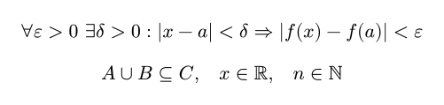{ .learn-result loading=lazy }


`space`, `quad` and `wide` add more and more horizontal space.

## Sums, integrals and limits

Big operators take their limits as subscripts and superscripts. In display formulas they go above and below.

```typst
$ sum_(i=1)^n i = (n (n + 1)) / 2 $

$ integral_0^infinity e^(-x^2) dif x = sqrt(pi) / 2 $

$ lim_(x -> 0) (sin x) / x = 1 $

$ product_(k=1)^n k = n! $
```

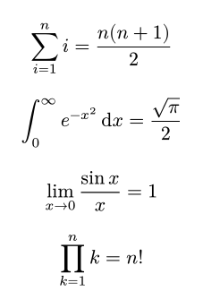{ .learn-result loading=lazy }


`dif` gives the upright "d" used in integrals. Known functions such as `sin`, `cos`, `log`, `exp`, `max` and `lim` are set upright automatically. For your own, use `op`:

```typst
$ op("argmax")_(x in RR) f(x) $
```

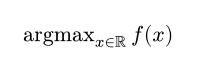{ .learn-result loading=lazy }


## Brackets that grow

Parentheses, brackets and braces grow to fit what is inside them automatically. Use `lr` to control the size, and `abs`, `norm`, `floor` and `ceil` for common pairs.

```typst
$ (1 + 1/n)^n $

$ lr([ sum_(i=1)^n x_i ], size: #150%) $

$ abs(x), quad norm(v), quad floor(x / 2), quad ceil(log_2 n) $
```

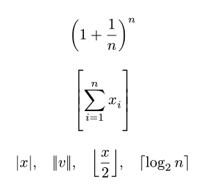{ .learn-result loading=lazy }


## Vectors, matrices and cases

Separate entries in a row with commas and rows with semicolons.

```typst
$ v = vec(1, 2, 3) $

$ A = mat(
  1, 2, 3;
  4, 5, 6;
  7, 8, 9;
) $

$ det mat(a, b; c, d) = a d - b c $

$ f(x) = cases(
  x^2 & "if" x >= 0,
  -x & "otherwise",
) $
```

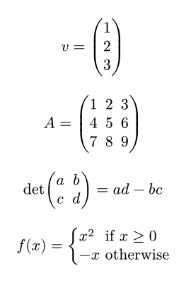{ .learn-result loading=lazy }


Change the brackets with `delim`: `mat(delim: "[", 1, 0; 0, 1)`.

## Accents and styles

| You type | Meaning |
|---|---|
| `hat(x)`, `tilde(x)`, `bar(x)`, `dot(x)`, `dot.double(x)` | accents |
| `arrow(v)` | a vector arrow |
| `overline(a + b)`, `underline(x)` | lines over and under |
| `overbrace(a + b, "sum")`, `underbrace(x y, "product")` | braces with notes |
| `bold(x)`, `upright(x)`, `italic(x)` | text styles |
| `cal(A)`, `frak(g)`, `bb(R)`, `mono(x)` | calligraphic, fraktur, blackboard and monospace letters |

```typst
$ hat(theta) = overline(x) quad "and" quad bold(F) = m bold(a) $

$ underbrace(1 + 2 + dots.c + n, n "terms") $
```

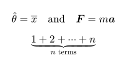{ .learn-result loading=lazy }


## Aligned equations on several lines

Use `\` to break lines and `&` to mark where the lines should line up.

```typst
$ (a + b)^2 &= (a + b)(a + b) \
            &= a^2 + a b + b a + b^2 \
            &= a^2 + 2 a b + b^2 $
```

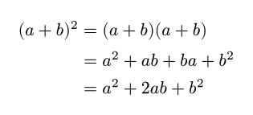{ .learn-result loading=lazy }


## Numbered equations

Turn on numbering for display formulas, then label an equation and refer to it with `@`.

```typst
#set math.equation(numbering: "(1)")

The famous identity is

$ e^(i pi) + 1 = 0 $ <euler>

and @euler connects five fundamental constants.
```

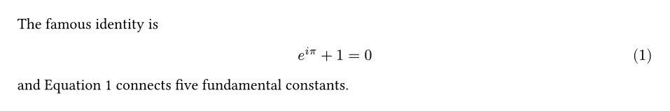{ .learn-result loading=lazy }


Inline formulas are never numbered. See [Images, tables and references](figures.md) for more about labels.

## Code inside math

Inside math, `#` brings back code, which is useful for variables and colours.

```typst
#let n = 5
$ sum_(i=1)^#n i = #(n * (n + 1) / 2) $

$ #text(fill: red)[$x$] + y $
```

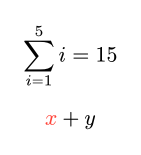{ .learn-result loading=lazy }


## Common mistakes

| Problem | Fix |
|---|---|
| `unknown variable: ab` | Put a space between single letters: `a b`. |
| A fraction takes too much | Wrap the parts in parentheses: `(a+b)/c` instead of `a+b/c`. |
| Text inside math has no spaces | Put words in quotes: `"for all" x`. |
| A subscript only covers one letter | Use parentheses: `x_(i j)` instead of `x_ij`. |

## Next steps

Continue with [Page layout and styling](layout.md).
