# Typst: scripting

Typst is also a small programming language. You can store values, write your own functions, repeat things in loops, make decisions and read data from files. This is what makes templates and data-driven documents possible.

## Markup mode and code mode

A document starts in **markup mode**: what you type is text. A `#` switches to **code mode** for one expression, such as a function call or a variable.

```typst
#let name = "Ada"
Hello, #name! Today is #datetime.today().display().
```

{ .learn-result loading=lazy }


Inside code, square brackets `[...]` go back to markup, and curly braces `{...}` hold several lines of code.

```typst
#let greeting = [Welcome, *#upper("reader")*!]
#greeting

#{
  let total = 2 + 3
  [The total is #total.]
}
```

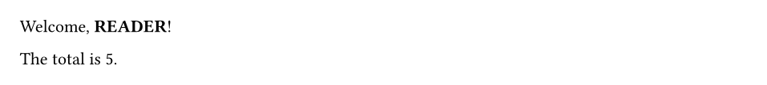{ .learn-result loading=lazy }


## Variables

`#let` gives a value a name. The name can be used anywhere after it.

```typst
#let project = "TypstDrive"
#let version = 2.2
#let release = [*#project #version*]

This document describes #release.
```

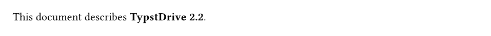{ .learn-result loading=lazy }


## Types of values

| Type | Examples |
|---|---|
| Content | `[Hello *world*]` |
| String | `"Hello"`, `"line one\nline two"` |
| Integer and float | `42`, `3.14`, `1e3` |
| Length | `2cm`, `12pt`, `1.5em` |
| Ratio and fraction | `50%`, `1fr` |
| Boolean | `true`, `false` |
| None | `none` |
| Array | `(1, 2, 3)`, `("a",)` for a single item |
| Dictionary | `(name: "Ada", born: 1815)` |
| Colour | `red`, `rgb("#1e66f5")`, `luma(50%)` |

Operators work as you would expect: `+ - * /`, comparisons `== != < <= > >=`, and `and`, `or`, `not`. `+` also joins strings and content, and `*` repeats them.

```typst
#let width = 3cm * 2
#let both = "Type" + "set"
#rect(width: width)[#both]
#("ab" * 3)
```

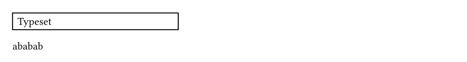{ .learn-result loading=lazy }


## Functions

Write your own with `#let name(arguments) = ...`. Named arguments get a default value.

```typst
#let note(body, colour: blue) = block(
  stroke: (left: 2pt + colour),
  inset: (left: 8pt, y: 4pt),
  body,
)

#note[This is a note.]
#note(colour: red)[This one is important.]
```

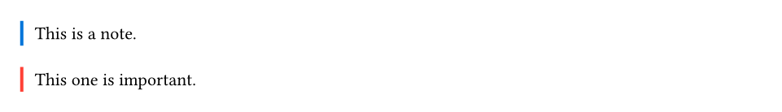{ .learn-result loading=lazy }


The last argument in brackets after the call is passed as the content: `#note[...]` is the same as `#note([...])`.

A function can contain several lines in curly braces. The last value is the result.

```typst
#let average(..numbers) = {
  let values = numbers.pos()
  values.sum() / values.len()
}

The average is #average(4, 8, 15, 16, 23, 42).
```

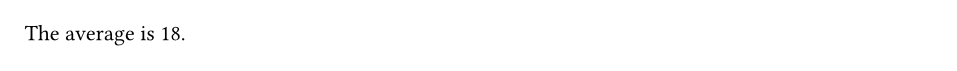{ .learn-result loading=lazy }


`..numbers` collects any number of arguments.

## Conditions

```typst
#let score = 72

#if score >= 90 [
  Excellent!
] else if score >= 60 [
  Passed with #score points.
] else [
  Try again.
]
```

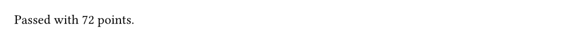{ .learn-result loading=lazy }


## Loops

`for` goes through an array, a dictionary, a string or a range. `while` repeats while a condition holds.

```typst
#for fruit in ("apple", "pear", "plum") [
  - #fruit
]

#for i in range(1, 6) [#i ]

#let born = (Ada: 1815, Charles: 1791)
#for (name, year) in born [
  #name was born in #year. \
]
```

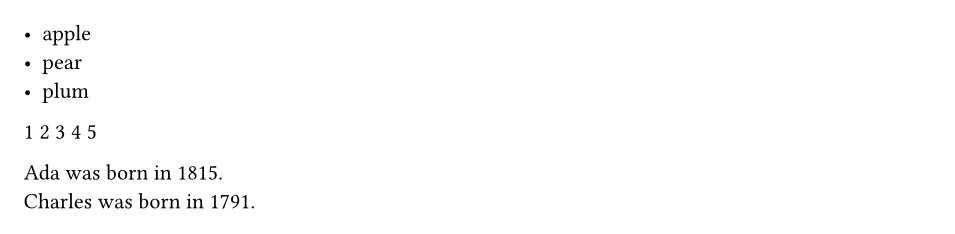{ .learn-result loading=lazy }


## Arrays and dictionaries

Arrays and dictionaries have **methods**, called with a dot.

```typst
#let numbers = (3, 1, 4, 1, 5, 9)
- Sorted: #numbers.sorted().map(str).join(", ")
- Largest: #calc.max(..numbers)
- Doubled: #numbers.map(n => n * 2).map(str).join(", ")
- Above three: #numbers.filter(n => n > 3).len() numbers

#let person = (name: "Ada", born: 1815)
#person.name was born in #person.at("born").
```

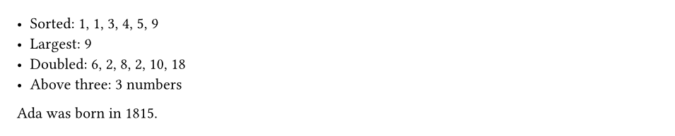{ .learn-result loading=lazy }


`n => n * 2` is a short function without a name, useful with `map` and `filter`.

The `calc` module has maths functions: `calc.round`, `calc.pow`, `calc.sqrt`, `calc.sin`, `calc.min`, `calc.max`, `calc.odd`, `calc.rem` and more.

## Reading data from files

Typst reads CSV, JSON, YAML, TOML and XML files. Upload the data file next to your document, then load it.

A file named `data.csv`:

```text
Name,Score
Ada,98
Charles,91
Grace,95
```

The document:

```typst
#let rows = csv("data.csv")
#let header = rows.first()
#let body = rows.slice(1)

#table(
  columns: header.len(),
  table.header(..header.map(cell => strong(cell))),
  ..body.flatten(),
)

The best score is #calc.max(..body.map(row => int(row.at(1)))).
```

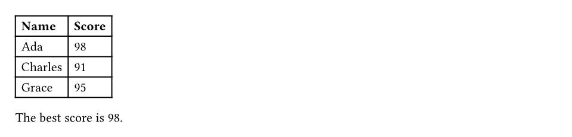{ .learn-result loading=lazy }


`..` spreads an array into separate arguments, so `..body.flatten()` passes every cell to the table.

A file named `data.json`:

```json
{ "title": "Quarterly report", "items": [ { "name": "Pens", "count": 120 }, { "name": "Paper", "count": 40 } ] }
```

```typst
#let data = json("data.json")

= #data.title
#for item in data.items [
  - #item.name: #item.count
]
```

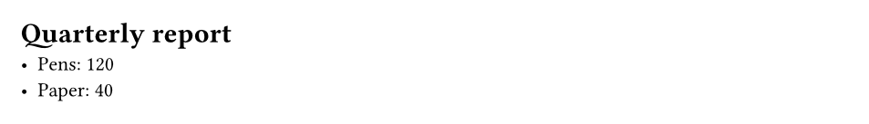{ .learn-result loading=lazy }


## Counters and state

Typst keeps counters for pages, headings, figures and equations, and you can make your own. Reading a counter needs `context`, because the value depends on where on the page it is read.

```typst
#set heading(numbering: "1.")

= Introduction
This is section #context counter(heading).display().

#let tip = counter("tip")
#let tip-box(body) = block(inset: 6pt, stroke: 0.5pt)[
  #tip.step()
  *Tip #context tip.display():* #body
]

#tip-box[Save often.]
#tip-box[Use labels for references.]
```

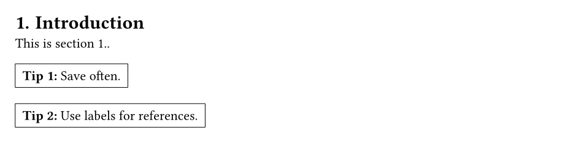{ .learn-result loading=lazy }


## Splitting a document into files

In a **project**, keep chapters and helper functions in separate files.

- `#include "chapter.typ"` places the content of another file here.
- `#import "helpers.typ": note, average` makes functions and variables from another file available.
- `#import "helpers.typ": *` imports everything.

For example, a project with three files:

`helpers.typ`:

```typst
#let note(body) = block(stroke: 0.5pt, inset: 8pt, body)
```

`chapters/intro.typ`:

```typst
#import "../helpers.typ": note

= Introduction
#note[Paths are relative to the file that uses them.]
```

`main.typ`:

```typst
#set heading(numbering: "1.")
#include "chapters/intro.typ"
```

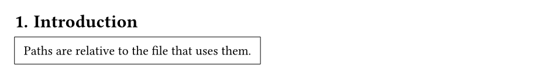{ .learn-result loading=lazy }


## Packages

Packages from [Typst Universe](https://typst.app/universe/) add diagrams, charts, slides and much more. Import them by name and version; TypstDrive downloads them the first time.

```typst
#import "@preview/cetz:0.3.4"

#cetz.canvas({
  import cetz.draw: *
  circle((0, 0), radius: 1)
  line((-1.5, 0), (1.5, 0), mark: (end: ">"))
  content((0, 1.4), [A circle])
})
```

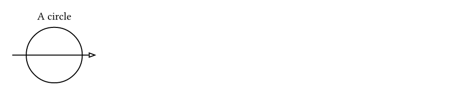{ .learn-result loading=lazy }


Packages your colleagues publish on your server are imported the same way. See [Packages](../../guide/packages.md).

## Next steps

Turn your styles into a template in [Show rules and templates](templates.md).
