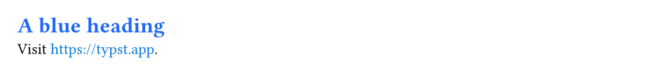
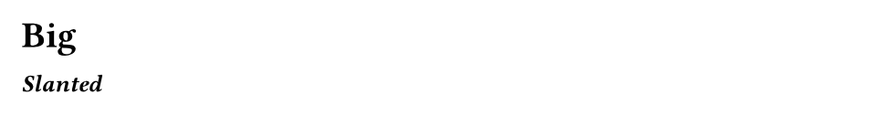
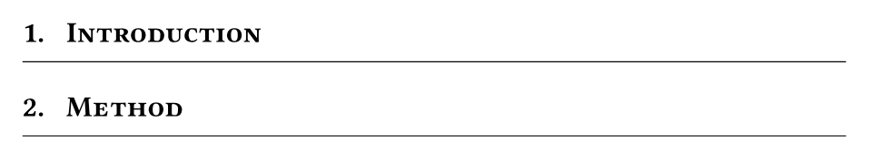
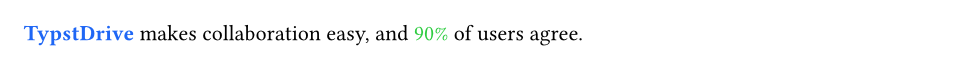
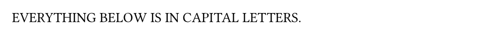
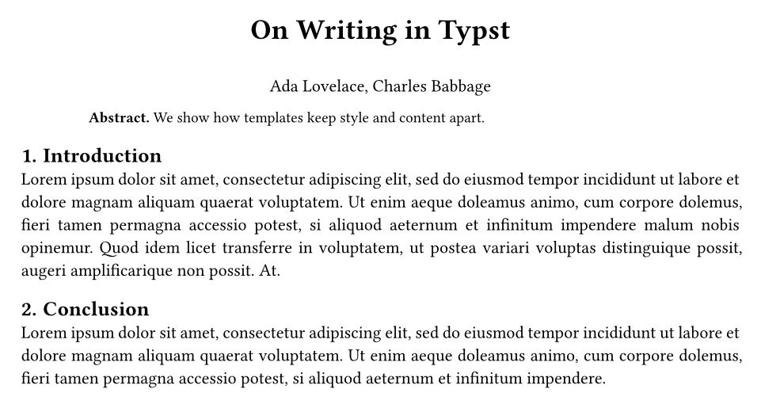
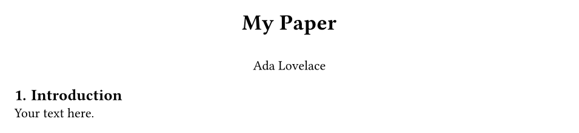
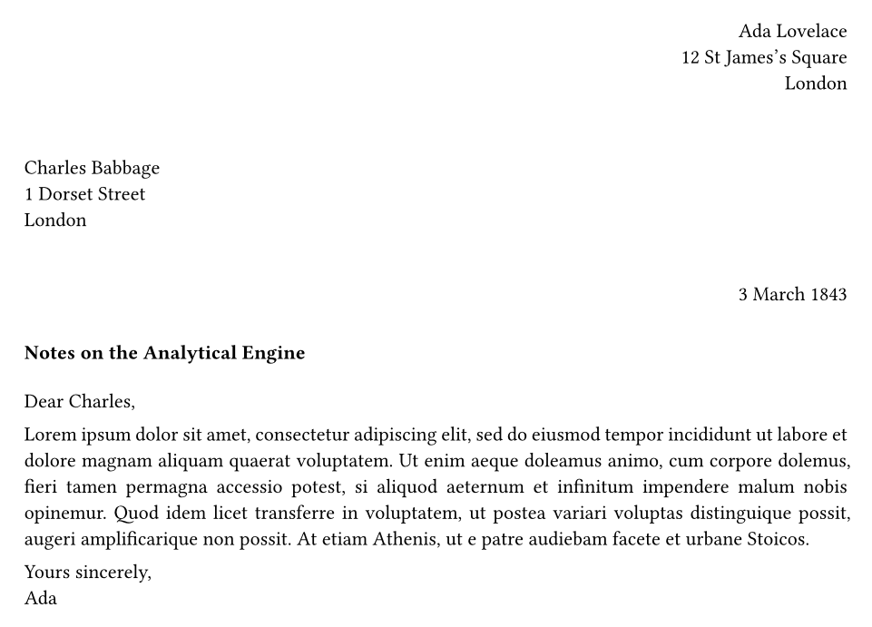

# Typst: show rules and templates

Set rules change the arguments of an element. **Show rules** go further: they let you replace how an element looks completely. Together they are how templates work.

## Show-set rules

The simplest show rule applies a set rule only to one kind of element.

```typst
#show heading: set text(fill: rgb("#1e66f5"))
#show link: set text(fill: blue)
#show raw: set text(font: "DejaVu Sans Mono")

= A blue heading
Visit https://typst.app.
```

{ .learn-result loading=lazy }


Use `where` to pick only some of them:

```typst
#show heading.where(level: 1): set text(size: 20pt)
#show heading.where(level: 2): set text(style: "italic")

= Big
== Slanted
```

{ .learn-result loading=lazy }


## Show rules with a function

A function receives the element (usually called `it`) and returns what to show instead. `it.body` is the text of a heading, and the element's other fields are available too.

```typst
#set heading(numbering: "1.")

#show heading.where(level: 1): it => block(width: 100%)[
  #set text(size: 16pt)
  #counter(heading).display()
  #h(0.5em)
  #smallcaps(it.body)
  #v(-0.6em)
  #line(length: 100%, stroke: 0.6pt)
]

= Introduction
= Method
```

{ .learn-result loading=lazy }


## Replacing text

A show rule can also match a word or a regular expression.

```typst
#show "TypstDrive": name => text(fill: rgb("#1e66f5"), weight: "bold", name)
#show regex("\d+%"): it => text(fill: green, it)

TypstDrive makes collaboration easy, and 90% of users agree.
```

{ .learn-result loading=lazy }


## The everything rule

`#show: function` passes the rest of the document to a function. This is the heart of every template.

```typst
#let shout(body) = {
  set text(size: 14pt)
  upper(body)
}

#show: shout
Everything below is in capital letters.
```

{ .learn-result loading=lazy }


## Writing a template

A template is a function that takes some details and the document body, sets all the styles, adds a title, and returns the body.

```typst
#let article(
  title: none,
  authors: (),
  abstract: none,
  body,
) = {
  set document(title: title, author: authors)
  set page(paper: "a4", margin: 2.5cm, numbering: "1")
  set text(font: "Libertinus Serif", size: 11pt)
  set par(justify: true)
  set heading(numbering: "1.")
  show heading.where(level: 1): set text(size: 13pt)

  align(center)[
    #text(size: 18pt, weight: "bold", title)
    #v(0.4em)
    #authors.join(", ")
  ]

  if abstract != none {
    pad(x: 1.5cm)[
      #set text(size: 9.5pt)
      *Abstract.* #abstract
    ]
  }

  body
}

#show: article.with(
  title: [On Writing in Typst],
  authors: ("Ada Lovelace", "Charles Babbage"),
  abstract: [We show how templates keep style and content apart.],
)

= Introduction
#lorem(60)

= Conclusion
#lorem(40)
```

{ .learn-result loading=lazy }


`article.with(...)` fills in the named arguments and leaves `body` for the show rule.

## Using a template from another file

In a project, keep the template in its own file, such as `template.typ`, and import it in `main.typ`:

```typst
#import "template.typ": article

#show: article.with(title: [My Paper], authors: ("Ada Lovelace",))

= Introduction
Your text here.
```

{ .learn-result loading=lazy }


This keeps your writing short and lets everyone on a team share the same look. To share a template with everyone on your server, publish the project as a package. See [Packages](../../guide/packages.md).

## Starting from someone else's template

TypstDrive can create a document or project from any template on Typst Universe, with the authors filled in for you. See [Templates](../../guide/templates.md). Open the template's main file to see how it uses `set`, `show` and `#show: template.with(...)`, exactly as on this page.

## A complete letter template

```typst
#let letter(sender: [], recipient: [], date: [], subject: [], body) = {
  set page(paper: "a4", margin: (x: 2.5cm, top: 2cm, bottom: 2.5cm))
  set text(size: 11pt)
  set par(justify: true, spacing: 1em)

  align(right, sender)
  v(1cm)
  recipient
  v(0.8cm)
  align(right, date)
  v(0.5cm)
  text(weight: "bold", subject)
  v(0.3cm)
  body
}

#show: letter.with(
  sender: [Ada Lovelace \ 12 St James's Square \ London],
  recipient: [Charles Babbage \ 1 Dorset Street \ London],
  date: [3 March 1843],
  subject: [Notes on the Analytical Engine],
)

Dear Charles,

#lorem(70)

Yours sincerely, \
Ada
```

{ .learn-result loading=lazy }


## Where to go from here

- The [Typst reference](https://typst.app/docs/reference/) lists every function and argument.
- [Typst Universe](https://typst.app/universe/) has templates and packages to learn from.
- [Typst for LaTeX users](../typst-for-latex-users.md) maps LaTeX habits to Typst.
